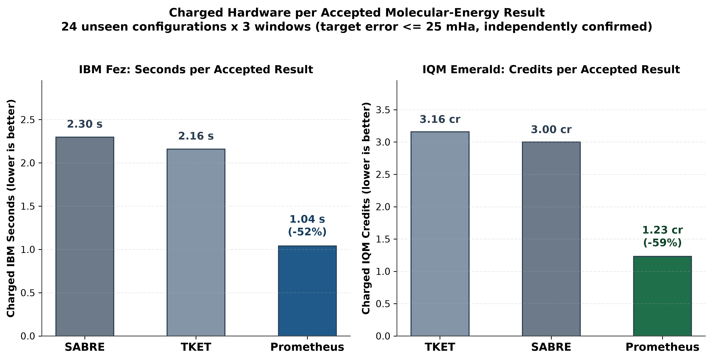
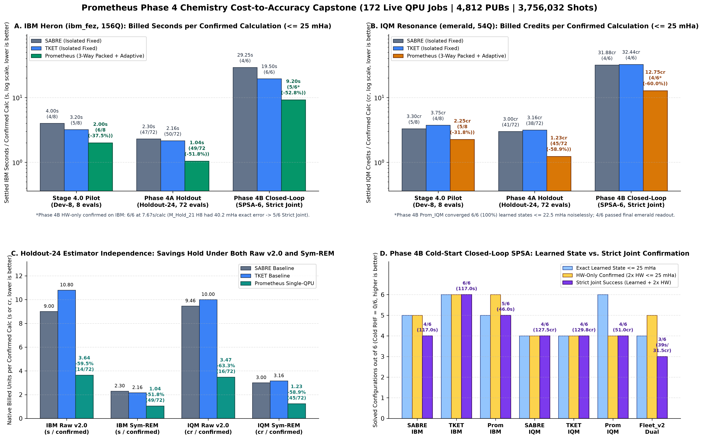

# Quantum Chemistry: Lower Hardware Cost per Accepted Molecular-Energy Result

*Explore the portfolio: [Prometheus Quantum Overview](https://github.com/PrometheusDynamicsCanada/prometheus-quantum-overview) · Additional spin-orbital Jordan-Wigner `4Q H2` (`-69.23%` QPU time, `10.04 mHa` Sym error) and `6Q LiH CAS(2e,3o)` (`-37.41%` off-diagonal correlation error, `88.24%` spin-sector retention) benchmarks are archived in [`prometheus-circuit-complexity-atlas`](https://github.com/PrometheusDynamicsCanada/prometheus-circuit-complexity-atlas).*

**We tested whether Prometheus could reduce the hardware resources needed to obtain an accepted molecular-energy result. In the tested workflows, it substantially reduced that cost, including when live hardware measurements guided optimization.**

Here, an **accepted result** means a molecular-energy answer close enough to the known reference value for that molecule and verified by a second, independent run on the quantum processor (within `25.0 mHa`, or `0.025` Hartree, in both runs). Standard cloud workflows run one small measurement circuit at a time on a large chip and keep spending shots after an estimate has already settled.

We tested two chemistry workflows on IBM (`ibm_fez`) and IQM (`IQM Emerald`) alongside Qiskit SABRE and Quantinuum TKET:
- **Evaluating unseen molecular configurations (`24` models repeated 3 times):** Prometheus cut charged hardware per accepted result by **52% to 55% on IBM** (`1.04 s` vs. `2.16-2.30 s`) and **59% to 61% on IQM** (`1.23 cr` vs. `3.00-3.16 cr`).
- **Live iterative energy optimization (`6` stretched-bond models optimized from scratch via `SPSA`):** Prometheus cut charged hardware per accepted optimization by **53% to 69% on IBM** (`9.20 s` vs. `19.50-29.25 s`) and **60% to 61% on IQM** (`12.75 cr` vs. `31.88-32.44 cr`), with all **49/49** early stops confirmed on hardware.

Savings measure **charged QPU resources** on 4-to-8-qubit benchmark models (excluding software, classical compute, and wet-lab validation); splitting workloads across both clouds trailed single-processor execution.

**[Detailed results](reports/prometheus_phase4_capstone_evidence_release.md) · [Verify the evidence](#verify-the-evidence) · [Discuss a pilot](#discuss-a-pilot)**


*Opening summary (`Phase 4A` unseen holdout): Charged IBM seconds (left) and IQM credits (right) per independently confirmed molecular-energy result across 24 unseen small-molecule configurations repeated three times.*

---

## 1. Principal Comparative Benchmark Tables (`Phase 4A`, `Phase 4B`, and `Stage 4.0`)

*Campaign Scope:* `32` small-molecule active-space configurations (`4` to `8` qubits), `172` live QPU jobs, `4,812` physical PUBs, and `3,756,032` physical shots across 156-qubit `ibm_fez` and 54-qubit `IQM Emerald`.

*Metric Conventions:* All molecular energies are evaluated against the pre-registered consistent active-space reference ($E_{\text{FCI}}^{\text{CAS}}$ for full-CAS `JW` models; $E_{\text{DOCI}}$ for paired-electron `DOCI` models) with target threshold `<= 25.0 mHa`. Prior to hardware submission, every compiled `QWC` subcircuit verified noiseless statevector equivalence with Classical Bhattacharyya Distribution Overlap $F_B = \sum_x \sqrt{P_{\text{ideal}}(x) P_{\text{meas}}(x)} > 0.999999$ (labeled `"State Fidelity"` in Studio UI screenshots) and Squared Hellinger Fidelity $F_H = F_B^2 > 0.999998$, and multi-slice `PUB` compilations used a frozen pre-registered execution configuration. Direction indicators `(↑)` and `(↓)` specify metric optimality; winning single-provider values in each stage/provider block are **bolded**. IBM Quantum seconds (`s`) and IQM Resonance credits (`cr`) are reported strictly in native provider billing units without cross-currency conversion.

### Table 1A: `Phase 4A` Prospective Out-of-Sample Fixed-Circuit Holdout (`Cohort Chem-Holdout-24`, `N = 60` Jobs, `2,585` PUBs, `1,802,752` Shots Across `W = 3` Windows = `72` Evals/Policy)

- **IBM `ibm_fez` Job IDs (`30` Jobs, `300.0 s`):** `dbs7t6vv5hds73dil810` .. `dbs89b0k09pc73avs3og` ([phase4_master_172_job_ledger.csv](./ledgers/phase4_master_172_job_ledger.csv)).
- **IQM `emerald` Job UUIDs (`30` Jobs, `345.00 cr`):** `01a1daae-ba58-7420-a81e-c786953d775e` .. `01a1dac8-0265-708d-b721-9c2759644823` ([phase4_master_172_job_ledger.csv](./ledgers/phase4_master_172_job_ledger.csv)).

| Policy Arm & Hardware (`QPU`) | Jobs / PUBs / Physical Shots (`3` Windows) `(↓)` | Compiled `2Q` Gates Across `76` Slices `(↓)` `*(sum / median / mean)*` | Compiled Depth `(↓)` `*(median / mean)*` | $Z$-Symmetry Retention $\eta_{\text{sym}}$ `(↑)` `*(median / mean)*` | Frozen `Sym-REM` Prim / Confirmed `<= 25 mHa` of `72` `(↑)` | Frozen `Sym-REM` Error `mHa` `(↓)` `*(median / mean)*` | Pre-Reg `Raw v2.0` Prim / Confirmed `<= 25 mHa` of `72` `(↑)` | Pre-Reg `Raw v2.0` Error `mHa` `(↓)` `*(median / mean)*` | Settled Charge (`IBM s` + `IQM cr`) `(↓)` | Cost / Confirmed `Sym-REM` `(↓)` | Cost / Confirmed `Raw v2.0` `(↓)` | `% Cost/Confirmed Delta vs. Best Same-QPU Baseline` (`Sym-REM` / `Raw v2.0`) `(↓)` |
| :--- | :---: | :---: | :---: | :---: | :---: | :---: | :---: | :---: | :---: | :---: | :---: | :---: |
| **`P1_SABRE_IBM`** (`ibm_fez` isolated) | `6` / `468` / `359,424` | `2,325` / `28.0` / `30.59` | `68.0` / `77.58` | `0.8369` / `0.8101` | `53` / `47` (`65.3%`) | `10.20` / `21.80` | **`14`** / `12` (`16.7%`) | `66.46` / `71.94` | `108.0 s` + `0.00 cr` *(IBM-only)* | `2.298 s` | `9.000 s` | `+6.4%` vs `TKET` / `0.0%` *(Best IBM Raw)* |
| **`P2_TKET_IBM`** (`ibm_fez` isolated) | `6` / `468` / `359,424` | `2,295` / **`26.0`** / `30.20` | `66.0` / `73.14` | **`0.8418`** / `0.8273` | `53` / **`50` (`69.4%`)** | **`9.71`** / `20.43` | `13` / `10` (`13.9%`) | `49.51` / `63.24` | `108.0 s` + `0.00 cr` *(IBM-only)* | `2.160 s` | `10.800 s` | `0.0%` *(Best IBM Sym-REM)* / `+20.0%` vs `SABRE` |
| **`P3_Prom_IBM`** (`ibm_fez` `3-way` + adaptive) | `9` / **`231`** / **`118,272`** | **`2,293`** / **`26.0`** / **`30.17`** | **`64.5`** / **`70.36`** | `0.8366` / **`0.8277`** | **`54`** / `49` (`68.1%`) | `11.29` / **`18.33`** | **`14`** / **`14` (`19.4%`)** | **`44.08`** / **`62.17`** | **`51.0 s`** + `0.00 cr` *(IBM-only)* | **`1.041 s`** | **`3.643 s`** | **`-51.8%` vs `TKET` (`-54.7%` vs `SABRE`)** / **`-59.5%` vs `SABRE` (`-66.3%` vs `TKET`)** |
| **`P1_SABRE_IQM`** (`emerald` isolated) | `6` / `468` / `359,424` | **`1,551`** / **`19.0`** / **`20.41`** | **`37.0`** / `43.50` | `0.8182` / `0.7923` | **`48`** / `41` (`56.9%`) | **`6.92`** / **`23.83`** | `18` / `13` (`18.1%`) | **`51.48`** / **`66.70`** | `0.0 s` *(IQM-only)* + `123.00 cr` | `3.000 cr` | `9.462 cr` | `0.0%` *(Best IQM Sym-REM)* / `0.0%` *(Best IQM Raw)* |
| **`P2_TKET_IQM`** (`emerald` isolated) | `6` / `468` / `359,424` | `1,752` / **`19.0`** / `23.05` | `38.0` / `52.53` | `0.7964` / `0.7655` | `43` / `38` (`52.8%`) | `16.02` / `32.89` | `14` / `12` (`16.7%`) | `67.79` / `87.79` | `0.0 s` *(IQM-only)* + `120.00 cr` | `3.158 cr` | `10.000 cr` | `+5.3%` vs `SABRE` / `+5.7%` vs `SABRE` |
| **`P3_Prom_IQM`** (`emerald` `3-way` + adaptive) | `9` / **`229`** / **`117,248`** | `1,564` / **`19.0`** / `20.58` | `38.0` / **`43.18`** | **`0.8213`** / **`0.7928`** | **`48`** / **`45` (`62.5%`)** | `14.22` / `31.20` | **`20`** / **`16` (`22.2%`)** | `58.58` / `70.67` | `0.0 s` *(IQM-only)* + **`55.50 cr`** | **`1.233 cr`** | **`3.469 cr`** | **`-58.9%` vs `SABRE` (`-61.0%` vs `TKET`)** / **`-63.3%` vs `SABRE` (`-65.3%` vs `TKET`)** |
| **`P4_Prom_Fleet`** (`IntactSplit`: `8 IBM + 16 IQM`) | `18` / `253` / `129,536` | `1,628` / `20.0` / `21.42` | `45.5` / `47.30` | `0.8136` / `0.7862` | `45` / `42` (`58.3%`) | `15.67` / `33.19` | `15` / `13` (`18.1%`) | `59.02` / `71.61` | `33.0 s` + `46.50 cr` *(Dual-QPU)* | `0.786s + 1.107cr` | `2.538s + 3.577cr` | Offloads `-35.3%` IBM `s` & `-16.2%` IQM `cr` vs single-QPU `P3` (`42/72` conf) |

---

### Table 1B: `Phase 4B` Live Closed-Loop Iterative Chemistry (`Cohort Chem-4B-6`, Cold-Start `8`-Step `SPSA` from Restricted Hartree-Fock $\boldsymbol{\phi}_0 = \mathbf{0}$, `N = 92` Jobs, `1,874` PUBs, `1,715,200` Shots)

- **IBM `ibm_fez` Job IDs (`46` Jobs, `319.0 s`):** `dbsaulhabdes73fqunp0` .. `dbsdlc6jjaos73ak2fq0` ([phase4b_spsa_job_ledger.csv](./ledgers/phase4b_spsa_job_ledger.csv)).
- **IQM `emerald` Job UUIDs (`46` Jobs, `339.75 cr`):** `01a1db6d-09bd-776e-8106-f524a9edd4b9` .. `01a1dc16-6acb-753a-a1fd-ce6a99540085` ([phase4b_spsa_job_ledger.csv](./ledgers/phase4b_spsa_job_ledger.csv)).

| Policy Arm & Hardware (`QPU`) | Jobs / PUBs / Physical Shots `(↓)` | Compiled `2Q` Gates Across `18` Slices `(↓)` `*(sum / median / mean)*` | Compiled Depth `(↓)` `*(median / mean)*` | Primary $\eta_{\text{sym}}$ `(↑)` `*(median / mean)*` | Exact Learned `\|E_ideal - E_DOCI\| <= 25 mHa` `(↑)` | Exact Learned Error `mHa` `(↓)` `*(median / mean)*` | HW-Only Confirmed `Sym-REM` `(↑)` | **Strict Joint Success (`Learned + 2x HW <= 25 mHa`)** `(↑)` | Primary `Sym-REM` Error `mHa` `(↓)` `*(median / mean)*` | Pre-Reg `Raw v2.0` Confirmed / Error `mHa` `*(median / mean)*` `(↓)` | Settled Charge (`IBM s` + `IQM cr`) `(↓)` | **Billed Cost per Strict Joint Success** `(↓)` | `% Cost / Strict Success Delta vs. Same-QPU Baselines` `(↓)` |
| :--- | :---: | :---: | :---: | :---: | :---: | :---: | :---: | :---: | :---: | :---: | :---: | :---: | :---: |
| **`P4B_SABRE_IBM`** (`ibm_fez`) | **`11`** / `364` / `362,496` | `315` / `10.0` / `17.50` | `41.5` / `51.72` | `0.876` / `0.858` | `5 / 6` (`83.3%`) | `4.49` / `10.45` | `5 / 6` (`23.40 s`) | `4 / 6` (`66.7%`) | `12.89` / `10.54` | `0 / 6` (`30.66` / `42.72`) | `117.0 s` + `0.00 cr` *(IBM-only)* | `29.25 s` | `+50.0%` vs `TKET` (`0/6` Raw: `Undefined`) |
| **`P4B_TKET_IBM`** (`ibm_fez`) | **`11`** / `364` / `362,496` | `285` / `10.0` / `15.83` | `40.0` / `47.11` | **`0.883`** / **`0.869`** | **`6 / 6` (`100.0%`)** | **`3.87`** / **`8.01`** | **`6 / 6`** (`19.50 s`) | **`6 / 6` (`100.0%`)** | `5.82` / `6.22` | **`2 / 6`** (**`35.48`** / **`38.69`**) | `117.0 s` + `0.00 cr` *(IBM-only)* | `19.50 s` | `0.0%` *(Best IBM Baseline; `58.50 s` Raw)* |
| **`P4B_Prom_IBM`** (`ibm_fez` adaptive) | `12` / **`128`** / **`79,872`** | **`281`** / **`9.5`** / **`15.61`** | **`39.0`** / **`43.39`** | `0.878` / **`0.869`** | `5 / 6` (`83.3%`) | `4.27` / `10.36` | **`6 / 6` (`7.67 s`)** | `5 / 6` (`83.3%`) | **`4.53`** / **`4.74`** | `1 / 6` (`40.21` / `43.02`) | **`46.0 s`** + `0.00 cr` *(IBM-only)* | **`9.20 s`** | **`-52.8%` vs `TKET` (`-68.5%` vs `SABRE`)** (`46.00 s` Raw) |
| **`P4B_SABRE_IQM`** (`emerald`) | **`11`** / `364` / `362,496` | `255` / **`8.0`** / `14.17` | `25.0` / `31.56` | `0.858` / `0.831` | `4 / 6` (`66.7%`) | `5.38` / `12.10` | **`4 / 6`** (`31.88 cr`) | **`4 / 6` (`66.7%`)** | **`4.82`** / **`11.15`** | `0 / 6` (`47.46` / **`55.45`**) | `0.0 s` *(IQM-only)* + `127.50 cr` | `31.88 cr` | `0.0%` *(Best IQM Baseline; `0/6` Raw: `Undefined`)* |
| **`P4B_TKET_IQM`** (`emerald`) | **`11`** / `364` / `362,496` | `291` / **`8.0`** / `16.17` | **`24.0`** / `34.50` | **`0.865`** / **`0.835`** | `4 / 6` (`66.7%`) | **`5.00`** / `16.16` | **`4 / 6`** (`32.44 cr`) | **`4 / 6` (`66.7%`)** | `9.01` / `13.53` | `0 / 6` (`54.90` / `69.52`) | `0.0 s` *(IQM-only)* + `129.75 cr` | `32.44 cr` | `+1.8%` vs `SABRE` (`0/6` Raw: `Undefined`) |
| **`P4B_Prom_IQM`** (`emerald` adaptive) | `12` / **`132`** / **`83,968`** | **`249`** / **`8.0`** / **`13.83`** | **`24.0`** / **`30.11`** | `0.859` / `0.832` | **`6 / 6` (`100.0%`)** | `6.98` / **`10.22`** | **`4 / 6` (`12.75 cr`)** | **`4 / 6` (`66.7%`)** | `11.78` / `19.30` | `0 / 6` (**`42.05`** / `58.24`) | `0.0 s` *(IQM-only)* + **`51.00 cr`** | **`12.75 cr`** | **`-60.0%` vs `SABRE` (`-60.7%` vs `TKET`)** (`0/6` Raw: `Undefined`) |
| **`P4B_Prom_Fleet_v2`** (`3 IBM + 3 IQM`) | `24` / `158` / `101,376` | `269` / `9.0` / `14.94` | `36.5` / `36.17` | `0.885` / `0.859` | `4 / 6` (`66.7%`) | `9.38` / `22.67` | `5 / 6` (`7.8s+6.3cr`) | `3 / 6` (`50.0%`) | `13.04` / `15.76` | `1 / 6` (`56.26` / `65.16`) | `39.0 s` + `31.50 cr` *(Dual-QPU)* | `13.00s + 10.50cr` | Dual-pool split (`3/6` strict: lower than single-QPU `P4B_Prom`) |

---

<details>
<summary><strong>Expand Supporting Pilot Table (Stage 4.0 Dev-8) and Multi-Panel Technical Figures</strong></summary>

### Table 1C: `Stage 4.0` Development & Cost Calibration Pilot (`Cohort Chem-Dev-8`, `N = 20` Jobs, `353` PUBs, `238,080` Shots; `0 / 24` Holdout Configs Touched)

- **IBM `ibm_fez` Job IDs (`10` Jobs, `56.0 s`):** `dbs58k1abdes73fqotc0` .. `dbs59i1abdes73fqoug0`.
- **IQM `emerald` Job UUIDs (`10` Jobs, `51.00 cr`):** `01a1da09-740c-77e5-879f-be411bf8fc70` .. `01a1da0c-2611-762b-8e43-b8d1c08d6d2c`.

| Policy Arm & Hardware (`QPU`) | Jobs / PUBs / Physical Shots `(↓)` | Compiled `2Q` Gates Across `26` Slices `(↓)` `*(sum / median / mean)*` | Compiled Depth `(↓)` `*(median / mean)*` | $\eta_{\text{sym}}$ `(↑)` `*(median / mean)*` | `Sym-REM` *(Dev Exploratory)* Confirmed `<= 25 mHa` `(↑)` | `Sym-REM` Error `mHa` `(↓)` `*(median / mean)*` | Pre-Reg `Raw v2.0` Confirmed `<= 25 mHa` `(↑)` | `Raw v2.0` Error `mHa` `(↓)` `*(median / mean)*` | Settled Charge (`IBM s` + `IQM cr`) `(↓)` | Cost / Confirmed `Sym-REM` `(↓)` | `% Cost/Confirmed Delta vs. Best Same-QPU Baseline` `(↓)` |
| :--- | :---: | :---: | :---: | :---: | :---: | :---: | :---: | :---: | :---: | :---: | :---: |
| **`P1_SABRE_IBM`** (`ibm_fez` isolated) | **`2`** / `56` / `43,008` | `774` / `26.0` / `29.77` | `64.0` / `74.12` | `0.7427` / `0.7407` | `4 / 8` (`50.0%`) | `13.75` / `33.82` | `2 / 8` (`8.00 s/ok`) | `115.27` / `131.12` | `16.0 s` + `0.00 cr` *(IBM-only)* | `4.00 s` | `+25.0%` vs `TKET` (`0.0%` Raw) |
| **`P2_TKET_IBM`** (`ibm_fez` isolated) | **`2`** / `56` / `43,008` | `762` / **`24.0`** / `29.31` | **`50.5`** / `68.38` | **`0.7895`** / **`0.7493`** | `5 / 8` (`62.5%`) | `14.74` / `44.94` | `2 / 8` (`8.00 s/ok`) | `81.13` / **`91.58`** | `16.0 s` + `0.00 cr` *(IBM-only)* | `3.20 s` | `0.0%` *(Best IBM Baseline)* |
| **`P3_Prom_IBM`** (`ibm_fez` `3-way` packed) | `3` / **`33`** / **`16,896`** | **`759`** / **`24.0`** / **`29.19`** | `52.5` / **`66.65`** | `0.7856` / `0.7402` | **`6 / 8` (`75.0%`)** | **`8.95`** / **`30.05`** | `2 / 8` (**`6.00 s/ok`**) | **`70.25`** / `102.33` | **`12.0 s`** + `0.00 cr` *(IBM-only)* | **`2.00 s`** | **`-37.5%` vs `TKET` (`-50.0%` vs `SABRE`; `-25.0%` Raw)** |
| **`P1_SABRE_IQM`** (`emerald` isolated) | **`2`** / `56` / `43,008` | **`525`** / **`17.0`** / **`20.19`** | **`33.0`** / **`42.69`** | `0.8272` / `0.7888` | **`5 / 8` (`62.5%`)** | `13.96` / `32.66` | `2 / 8` (`8.25 cr/ok`) | `62.37` / **`65.49`** | `0.0 s` *(IQM-only)* + `16.50 cr` | `3.30 cr` | `0.0%` *(Best IQM Sym-REM; `+10.0%` Raw vs `TKET`)* |
| **`P2_TKET_IQM`** (`emerald` isolated) | **`2`** / `56` / `43,008` | `576` / `19.0` / `22.15` | `35.0` / `49.77` | `0.8203` / `0.7796` | `4 / 8` (`50.0%`) | `25.38` / `37.59` | `2 / 8` (`7.50 cr/ok`) | `56.00` / `88.17` | `0.0 s` *(IQM-only)* + `15.00 cr` | `3.75 cr` | `+13.6%` vs `SABRE` (`0.0%` Best IQM Raw) |
| **`P3_Prom_IQM`** (`emerald` `3-way` packed) | `3` / **`33`** / **`16,896`** | `528` / **`17.0`** / `20.31` | `34.0` / `43.00` | **`0.8316`** / **`0.7937`** | **`5 / 8` (`62.5%`)** | **`7.53`** / **`27.45`** | `2 / 8` (**`5.63 cr/ok`**) | **`51.21`** / `66.19` | `0.0 s` *(IQM-only)* + **`11.25 cr`** | **`2.25 cr`** | **`-31.8%` vs `SABRE` (`-40.0%` vs `TKET`; `-25.0%` vs `TKET` Raw)** |
| **`P4_Prom_Fleet`** (`GroupSplit` `IQM-Z / IBM-NonZ`) | `6` / `63` / `32,256` | `661` / `21.5` / `25.42` | `52.5` / `58.19` | `0.8384` / `0.8032` | `5 / 8` (`62.5%`) | `16.95` / `22.65` | `2 / 8` (`6.0s+4.13cr`) | `44.42` / `54.96` | `12.0 s` + `8.25 cr` *(Dual-QPU)* | `2.40s + 1.65cr` | Lowest pilot mean error (`22.65 mHa`), higher PUB overhead (`63`) |

---

## 2. Capstone Phase 4 Synthesis Figures (`300 DPI`)

### Figure 1: Billed Hardware Cost per Confirmed Calculation Across `Stage 4.0`, `Phase 4A`, and `Phase 4B`


### Figure 2: Out-of-Sample `Sym-REM` Species Regime Boundary & Prospective Adaptive Stopping Reliability


### Figure 3: Complete `172`-Job Campaign Accounting, Shot Breakdown, & Provider Allowance Reconciliation


---

</details>

---

## Verify the Evidence

**Verification Kind:** Deterministic **outcome-ledger, provider-billing arithmetic, paired Wilcoxon statistical audit, and 42-trajectory closed-loop `SPSA` replay (`0.00e+00 rad` parameter drift)** across 6 verification stages (requires Python 3, `numpy`, and `scipy`; zero cloud credentials):

```bash
python scripts/verify_phase4_public_release.py
```

- **Detailed stage reports:** [Capstone Release](reports/prometheus_phase4_capstone_evidence_release.md) · [Phase 4A Holdout-24](reports/phase4a_holdout24_campaign_report.md) · [Phase 4B Iterative SPSA](reports/phase4b_iterative_spsa_campaign_report.md) · [Stage 4.0 Pilot](reports/phase4_stage4_0_dev_pilot_report.md)
- **Master ledgers & governance:** [`ledgers/phase4_master_172_job_ledger.csv`](ledgers/phase4_master_172_job_ledger.csv) · [`PUBLIC_DISCLOSURE.md`](PUBLIC_DISCLOSURE.md) · [`DATA_DICTIONARY.md`](DATA_DICTIONARY.md) · [`REPO_SHA256_MANIFEST.json`](REPO_SHA256_MANIFEST.json)

---

## Discuss a Pilot

**Bring a representative workload and an acceptance criterion. We can compare Prometheus with your existing execution approach and measure quality, acceptance rate and charged hardware resources.**

- **Contact:** [william@prometheusdynamics.ca](mailto:william@prometheusdynamics.ca) | [prometheusdynamics.ca](https://prometheusdynamics.ca)
