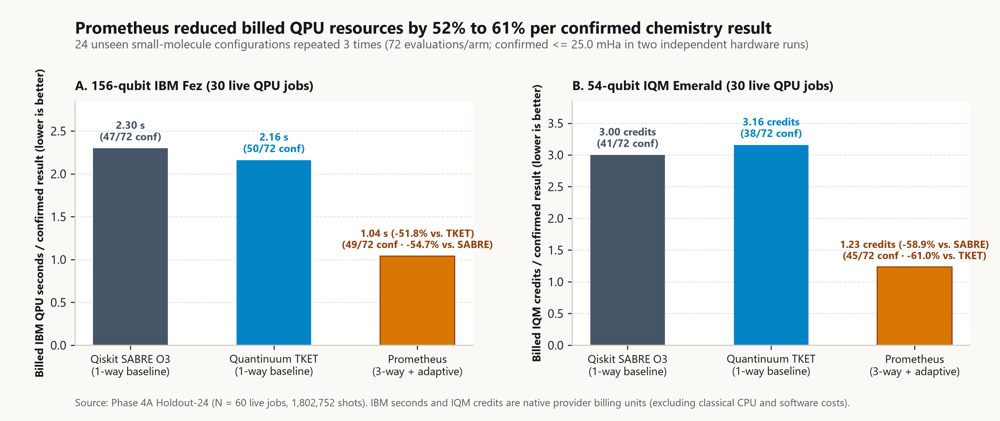
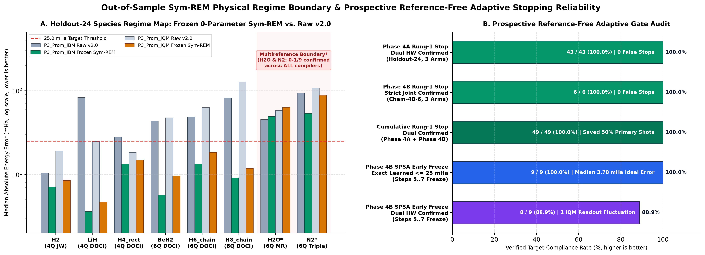
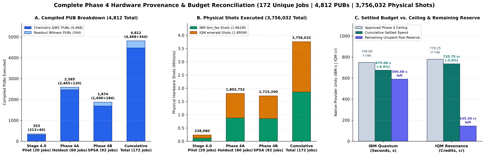

# Quantum Chemistry: Lower QPU Cost per Confirmed Molecular Energy

*Portfolio Hub: [Prometheus Quantum Overview](https://github.com/PrometheusDynamicsCanada/prometheus-quantum-overview) · [Complexity Atlas (`H2` & `LiH`)](https://github.com/PrometheusDynamicsCanada/prometheus-circuit-complexity-atlas) · [Full Capstone Report](reports/prometheus_phase4_capstone_evidence_release.md)*

## Introduction

- **The question:** Can quantum chemistry workflows reach verified molecular-energy accuracy (`<= 25.0 mHa` error in two independent hardware runs) while spending substantially less billed QPU time and credits?
- **The test:** Across `172` live QPU jobs (`4,812` PUBs, `3,756,032` physical shots on `156Q` `ibm_fez` and `54Q` `IQM Emerald`), we compared Prometheus (`3-way` spatial packing + adaptive measurement stopping) against isolated `1-way` Qiskit SABRE O3 and Quantinuum TKET on `24` unseen `4Q-8Q` molecular configurations (`3` repeats each) and `6` cold-start iterative `SPSA` optimizations.
- **The finding:** On the `24` unseen molecular configurations, Prometheus cut billed hardware cost per confirmed result by **`51.8%` to `54.7%` on IBM** (`1.04 s` vs. `2.16-2.30 s`) and **`58.9%` to `61.0%` on IQM** (`1.23 cr` vs. `3.00-3.16 cr`). During live iterative `SPSA` optimization, billed cost fell **`52.8%` to `68.5%` on IBM** (`9.20 s` vs. `19.50-29.25 s`) and **`60.0%` to `60.7%` on IQM** (`12.75 cr` vs. `31.88-32.44 cr`), with **`49/49` early stops confirmed**.
- **The significance:** Chemistry and materials R&D teams can evaluate roughly twice as many bond geometries or optimization steps within the same cloud hardware allocation.
- **The boundary:** Savings measure provider-billed QPU resources on `4Q-8Q` benchmark active spaces (excluding classical compute and wet-lab validation); splitting circuits across two clouds trailed single-processor execution (`42/72` vs. `49/72` confirmed).
- **The evidence:** Simplified cost comparison chart and summary table below, with full `Phase 4A`, `4B`, and `Stage 4.0` ledgers and multi-panel figures underneath.

*Opening summary (`Phase 4A` Holdout-24, `N = 60` live jobs): Billed IBM seconds and IQM credits per dual-wave confirmed `<= 25.0 mHa` molecular-energy calculation.*

---

## Executive Summary (`Phase 4A` Holdout-24 & `Phase 4B` Live `SPSA`, `N = 152` Primary + `20` Pilot = `172` Jobs)

*Hardware IDs:* IBM `dbs58k1abdes73fqotc0`..`dbsdlc6jjaos73ak2fq0` (`675.0 s`) & IQM `01a1da09-740c..`..`01a1dc16-6acb..` (`735.75 cr`) in [`phase4_master_172_job_ledger.csv`](./ledgers/phase4_master_172_job_ledger.csv).

| Stage & Provider (`QPU`) | Qiskit SABRE Cost/Accepted `(↓)` | Quantinuum TKET Cost/Accepted `(↓)` | Prometheus Cost/Accepted `(↓)` | Mean `2Q` Gates / Depth (`Prom`) `(↓)` | Symmetry $\eta_{\text{sym}}$ `*(mean)*` (`Prom`) `(↑)` | Cost Delta vs. Best Baseline `(↓)` |
| :--- | :---: | :---: | :---: | :---: | :---: | :---: |
| **`Phase 4A` Holdout-24 (`ibm_fez`)** | `2.298 s` (`47/72` conf) | `2.160 s` (`50/72` conf) | **`1.041 s`** (`49/72` conf) | **`30.17` / `70.36`** | **`0.8277`** | **`-51.8%` vs. TKET (`-54.7%` vs. S)** |
| **`Phase 4A` Holdout-24 (`IQM Emerald`)** | `3.000 cr` (`41/72` conf) | `3.158 cr` (`38/72` conf) | **`1.233 cr`** (**`45/72`** conf) | `20.58` / **`43.18`** | **`0.7928`** | **`-58.9%` vs. SABRE (`-61.0%` vs. T)** |
| **`Phase 4B` Live `SPSA` (`ibm_fez`)** | `29.25 s` (`4/6` strict) | `19.50 s` (**`6/6`** strict) | **`9.20 s`** (`5/6` strict) | **`15.61` / `43.39`** | **`0.869`** | **`-52.8%` vs. TKET (`-68.5%` vs. S)** |
| **`Phase 4B` Live `SPSA` (`IQM Emerald`)** | `31.88 cr` (`4/6` strict) | `32.44 cr` (`4/6` strict) | **`12.75 cr`** (`4/6` strict) | **`13.83` / `30.11`** | `0.832` | **`-60.0%` vs. SABRE (`-60.7%` vs. T)** |

*Metric Key:* Pre-submission subcircuits verified noiseless output-distribution agreement $F_B > 0.999999$ ($F_H = F_B^2 > 0.999998$). IBM seconds (`s`) and IQM credits (`cr`) are native provider billing units without cross-currency conversion.

---

## Inspect the Evidence & Reproduce Supported Checks Offline

- **Command:** `python scripts/verify_phase4_public_release.py`
- **Dependencies & measured runtime:** Python 3 + `numpy` + `scipy` (`0` cloud credentials, **`~0.80 s`** measured runtime; verifies `172`-job billing arithmetic, Wilcoxon tests, `42` `SPSA` trajectories with `0.00e+00 rad` drift, and SHA-256 manifests).
- **Start a pilot:** [william@prometheusdynamics.ca](mailto:william@prometheusdynamics.ca) | [prometheusdynamics.ca](https://prometheusdynamics.ca)

---

## Full Stage Tables (`Phase 4A`, `Phase 4B`, `Stage 4.0`) & Scientific Figures

<strong>1. Complete Per-Policy Tables (Sym-REM & Raw v2.0 Medians/Means, Shots, PUBs, and Dual-Cloud Fleet Splits) - Click to expand</strong>

### Table 1A: `Phase 4A` Prospective Fixed-Circuit Holdout (`Cohort Chem-Holdout-24`, `N = 60` Jobs, `2,585` PUBs, `1,802,752` Shots Across `3` Windows = `72` Evals/Policy)
| Policy Arm (`QPU`) | Jobs / PUBs / Shots `(↓)` | `2Q` `*(med / mean)*` `(↓)` | Depth `*(med / mean)*` `(↓)` | $\eta_{\text{sym}}$ `*(med / mean)*` `(↑)` | `Sym-REM` Conf / `mHa` `*(med / mean)*` `(↓)` | `Raw v2.0` Conf / `mHa` `*(med / mean)*` `(↓)` | Settled Spend `(↓)` | Cost / Conf (`Sym` / `Raw`) `(↓)` |
| :--- | :---: | :---: | :---: | :---: | :---: | :---: | :---: | :---: |
| **`P1_SABRE_IBM`** | `6` / `468` / `359,424` | `28.0` / `30.59` | `68.0` / `77.58` | `0.8369` / `0.8101` | `47/72` (`10.20` / `21.80`) | `12/72` (`66.46` / `71.94`) | `108.0 s` | `2.298 s` / `9.000 s` |
| **`P2_TKET_IBM`** | `6` / `468` / `359,424` | **`26.0`** / `30.20` | `66.0` / `73.14` | **`0.8418`** / `0.8273` | **`50/72`** (**`9.71`** / `20.43`) | `10/72` (`49.51` / `63.24`) | `108.0 s` | `2.160 s` / `10.800 s` |
| **`P3_Prom_IBM`** | `9` / **`231`** / **`118,272`** | **`26.0` / `30.17`** | **`64.5` / `70.36`** | `0.8366` / **`0.8277`** | `49/72` (`11.29` / **`18.33`**) | **`14/72`** (**`44.08` / `62.17`**) | **`51.0 s`** | **`1.041 s` / `3.643 s`** |
| **`P1_SABRE_IQM`** | `6` / `468` / `359,424` | **`19.0` / `20.41`** | **`37.0`** / `43.50` | `0.8182` / `0.7923` | `41/72` (**`6.92` / `23.83`**) | `13/72` (**`51.48` / `66.70`**) | `123.00 cr` | `3.000 cr` / `9.462 cr` |
| **`P2_TKET_IQM`** | `6` / `468` / `359,424` | **`19.0`** / `23.05` | `38.0` / `52.53` | `0.7964` / `0.7655` | `38/72` (`16.02` / `32.89`) | `12/72` (`67.79` / `87.79`) | `120.00 cr` | `3.158 cr` / `10.000 cr` |
| **`P3_Prom_IQM`** | `9` / **`229`** / **`117,248`** | **`19.0`** / `20.58` | `38.0` / **`43.18`** | **`0.8213` / `0.7928`** | **`45/72`** (`14.22` / `31.20`) | **`16/72`** (`58.58` / `70.67`) | **`55.50 cr`** | **`1.233 cr` / `3.469 cr`** |
| **`P4_Prom_Fleet`** (`8 IBM + 16 IQM`) | `18` / `253` / `129,536` | `20.0` / `21.42` | `45.5` / `47.30` | `0.8136` / `0.7862` | `42/72` (`15.67` / `33.19`) | `13/72` (`59.02` / `71.61`) | `33.0s + 46.50cr` | `0.786s+1.107cr` *(trailed P3)* |

### Table 1B: `Phase 4B` Live Closed-Loop Iterative `SPSA` (`N = 92` Jobs, `1,874` PUBs, `1,715,200` Shots)
| Policy Arm (`QPU`) | Jobs / PUBs / Shots `(↓)` | `2Q` / Depth `*(mean)*` `(↓)` | Learned `<= 25 mHa` (`med / mean` `mHa`) | HW-Conf `Sym-REM` `(↑)` | Strict Joint Success `(↑)` | Settled Spend `(↓)` | Cost / Strict Success `(↓)` |
| :--- | :---: | :---: | :---: | :---: | :---: | :---: | :---: |
| **`P4B_SABRE_IBM`** | **`11`** / `364` / `362,496` | `17.50` / `51.72` | `5/6` (`4.49` / `10.45`) | `5/6` (`23.40 s`) | `4/6` (`66.7%`) | `117.0 s` | `29.25 s` |
| **`P4B_TKET_IBM`** | **`11`** / `364` / `362,496` | `15.83` / `47.11` | **`6/6` (`3.87` / `8.01`)** | **`6/6`** (`19.50 s`) | **`6/6` (`100.0%`)** | `117.0 s` | `19.50 s` |
| **`P4B_Prom_IBM`** | `12` / **`128`** / **`79,872`** | **`15.61` / `43.39`** | `5/6` (`4.27` / `10.36`) | **`6/6` (`7.67 s`)** | `5/6` (`83.3%`) | **`46.0 s`** | **`9.20 s` (`-52.8%` vs. T)** |
| **`P4B_SABRE_IQM`** | **`11`** / `364` / `362,496` | `14.17` / `31.56` | `4/6` (`5.38` / `12.10`) | **`4/6`** (`31.88 cr`) | **`4/6` (`66.7%`)** | `127.50 cr` | `31.88 cr` |
| **`P4B_TKET_IQM`** | **`11`** / `364` / `362,496` | `16.17` / `34.50` | `4/6` (**`5.00`** / `16.16`) | **`4/6`** (`32.44 cr`) | **`4/6` (`66.7%`)** | `129.75 cr` | `32.44 cr` |
| **`P4B_Prom_IQM`** | `12` / **`132`** / **`83,968`** | **`13.83` / `30.11`** | **`6/6`** (`6.98` / **`10.22`**) | **`4/6` (`12.75 cr`)** | **`4/6` (`66.7%`)** | **`51.00 cr`** | **`12.75 cr` (`-60.0%` vs. S)** |
| **`P4B_Prom_Fleet_v2`** | `24` / `158` / `101,376` | `14.94` / `36.17` | `4/6` (`9.38` / `22.67`) | `5/6` (`7.8s+6.3cr`) | `3/6` (`50.0%`) | `39.0s + 31.50cr` | `13.00s + 10.50cr` |

*(Stage 4.0 Dev-8 Pilot [`20` jobs, `0/24` holdout touch]: `P3_Prom_IBM` `2.00 s/conf` [`-37.5%` vs. TKET]; `P3_Prom_IQM` `2.25 cr/conf` [`-31.8%` vs. SABRE].)*

<strong>2. Full Scientific Multi-Panel Figures (Stages 4.0, 4A, 4B & 172-Job Accounting) - Click to expand</strong>

