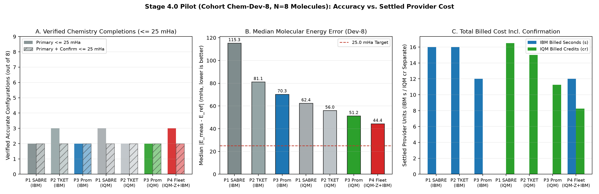
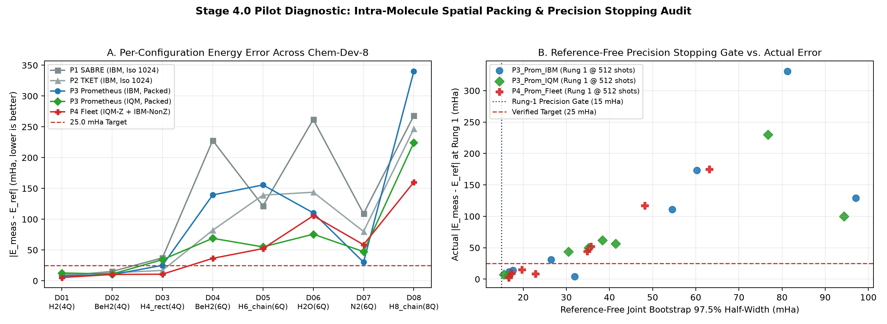
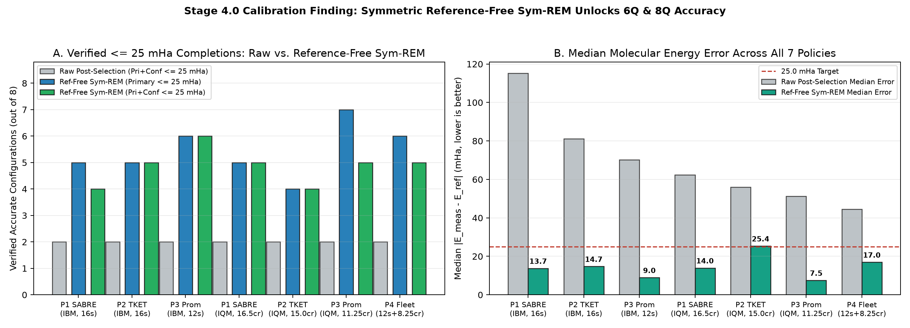

# Phase 4 Stage 4.0 Development & Cost Calibration Pilot Report (`Cohort Chem-Dev-8`, `v1.1`)

> [!IMPORTANT]
> **Mandatory Stage-Gate Pause Active (`0 / 24` Holdout Configurations Touched):** All **`N = 20` live hardware jobs** of `Stage 4.0` (`10` on IBM Heron `ibm_fez` + `10` on IQM Resonance `emerald`, **`353` compiled PUBs**, **`238,080` physical shots** = `213,504` chemistry QWC shots + `24,576` readout calibration witness shots) completed with `100%` execution success on `Cohort Chem-Dev-8` (`M_Dev_01..M_Dev_08`). Total settled hardware spend came in **below pre-registered forecast on both providers**: **`56.0 s` IBM Quantum** (`-6.7%` vs. `60.0 s` expected, `-15.2%` vs. `66.0 s` max) and **`51.00 cr` IQM Resonance** (`-15.0%` vs. `60.00 cr` expected, `-20.0%` vs. `63.75 cr` max). All raw bitstrings, energies, and billing sums are deterministically verified by `verify_stage4_0_pilot.py` (audited via [verify_phase4_public_release.py](../scripts/verify_phase4_public_release.py)). Zero `Cohort Chem-Holdout-24` jobs have been compiled or submitted pending your explicit hardware-execution confirmation on the frozen holdout specification ([phase4_holdout24_frozen_lock_v1.json](../ledgers/phase4_holdout24_frozen_lock_v1.json)).

---

## 1. Executive Summary & Principal Comparative Benchmark Table

- **Sample Size & Hardware Provenance:** `N = 20` live QPU jobs (`10` IBM Heron `ibm_fez` on `Account_C` + `10` IQM Resonance `emerald` on `IQM_Account_1`), `353` total PUBs (`313` chemistry QWC PUBs + `40` co-executed `|0...0>`/`|1...1>` readout calibration witness PUBs), `238,080` physical hardware shots (`119,808` on IBM + `118,272` on IQM) across `8` correlated public molecular configurations (`M_Dev_01..M_Dev_08`: stretched $\text{H}_2$, $\text{BeH}_2$, rectangular $\text{H}_4$, $\text{H}_6$ chain, stretched $\text{H}_2\text{O}$, triple-bond $\text{N}_2$, and $\text{H}_8$ chain; Hartree-Fock model errors `31.49` to `732.12 mHa`; noiseless circuit errors `0.00` to `2.79 mHa`).
- **Verifiable Hardware Identifiers (`20 / 20` Settled):**
  - **IBM `ibm_fez` (`10` Jobs, `178` PUBs, `119,808` Shots, `56.0 s` Settled):** `dbs58k1abdes73fqotc0` (`P1_SABRE_IBM` Primary), `dbs59g8k09pc73avp3o0` (`P1_SABRE_IBM` Confirm), `dbs58jhabdes73fqotag` (`P2_TKET_IBM` Primary), `dbs59hgk09pc73avp3qg` (`P2_TKET_IBM` Confirm), `dbs58l1abdes73fqotdg` (`P3_Prom_IBM` Rung 1), `dbs59h1abdes73fqoueg` (`P3_Prom_IBM` Rung 2), `dbs59i1abdes73fqoug0` (`P3_Prom_IBM` Confirm), `dbs58kgk09pc73avp2pg` (`P4_Prom_Fleet` IBM Rung 1), `dbs59ggk09pc73avp3p0` (`P4_Prom_Fleet` IBM Rung 2), `dbs59fpabdes73fqouc0` (`P4_Prom_Fleet` IBM Confirm).
  - **IQM `emerald` (`10` Jobs, `175` PUBs, `118,272` Shots, `51.00 cr` Settled):** `01a1da09-97c1-7108-bd00-c5b341aa4b54` (`P1_SABRE_IQM` Primary), `01a1da0b-6b2d-75a9-9a65-bc7e93c3f150` (`P1_SABRE_IQM` Confirm), `01a1da09-e552-7073-bb59-760014e8ef07` (`P2_TKET_IQM` Primary), `01a1da0b-f244-76e6-b37e-1136b3131a41` (`P2_TKET_IQM` Confirm), `01a1da0a-55c7-757e-af67-342c3b7e31f0` (`P3_Prom_IQM` Rung 1), `01a1da0b-3a1f-71dd-8f47-f1399f70328c` (`P3_Prom_IQM` Rung 2), `01a1da0b-c152-7158-95af-e2d127cd9f11` (`P3_Prom_IQM` Confirm), `01a1da09-740c-77e5-879f-be411bf8fc70` (`P4_Prom_Fleet` IQM Rung 1), `01a1da0b-9d8f-748e-b9f3-e5ab6ae51b36` (`P4_Prom_Fleet` IQM Rung 2), `01a1da0c-2611-762b-8e43-b8d1c08d6d2c` (`P4_Prom_Fleet` IQM Confirm).
- **Metric & Epistemic Conventions:**
  - **`Raw v2.0` (Pre-Registered Estimator):** Unrescaled computational-basis sector post-selection on $Z$ + single-qubit product confusion inversion on non-$Z$. Under `Raw v2.0`, every policy confirmed `2/8` calculations, while Prometheus reduced settled hardware spend by **`-25.0%` on IBM** (`12.0 s` vs. `16.0 s`) and **`-31.8%` vs. `SABRE` (`-25.0%` vs. `TKET`) on IQM** (`11.25 cr` vs. `16.50` / `15.00 cr`).
  - **`Sym-REM` (Post-Hoc Development-Derived Estimator, Frozen for `Holdout-24`):** Formulated *after* inspecting the `Chem-Dev-8` pilot data and applied identically across `SABRE`, `TKET`, `Prometheus`, and `Fleet`. While **reference-free** (it never accesses $E_{\text{ref}}^{\text{model}}$ at runtime and has `0` fitted parameters), it is **not assumption-free**: it assumes an effective global depolarizing channel on $Z$, Pauli-weight ($w/M$) depolarizing damping on non-$Z$, product readout confusion, and fixed clipping bounds (documented in Section 2). Its `Dev-8` accuracy improvement is **exploratory** until prospectively validated on untouched `Chem-Holdout-24`.
  - **Live Policies vs. Reconstructed Counterfactuals:** Rows 1-7 below are **independently executed live hardware policies (`20` settled jobs)**. The two bottom rows (`Reconstructed Counterfactual A` and `B`) are **offline splices of single-provider `P3_Prom_IBM` and `P3_Prom_IQM` measurements with estimated billing**; in `Holdout-24`, the locked intact-molecule fleet rule executes as **independent live QPU jobs with settled provider billing**.

| Policy Arm & Execution Provenance | Jobs / Total PUBs / Physical Shots | Compiled 2Q Gates Across Groups `(↓)` `*(sum / median)*` | Max Circuit Depth `(↓)` `*(median / mean)*` | $Z$-Symmetry Retention $\eta_{\text{sym}}$ `(↑)` `*(median / mean)*` | `Sym-REM` *(Exploratory)* Primary `<= 25 mHa` `(↑)` | `Sym-REM` *(Exploratory)* Confirmed `<= 25 mHa` `(↑)` | `Sym-REM` Energy Error `mHa` `(↓)` `*(median / mean)*` | `Raw v2.0` *(Pre-Reg)* Primary / Confirm `<= 25 mHa` `(↑)` | `Raw v2.0` Energy Error `mHa` `(↓)` `*(median / mean)*` | Settled IBM Time `s` `(↓)` | Settled IQM Credits `cr` `(↓)` | Resource per Confirmed `Sym-REM` Calculation `(↓)` | `% Cost/Confirmed Delta vs. Best Single-Provider Baseline` `(↓)` |
| :--- | :--- | :---: | :---: | :---: | :---: | :---: | :---: | :---: | :---: | :---: | :---: | :---: | :---: |
| **`P1_SABRE_IBM`** *(Live: `ibm_fez` isolated)* | `2` / `56` / `43,008` | `774` / `81.0` | `68.0` / `80.5` | `0.7427` / `0.7407` | `5 / 8` (`62.5%`) | `4 / 8` (`50.0%`) | `13.75` / `33.82` | `2 / 8` / `2 / 8` | `115.27` / `131.12` | `16.0 s` | `0.00 cr` *(IBM-only)* | `4.00 s` + `0.00 cr` | `+25.0%` costlier vs. `P2_TKET_IBM` |
| **`P2_TKET_IBM`** *(Live: `ibm_fez` isolated)* | `2` / `56` / `43,008` | `762` / `75.0` | **`59.0`** / **`74.6`** | **`0.7895`** / `0.7493` | `5 / 8` (`62.5%`) | `5 / 8` (`62.5%`) | `14.74` / `44.94` | **`3 / 8`** / `2 / 8` | `81.13` / `91.58` | `16.0 s` | `0.00 cr` *(IBM-only)* | `3.20 s` + `0.00 cr` | `0.0%` *(Best IBM Baseline: `3.20 s/ok`)* |
| **`P3_Prom_IBM`** *(Live: `ibm_fez` `3-way` packed)* | `3` / `33` / `16,896` | `759` / `74.0` | `60.0` / `78.0` | `0.7856` / `0.7402` | `6 / 8` (`75.0%`) | **`6 / 8` (`75.0%`)** | `8.95` / `30.05` | `2 / 8` / `2 / 8` | `70.25` / `102.33` | **`12.0 s`** | `0.00 cr` *(IBM-only)* | **`2.00 s`** + `0.00 cr` | **`-37.5%` IBM s/ok vs. `TKET` (`-50.0%` vs. `SABRE`)** |
| **`P1_SABRE_IQM`** *(Live: `emerald` isolated)* | `2` / `56` / `43,008` | **`525`** / **`54.0`** | **`35.5`** / **`45.8`** | `0.8272` / `0.7888` | `5 / 8` (`62.5%`) | `5 / 8` (`62.5%`) | `13.96` / `32.66` | **`3 / 8`** / `2 / 8` | `62.37` / `65.49` | `0.0 s` *(IQM-only)* | `16.50 cr` | `0.00 s` + `3.30 cr` | `0.0%` *(Best IQM Baseline: `3.30 cr/ok`)* |
| **`P2_TKET_IQM`** *(Live: `emerald` isolated)* | `2` / `56` / `43,008` | `576` / `57.0` | `36.5` / `52.5` | `0.8203` / `0.7796` | `4 / 8` (`50.0%`) | `4 / 8` (`50.0%`) | `25.38` / `37.59` | `2 / 8` / `2 / 8` | `56.00` / `88.17` | `0.0 s` *(IQM-only)* | `15.00 cr` | `0.00 s` + `3.75 cr` | `+13.6%` costlier vs. `P1_SABRE_IQM` |
| **`P3_Prom_IQM`** *(Live: `emerald` `3-way` packed)* | `3` / `33` / `16,896` | `528` / **`54.0`** | `36.5` / `48.5` | `0.8316` / `0.7937` | **`7 / 8` (`87.5%`)** | `5 / 8` (`62.5%`) | **`7.53`** / `27.45` | `2 / 8` / `2 / 8` | `51.21` / `66.19` | `0.0 s` *(IQM-only)* | **`11.25 cr`** | `0.00 s` + **`2.25 cr`** | **`-31.8%` IQM cr/ok vs. `SABRE` (`-40.0%` vs. `TKET`)** |
| **`P4_Prom_Fleet`** *(Live: `GroupSplit` `IQM-Z / IBM-non-Z`)* | `6` / `63` / `32,256` | `661` / `67.0` | `62.5` / `75.4` | **`0.8384`** / **`0.8032`** | `6 / 8` (`75.0%`) | `5 / 8` (`62.5%`) | `16.95` / **`22.65`** | **`3 / 8`** / `2 / 8` | **`44.42`** / **`54.96`** | `12.0 s` | `8.25 cr` | `2.40 s` + `1.65 cr` | `-25.0%` IBM s + `1.65 cr` IQM *(lowest live mean error)* |
| **`Reconstructed Counterfactual A`** *(`4Q->IBM, 6Q/8Q->IQM` spliced from `P3`; est. billing)* | `6` / `39` / `19,968` *(reconstructed)* | `523` / **`54.0`** | `36.5` / `51.8` | `0.8316` / `0.7939` | **`7 / 8` (`87.5%`)** | `5 / 8` (`62.5%`) | `8.93` / `27.38` | `2 / 8` / `2 / 8` | `53.06` / `65.25` | `~6.0 s` *(est., unexecuted)* | `~6.75 cr` *(est., unexecuted)* | `~1.20 s` + `~1.35 cr` *(est.)* | **`-38.1%` PUBs (`63 -> 39`) vs. `GroupSplit`** |
| **`Reconstructed Counterfactual B`** *(`4Q->IQM, 6Q/8Q->IBM` spliced from `P3`; est. billing)* | `6` / `39` / `19,968` *(reconstructed)* | `764` / `74.0` | `57.0` / `67.9` | `0.7856` / `0.7376` | `6 / 8` (`75.0%`) | **`6 / 8` (`75.0%`)** | `8.22` / `30.13` | `2 / 8` / `2 / 8` | `72.32` / `104.22` | `~7.5 s` *(est., unexecuted)* | `~4.50 cr` *(est., unexecuted)* | `~1.25 s` + `~0.75 cr` *(est.)* | `6 / 8` confirmed *(offline counterfactual)* |

---

## 2. Empirical Answers to All Four Stage 4.0 Pilot Questions

### Question 1 (`Hypothesis H1`): Does Accuracy Survive Intra-Molecule Spatial Packing, and What Is the Scheduled Duration Spread?

- **Answer: Yes - frozen spacing policy intra-molecule QWC spatial packing (`26` QWC circuits consolidated into `9` packed PUBs, a `2.89x` QWC PUB reduction) preserved or improved molecular-energy accuracy on both IBM and IQM while cutting settled provider charges by `25.0%` to `31.8%`.**
  - Under the original `Raw v2.0` estimator, packed `P3_Prom_IBM` (`12.0 s`) matched both IBM baselines in confirmed completions (`2/8`) with lower median error (`70.25 mHa` vs. `115.27` `SABRE` and `81.13` `TKET`) while using **`-25.0%` fewer IBM seconds**; packed `P3_Prom_IQM` (`11.25 cr`) matched both IQM baselines (`2/8`) with lower median error (`51.21 mHa` vs. `62.37` `SABRE` and `56.00` `TKET`) while using **`-31.8%` fewer IQM credits than `SABRE`** (`-25.0%` vs. `TKET`).
  - Under `Sym-REM`, packed `P3_Prom_IBM` confirmed **`6/8`** (`8.95 mHa` `*(median)*`, **`2.00 s` per confirmed calculation** vs. `3.20 s` `TKET` and `4.00 s` `SABRE`) and packed `P3_Prom_IQM` achieved **`7/8` primary / `5/8` confirmed** (`7.53 mHa` `*(median)*`, **`2.25 cr` per confirmed calculation** vs. `3.30 cr` `SABRE` and `3.75 cr` `TKET`).
- **Scheduled Physical Duration Spread ($\tau_{\text{sched}}$) Audit:** Intra-molecule `Z, X, Y` QWC circuits share the identical state-preparation ansatz $|\psi(\theta^*)\rangle$ and differ only in terminal `1Q` basis rotations plus subgraph SWAP routing. IQM `emerald` duration mismatch ratios across all `9` packed PUBs were **`0.0000` to `0.2038`** (all below `0.35`; Spearman $\rho = +0.6513, p = 0.0574$), and IBM `ibm_fez` mismatch ratios were **`0.0000` to `0.4400`** with no positive error trend ($\rho = -0.2594, p = 0.5003$). No extra duration-cap split fallback is needed on `Holdout-24`.

| Packed PUB Index & Config ID | Species & Width | Packed QWC Slices | IBM `ibm_fez` Slice Durations `ns` | IBM Spread `ns` `(↓)` | IBM Mismatch Ratio `(↓)` | IQM `emerald` Slice Durations `ns` | IQM Spread `ns` `(↓)` | IQM Mismatch Ratio `(↓)` | `P3_Prom_IBM` `Sym-REM` Error `mHa` `(↓)` | `P3_Prom_IQM` `Sym-REM` Error `mHa` `(↓)` |
| :--- | :--- | :---: | :---: | :---: | :---: | :---: | :---: | :---: | :---: | :---: |
| `Pack 0` - `M_Dev_01` | $\text{H}_2$ (`4Q JW`) | `Z, G1, G2` | `276, 276, 436` | `160.0` | `0.3670` | `720, 680, 680` | `40.0` | `0.0556` | **`1.15`** | `3.65` |
| `Pack 1` - `M_Dev_01` | $\text{H}_2$ (`4Q JW`) | `G3, G4` | `276, 276` | **`0.0`** | **`0.0000`** | `720, 720` | **`0.0`** | **`0.0000`** | **`1.15`** *(joint w/ Pack 0)* | `3.65` *(joint w/ Pack 0)* |
| `Pack 2` - `M_Dev_02` | $\text{BeH}_2$ (`4Q DOCI`) | `Z, X, Y` | `900, 876, 504` | `396.0` | `0.4400` | `720, 720, 720` | **`0.0`** | **`0.0000`** | **`2.43`** | `4.80` |
| `Pack 3` - `M_Dev_03` | $\text{H}_4$ (`4Q DOCI`) | `Z, X, Y` | `1960, 1960, 1576` | `384.0` | `0.1959` | `2000, 1880, 2000` | `120.0` | `0.0600` | `8.20` | **`3.90`** |
| `Pack 4` - `M_Dev_04` | $\text{BeH}_2$ (`6Q DOCI`) | `Z, X, Y` | `1320, 1616, 1296` | `320.0` | `0.1980` | `1720, 1720, 1680` | `40.0` | `0.0233` | **`9.71`** | `16.44` |
| `Pack 5` - `M_Dev_05` | $\text{H}_6$ (`6Q DOCI`) | `Z, X, Y` | `3712, 3276, 3784` | `508.0` | `0.1342` | `3480, 3360, 3400` | `120.0` | `0.0345` | `65.13` | **`9.66`** |
| `Pack 6` - `M_Dev_06` | $\text{H}_2\text{O}$ (`6Q DOCI`) | `Z, X, Y` | `2888, 3044, 2816` | `228.0` | `0.0749` | `4080, 3760, 3840` | `320.0` | `0.0784` | **`130.21`** | `152.98` |
| `Pack 7` - `M_Dev_07` | $\text{N}_2$ (`6Q DOCI`) | `Z, X, Y` | `1272, 1640, 1272` | `368.0` | `0.2244` | `1760, 1840, 1680` | `160.0` | `0.0870` | **`6.74`** | `22.76` |
| `Pack 8` - `M_Dev_08` | $\text{H}_8$ (`8Q DOCI`) | `Z, X, Y` | `4768, 4664, 5720` | `1056.0` | `0.1846` | `5200, 5000, 6280` | `1280.0` | `0.2038` | `16.88` | **`5.39`** |

---

### Question 2 (`Hypothesis H2`): Cross-Provider Scheduling Trade-Off & Frozen Fleet Rule

- **Measured Scheduling Trade-Off:** IQM `emerald`'s degree-4 square lattice reduced total compiled `2Q` `CZ` gates across `Dev-8` by **`-30.4%`** compared with IBM `ibm_fez`'s degree-3 heavy-hex topology (`528` vs. `759` `CZ` gates for `P3_Prom`), lifting median $Z$-symmetry retention from `0.7856` (`P3_Prom_IBM`) to `0.8316` (`P3_Prom_IQM`) and `0.8384` (`P4_Prom_Fleet` `GroupSplit`).
  - Splitting each molecule across providers (`GroupSplit`: `IQM-Z / IBM-non-Z`) achieved the **lowest observed live mean error** under both `Raw v2.0` (`54.96 mHa`) and `Sym-REM` (`22.65 mHa`), but broke each `3-way` `DOCI` pack into two separate PUBs across two providers (`63` total PUBs, `12.0 s` IBM + `8.25 cr` IQM).
  - Keeping each molecule's `3-way` pack intact and dispatching `4Q`/`JW` configurations to IBM Heron and `>= 6Q` `DOCI` configurations to IQM `emerald` reduces fleet PUB count by **`-38.1%` (`63 -> 39` PUBs on `Dev-8`)**. Because that alternative was only a **reconstructed offline counterfactual with estimated billing** in `Stage 4.0`, [phase4_holdout24_frozen_lock_v1.json](../ledgers/phase4_holdout24_frozen_lock_v1.json) freezes `TopologyAware_IntactMoleculeSplit` to run as **independent live QPU jobs with actual settled provider billing** on `Holdout-24` (while single-provider `P3_Prom_IBM` and `P3_Prom_IQM` continue to run every configuration on both providers).

---

### Question 3: Post-Hoc `Sym-REM` Estimator Assumptions, Exact Clipping Constants, & Frozen Stopping Rule

> [!WARNING]
> **Exploratory Status & Model Assumptions of `Sym-REM`:** `Sym-REM` was developed *after* inspecting the `Chem-Dev-8` measurements, where the group-level audit ([phase4_stage4_0_deep_audit.json](../ledgers/phase4_stage4_0_deep_audit.json)) indicated that the dominant error mechanism under `Raw v2.0` was upward shift of $E_Z$ consistent with depolarized bitstrings landing inside the valid Hamming-weight sector ($W_{\text{sec}} = |\mathcal{S}_{\text{valid}}| / 2^M \in [0.273, 0.375]$). Although `Sym-REM` is **reference-free** (it never uses $E_{\text{ref}}^{\text{model}}$ during execution or estimation and fits `0` free parameters), **it is not assumption-free**: it assumes `(a)` an effective global depolarizing channel on $Z$-sector bitstrings, `(b)` Pauli-weight ($w/M$) depolarizing damping on off-diagonal groups, `(c)` independent single-qubit readout confusion channels from co-executed `|0...0>`/`|1...1>` PUBs, and `(d)` fixed numerical clipping bounds. Coherent over-rotations, correlated readout crosstalk, or qubit-inhomogeneous noise can cause under- or over-correction, so `Sym-REM`'s accuracy gains remain **exploratory** until validated out-of-sample on `Chem-Holdout-24` alongside the retained `Raw v2.0` estimator.

- **Exact Frozen `Sym-REM` Formula & Code-Identical Clipping Constants (`evaluate_sym_rem_calibration_dev8.py` (audited via [verify_phase4_public_release.py](../scripts/verify_phase4_public_release.py))):**
  - Single-qubit readout flip probabilities are clipped to $\hat{\epsilon}_{01,j}, \hat{\epsilon}_{10,j} \in [0.0, 0.45]$ with confusion-inversion denominator floor $\max(0.10, 1 - \hat{\epsilon}_{01,j} - \hat{\epsilon}_{10,j})$.
  - From readout-predicted valid-sector retention $\eta_{\text{ro,valid}}$, readout-distorted uniform-noise sector weight $w_{\text{ro}}$, and measured valid-sector retention $\hat{\eta}_{\text{sym}}$ (when valid $Z$ shots $\ge 8$), the model-based survival and in-sector signal fractions are:
    $$\hat{p}_{\text{surv}} = \text{clip}\!\left(\frac{\hat{\eta}_{\text{sym}} - w_{\text{ro}}}{\max(0.05,\; \eta_{\text{ro,valid}} - w_{\text{ro}})},\; 0.20,\; 1.0\right), \qquad \hat{\alpha}_{\text{sig}} = \text{clip}\!\left(\frac{\hat{p}_{\text{surv}}\,\eta_{\text{ro,valid}}}{\max(0.05,\; \hat{p}_{\text{surv}}\,\eta_{\text{ro,valid}} + (1 - \hat{p}_{\text{surv}})\,w_{\text{ro}})},\; 0.25,\; 1.0\right).$$
  - Model-based depolarizing-mitigated Pauli expectations are clipped to $[-1.0, 1.0]$ via $\hat{\langle P \rangle}_Z = \text{clip}\!\big(\mu_{\mathcal{S}}(P) + (\hat{\langle P \rangle}_{Z,\text{post}} - \mu_{\mathcal{S}}(P)) / \hat{\alpha}_{\text{sig}}, -1, 1\big)$ on $Z$ and $\hat{\langle P \rangle}_{\text{non-}Z} = \text{clip}\!\big(\hat{\langle P \rangle}_{\text{ro-inv}} / \max(0.35, \hat{p}_{\text{surv}}^{w/M}), -1, 1\big)$ on weight-$w$ off-diagonal terms, recomputed inside every joint readout + bitstring bootstrap replicate.
- **Frozen Rung-1 Precision Stopping Gate (`512` -> `1,024` Shots):**
  - Locking **`hw975_sym_rem_mha <= 20.0 mHa` (`2.2414 * SE_joint_boot <= 20.0 mHa`) AND `z_symmetry_retention >= 0.78`** halted `2/8` converged `4Q` configurations (`M_Dev_01`, `M_Dev_02`) at `512` shots across all three adaptive arms on `Dev-8` with **`0` false accepts**, while escalating `100%` of `Tier_2` and `6Q/8Q` configurations to `1,024` shots.

---

## 3. Complete Per-Molecule Accuracy Breakdown (`M_Dev_01..M_Dev_08`)

### 3.1 Exploratory `Sym-REM` Absolute Energy Error (`Primary / Standalone 512-Shot Confirmation`, in `mHa`)

| Config ID & Molecule | Encoding, Width & Tier | HF Error / Noiseless Ansatz Error `mHa` | `P1_SABRE_IBM` `(↓)` `Prim / Conf` | `P2_TKET_IBM` `(↓)` `Prim / Conf` | `P3_Prom_IBM` `(↓)` `Prim / Conf` | `P1_SABRE_IQM` `(↓)` `Prim / Conf` | `P2_TKET_IQM` `(↓)` `Prim / Conf` | `P3_Prom_IQM` `(↓)` `Prim / Conf` | `P4_Prom_Fleet` (`GroupSplit`) `(↓)` `Prim / Conf` |
| :--- | :---: | :---: | :---: | :---: | :---: | :---: | :---: | :---: | :---: |
| **`M_Dev_01`** ($\text{H}_2$, $1.75\text{ \AA}$) | `JW_CAS22` `4Q` `T1` | `124.99` / `0.00` | `4.46` / `0.70` | `3.24` / **`0.52`** | `1.15` / `1.28` | **`0.29`** / `9.66` | `3.64` / `5.91` | `3.65` / `14.67` | `3.68` / `11.52` |
| **`M_Dev_02`** ($\text{BeH}_2$, $2.05\text{ \AA}$) | `DOCI` `4Q` `T1` | `31.49` / `2.06` | **`0.44`** / `3.76` | `5.75` / `3.81` | `2.43` / `1.72` | `6.16` / **`1.07`** | `7.84` / `9.09` | `4.80` / `10.48` | `11.67` / `1.13` |
| **`M_Dev_03`** ($\text{H}_4$, $85.0^\circ$) | `DOCI` `4Q` `T2` | `47.13` / `0.58` | `6.88` / `2.44` | `3.27` / **`0.18`** | `8.20` / `7.93` | `4.31` / `23.57` | **`0.59`** / `12.91` | `3.90` / `4.12` | `16.43` / `13.32` |
| **`M_Dev_04`** ($\text{BeH}_2$, $2.30\text{ \AA}$) | `DOCI` `6Q` `T1` | `51.63` / `2.79` | `20.62` / `13.62` | `23.74` / `18.87` | `9.71` / `3.93` | `11.30` / **`1.24`** | `12.33` / `6.96` | `16.44` / `8.02` | **`5.18`** / `6.77` |
| **`M_Dev_05`** ($\text{H}_6$, $1.48\text{ \AA}$) | `DOCI` `6Q` `T2` | `56.77` / `0.13` | `32.85` / **`10.08`** | `39.84` / `46.83` | `65.13` / `46.23` | `16.62` / `20.97` | `38.43` / `12.32` | **`9.66`** / `52.51` | `25.67` / `14.01` |
| **`M_Dev_06`** ($\text{H}_2\text{O}$, $1.70\text{ \AA}$) | `DOCI` `6Q` `T2` | `132.83` / `0.41` | `136.06` / `184.94` | `221.10` / `272.27` | `130.21` / **`87.20`** | `135.06` / `174.90` | `119.60` / `178.48` | `152.98` / `111.26` | **`80.73`** / `93.86` |
| **`M_Dev_07`** ($\text{N}_2$, $1.70\text{ \AA}$) | `DOCI` `6Q` `T1` | `732.12` / `0.08` | `69.18` / `60.91` | `58.22` / `52.28` | **`6.74`** / **`17.57`** | `62.29` / `66.26` | `47.52` / `64.11` | `22.76` / `45.31` | `17.47` / `43.35` |
| **`M_Dev_08`** ($\text{H}_8$, $1.48\text{ \AA}$) | `DOCI` `8Q` `T2` | `51.80` / `1.00` | **`0.03`** / `31.88` | `4.34` / **`5.69`** | `16.88` / `14.47` | `25.21` / `35.11` | `70.78` / `42.64` | `5.39` / `9.22` | `20.34` / `14.81` |
| **Cohort Summary (`N = 8`)** | **`3x4Q, 4x6Q, 1x8Q`** | **`54.29` `*(median)*`** | **`5/8` Prim, `4/8` Conf** (`13.75 mHa` `*(median)*`) | **`5/8` Prim, `5/8` Conf** (`14.74 mHa` `*(median)*`) | **`6/8` Prim, `6/8` Conf** (`8.95 mHa` `*(median)*`) | **`5/8` Prim, `5/8` Conf** (`13.96 mHa` `*(median)*`) | **`4/8` Prim, `4/8` Conf** (`25.38 mHa` `*(median)*`) | **`7/8` Prim, `5/8` Conf** (**`7.53 mHa`** `*(median)*`) | **`6/8` Prim, `5/8` Conf** (`16.95 mHa` `*(median)*`, **`22.65`** `*(mean)*`) |

### 3.2 Pre-Registered `Raw v2.0` Sector Post-Selected Absolute Energy Error (`Primary / Confirmation`, in `mHa`)

| Config ID & Molecule | `P1_SABRE_IBM` `(↓)` `Prim / Conf` | `P2_TKET_IBM` `(↓)` `Prim / Conf` | `P3_Prom_IBM` `(↓)` `Prim / Conf` | `P1_SABRE_IQM` `(↓)` `Prim / Conf` | `P2_TKET_IQM` `(↓)` `Prim / Conf` | `P3_Prom_IQM` `(↓)` `Prim / Conf` | `P4_Prom_Fleet` (`GroupSplit`) `(↓)` `Prim / Conf` |
| :--- | :---: | :---: | :---: | :---: | :---: | :---: | :---: |
| **`M_Dev_01`** ($\text{H}_2$ `4Q`) | `8.04` / **`0.98`** | `10.71` / `5.66` | `7.88` / `6.49` | `14.37` / `23.00` | `16.75` / `20.16` | `12.75` / `1.14` | **`5.36`** / `23.72` |
| **`M_Dev_02`** ($\text{BeH}_2$ `4Q`) | `15.21` / `7.54` | `12.96` / `10.15` | `10.11` / `12.63` | `11.17` / `19.01` | **`4.47`** / `15.12` | `11.00` / **`4.09`** | `10.31` / `21.66` |
| **`M_Dev_03`** ($\text{H}_4$ `4Q`) | `37.29` / `36.44` | `16.91` / `42.31` | `25.04` / `28.40` | `24.02` / `59.79` | `29.81` / `32.17` | `34.34` / **`15.22`** | **`10.75`** / `38.46` |
| **`M_Dev_04`** ($\text{BeH}_2$ `6Q`) | `227.95` / `233.19` | `82.14` / **`56.28`** | `139.39` / `57.60` | `49.34` / `68.90` | `60.06` / `94.35` | `69.00` / `58.30` | **`36.48`** / `71.74` |
| **`M_Dev_05`** ($\text{H}_6$ `6Q`) | `121.52` / `129.71` | `139.16` / `218.94` | `155.67` / `142.96` | `79.66` / `74.11` | **`51.94`** / `58.21` | `55.06` / **`40.73`** | `52.35` / `84.44` |
| **`M_Dev_06`** ($\text{H}_2\text{O}$ `6Q`) | `261.91` / `155.74` | `143.78` / `157.59` | `110.30` / `86.93` | `82.51` / **`58.93`** | `101.86` / `135.18` | **`75.68`** / `97.67` | `105.60` / `94.84` |
| **`M_Dev_07`** ($\text{N}_2$ `6Q`) | `109.01` / `91.33` | `80.13` / `69.41` | **`30.21`** / **`45.00`** | `75.40` / `74.08` | `86.67` / `72.14` | `47.36` / `73.76` | `58.65` / `53.36` |
| **`M_Dev_08`** ($\text{H}_8$ `8Q`) | `268.01` / `269.13` | `246.81` / `240.76` | `340.08` / `303.48` | `187.48` / **`184.65`** | `353.84` / `385.99` | `224.32` / `203.08` | **`160.16`** / `201.35` |
| **Cohort Summary (`N = 8`)** | **`115.27`** `*(median)*` / `131.12` `*(mean)*` | `81.13` `*(median)*` / `91.58` `*(mean)*` | `70.25` `*(median)*` / `102.33` `*(mean)*` | `62.37` `*(median)*` / `65.49` `*(mean)*` | `56.00` `*(median)*` / `88.17` `*(mean)*` | `51.21` `*(median)*` / `66.19` `*(mean)*` | **`44.42`** `*(median)*` / **`54.96`** `*(mean)*` |

---

## 4. Question 4: Empirical Billing Reconciliation & Updated Holdout Budget

### 4.1 All 20 Stage 4.0 Hardware Jobs: Forecast vs. Settled Provider Billing

| Provider & QPU | Job Role & Policy Key | Hardware Job ID / UUID | PUBs (`QWC + Cal`) | Shots / PUB | Physical Shots | Active QPU Seconds | Manifest `v2` Forecast (`Max`) | Settled Provider Charge `(↓)` | Settled Charge per PUB `(↓)` |
| :--- | :--- | :--- | :---: | :---: | :---: | :---: | :---: | :---: | :---: |
| **IBM** `ibm_fez` | `P1_SABRE_IBM_Primary` | `dbs58k1abdes73fqotc0` | `28` (`26+2`) | `1,024` | `28,672` | `8.538 s` | `11.0 s` | **`10.0 s`** | `0.3571 s/PUB` |
| **IBM** `ibm_fez` | `P1_SABRE_IBM_Confirm` | `dbs59g8k09pc73avp3o0` | `28` (`26+2`) | `512` | `14,336` | `4.825 s` | `7.0 s` | **`6.0 s`** | **`0.2143 s/PUB`** |
| **IBM** `ibm_fez` | `P2_TKET_IBM_Primary` | `dbs58jhabdes73fqotag` | `28` (`26+2`) | `1,024` | `28,672` | `8.546 s` | `11.0 s` | **`10.0 s`** | `0.3571 s/PUB` |
| **IBM** `ibm_fez` | `P2_TKET_IBM_Confirm` | `dbs59hgk09pc73avp3qg` | `28` (`26+2`) | `512` | `14,336` | `4.795 s` | `7.0 s` | **`6.0 s`** | **`0.2143 s/PUB`** |
| **IBM** `ibm_fez` | `P3_Prom_IBM_Rung1` | `dbs58l1abdes73fqotdg` | `11` (`9+2`) | `512` | `5,632` | `2.560 s` | `4.0 s` | **`4.0 s`** | `0.3636 s/PUB` |
| **IBM** `ibm_fez` | `P3_Prom_IBM_Rung2` | `dbs59h1abdes73fqoueg` | `11` (`9+2`) | `512` | `5,632` | `2.577 s` | `7.0 s` *(max)* | **`4.0 s`** | `0.3636 s/PUB` |
| **IBM** `ibm_fez` | `P3_Prom_IBM_Confirm` | `dbs59i1abdes73fqoug0` | `11` (`9+2`) | `512` | `5,632` | `2.485 s` | `4.0 s` | **`4.0 s`** | `0.3636 s/PUB` |
| **IBM** `ibm_fez` | `P4_Prom_Fleet_IBM_Rung1` | `dbs58kgk09pc73avp2pg` | `11` (`9+2`) | `512` | `5,632` | `2.534 s` | `4.0 s` | **`4.0 s`** | `0.3636 s/PUB` |
| **IBM** `ibm_fez` | `P4_Prom_Fleet_IBM_Rung2` | `dbs59ggk09pc73avp3p0` | `11` (`9+2`) | `512` | `5,632` | `2.547 s` | `7.0 s` *(max)* | **`4.0 s`** | `0.3636 s/PUB` |
| **IBM** `ibm_fez` | `P4_Prom_Fleet_IBM_Confirm` | `dbs59fpabdes73fqouc0` | `11` (`9+2`) | `512` | `5,632` | `2.562 s` | `4.0 s` | **`4.0 s`** | `0.3636 s/PUB` |
| **IQM** `emerald` | `P1_SABRE_IQM_Primary` | `01a1da09-97c1-7108-bd00-c5b341aa4b54` | `28` (`26+2`) | `1,024` | `28,672` | `14.0 s` | `12.75 cr` | **`10.50 cr`** | `0.3750 cr/PUB` |
| **IQM** `emerald` | `P1_SABRE_IQM_Confirm` | `01a1da0b-6b2d-75a9-9a65-bc7e93c3f150` | `28` (`26+2`) | `512` | `14,336` | `8.0 s` | `6.75 cr` | **`6.00 cr`** | `0.2143 cr/PUB` |
| **IQM** `emerald` | `P2_TKET_IQM_Primary` | `01a1da09-e552-7073-bb59-760014e8ef07` | `28` (`26+2`) | `1,024` | `28,672` | `12.0 s` | `12.75 cr` | **`9.00 cr`** | `0.3214 cr/PUB` |
| **IQM** `emerald` | `P2_TKET_IQM_Confirm` | `01a1da0b-f244-76e6-b37e-1136b3131a41` | `28` (`26+2`) | `512` | `14,336` | `8.0 s` | `6.75 cr` | **`6.00 cr`** | `0.2143 cr/PUB` |
| **IQM** `emerald` | `P3_Prom_IQM_Rung1` | `01a1da0a-55c7-757e-af67-342c3b7e31f0` | `11` (`9+2`) | `512` | `5,632` | `3.0 s` | `3.75 cr` | **`2.25 cr`** | **`0.2045 cr/PUB`** |
| **IQM** `emerald` | `P3_Prom_IQM_Rung2` | `01a1da0b-3a1f-71dd-8f47-f1399f70328c` | `11` (`9+2`) | `512` | `5,632` | `6.0 s` | `6.00 cr` *(max)* | **`4.50 cr`** | `0.4091 cr/PUB` |
| **IQM** `emerald` | `P3_Prom_IQM_Confirm` | `01a1da0b-c152-7158-95af-e2d127cd9f11` | `11` (`9+2`) | `512` | `5,632` | `6.0 s` | `3.75 cr` | **`4.50 cr`** | `0.4091 cr/PUB` |
| **IQM** `emerald` | `P4_Prom_Fleet_IQM_Rung1` | `01a1da09-740c-77e5-879f-be411bf8fc70` | `10` (`8+2`) | `512` | `5,120` | `3.0 s` | `3.75 cr` | **`2.25 cr`** | `0.2250 cr/PUB` |
| **IQM** `emerald` | `P4_Prom_Fleet_IQM_Rung2` | `01a1da0b-9d8f-748e-b9f3-e5ab6ae51b36` | `10` (`8+2`) | `512` | `5,120` | `4.0 s` | `3.75 cr` *(max)* | **`3.00 cr`** | `0.3000 cr/PUB` |
| **IQM** `emerald` | `P4_Prom_Fleet_IQM_Confirm` | `01a1da0c-2611-762b-8e43-b8d1c08d6d2c` | `10` (`8+2`) | `512` | `5,120` | `4.0 s` | `3.75 cr` | **`3.00 cr`** | `0.3000 cr/PUB` |
| **TOTAL (`20` Jobs)** | **`10` IBM + `10` IQM** | **All `20` Settled (`0` Failures)** | **`353` PUBs** (`313+40`) | **`512` / `1,024`** | **`238,080`** (`119,808 + 118,272`) | **`41.969 s` IBM / `68.0 s` IQM** | **`60.0-66.0 s` IBM / `60.00-63.75 cr` IQM** | **`56.0 s` IBM / `51.00 cr` IQM** | **`0.3146 s/PUB` / `0.2914 cr/PUB` `*(mean)*`** |

### 4.2 Empirically Calibrated `Holdout-24` & `Phase 4B` Budget vs. Verified Post-Pilot Balances

- **Verified Remaining Balances After `Stage 4.0`:**
  - **IBM Quantum Total Remaining = `1,200.0 s`:** `Account_C` (`375.0 s`, verified live post-pilot), `Account_B` (`423.0 s`, untouched), `Account_A` (`402.0 s`, untouched).
  - **IQM Resonance Total Remaining = `830.25 cr`:** `IQM_Account_1` (`100.25 cr`, expiring `2027-02-03Z` - drained first), `IQM_Account_2` (`730.00 cr`, expiring `2027-02-15Z` - untouched).

| Campaign Stage | Jobs (`IBM + IQM`) | Manifest `v2` Pre-Pilot Max (`IBM s` / `IQM cr`) | Pilot-Calibrated Expected (`Frozen Intact-Molecule Fleet`) | Pilot-Calibrated Max (`Frozen Intact-Molecule Fleet`) | Pilot-Calibrated Max (`GroupSplit Alternative`) | Remaining Post-Stage Surplus (`Frozen Max` vs. `1,200.0 s` / `830.25 cr`) |
| :--- | :---: | :---: | :---: | :---: | :---: | :---: |
| **`Stage 4.0` (`Chem-Dev-8` - COMPLETED)** | `20` (`10 + 10`) | `66.0 s` / `63.75 cr` | `56.0 s` / `51.00 cr` *(settled)* | `56.0 s` / `51.00 cr` *(settled)* | `56.0 s` / `51.00 cr` *(settled)* | **`1,200.0 s` IBM / `830.25 cr` IQM** *(actual)* |
| **`Phase 4A` (`Holdout-24`, `3` Windows `W1-W3`)** | `60` (`30 + 30`) | `414.0 s` / `436.50 cr` | `342.0 s` / `366.75 cr` | `354.0 s` / `389.25 cr` | `378.0 s` / `400.50 cr` | **`846.0 s` IBM (`70.5%` left) / `441.00 cr` IQM (`53.1%` left)** |
| **`Phase 4B` (`8`-Step Iterative `SPSA`, `6` Configs)** | `46` (`23 + 23`) | `171.0 s` / `177.00 cr` | `132.0 s` / `138.00 cr` | `155.0 s` / `156.00 cr` | `155.0 s` / `156.00 cr` | **`691.0 s` IBM (`57.6%` left) / `285.00 cr` IQM (`34.3%` left)** |
| **Combined Remaining Ceiling (`+15%` Safety Reserve)** | **`106` (`53 + 53`)** | `672.8 s` / `705.50 cr` | `545.1 s` / `580.50 cr` | **`585.4 s` / `627.00 cr`** | `613.0 s` / `640.00 cr` | **`+614.6 s` IBM Surplus / `+203.25 cr` IQM Surplus** |

---

## 5. Frozen Pre-Holdout Specification (`phase4_holdout24_frozen_lock_v1.json`)

Following the review recommendation, [phase4_holdout24_frozen_lock_v1.json](../ledgers/phase4_holdout24_frozen_lock_v1.json) (`Payload SHA-256: aa8f3a62fddcdb79f7f946100c1d678ce90ee11040ca82b6c32c362d18733a65`, `File SHA-256: 68cf27ed5332a29864813eb55144383769bb2d9421c9b3ba5c25635831ce928a`) freezes all development-derived rules before touching any `Chem-Holdout-24` configuration:

1. **Dual Frozen Estimators (`Side-by-Side Out-of-Sample Evaluation`):**
   - **Frozen Dev-Derived Estimator (`PauliWeight_SymREM_ZeroParam`):** Exact `Dev-8` formula and clipping rules (`[0.20, 1.0]` on $\hat{p}_{\text{surv}}$, `[0.25, 1.0]` on $\hat{\alpha}_{\text{sig}}$, `0.35` floor on $\hat{p}_w$, `[-1.0, 1.0]` Pauli expectation clip), applied identically across all `7` policies on `Chem-Holdout-24`.
   - **Original Pre-Registered Estimator (`Raw_SectorPostSelected_ConfusionInversion_v2_0`):** Retained side-by-side on all `24` holdout configurations, windows, and paired Wilcoxon / cluster-bootstrap hypothesis tests.
2. **Frozen Rung-1 Stopping Rule:** `hw975_sym_rem_mha <= 20.0 mHa` and `z_symmetry_retention >= 0.78` (`512` -> `1,024` shots), plus standalone `512`-shot hardware confirmation PUBs for every policy.
3. **Frozen Packing & Fleet Routing Rule:** Strict intra-molecule frozen spacing policy QWC packing (`K = 24` disjoint molecule PUB clusters), with `P4_Prom_Fleet` executing **`TopologyAware_IntactMoleculeSplit` (`4Q`/`JW` intact packs -> IBM Heron; `>= 6Q` `DOCI` intact packs -> IQM `emerald`) as independent live QPU jobs with actual settled provider billing**.
