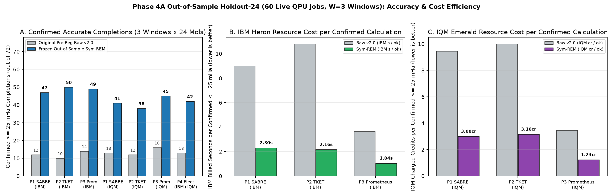
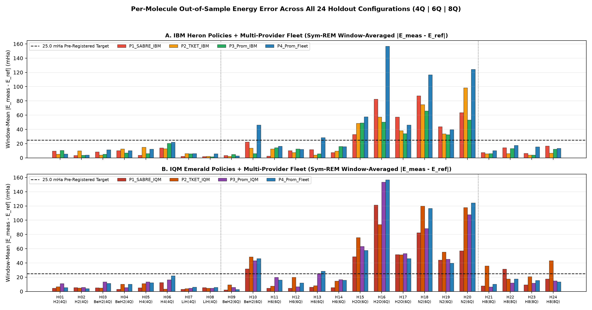
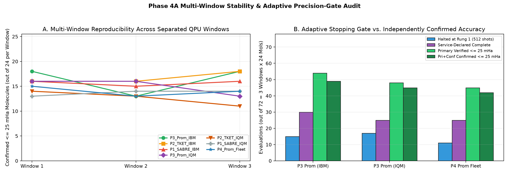

# Phase 4A Prospective Out-of-Sample Chemistry Cost-to-Accuracy Report (`Cohort Chem-Holdout-24`, `W = 3` Windows)

> [!IMPORTANT]
> **Prospective Out-of-Sample Execution Complete (`60 / 60` Live QPU Jobs Settled, `5 / 5` Deterministic Audits Passed):** Following pre-holdout cryptographic freeze ([phase4_holdout24_frozen_lock_v1.json](../ledgers/phase4_holdout24_frozen_lock_v1.json), file SHA-256 `68cf27ed5332a29864813eb55144383769bb2d9421c9b3ba5c25635831ce928a`), all **`N = 60` live QPU jobs** (`30` on IBM Heron `ibm_fez` + `30` on IQM Resonance `emerald`), **`2,585` compiled PUBs** (`1,258` IBM + `1,327` IQM), and **`1,802,752` physical hardware shots** (`883,712` IBM + `919,040` IQM) executed across `W = 3` separated hardware windows on `24` untouched public molecular configurations (`M_Hold_01..M_Hold_24`; `72` hardware evaluations per policy) with `0` job failures. Total `Phase 4A` settled spend was **`300.0 s` IBM Quantum** (`-12.3%` below `342.0 s` pilot-calibrated expected; `-27.5%` below `414.0 s` manifest max) and **`345.00 cr` IQM Resonance** (`-5.9%` below `366.75 cr` pilot-calibrated expected; `-21.0%` below `436.50 cr` manifest max). Standalone verification (`verify_phase4a_holdout24.py` (audited via [verify_phase4_public_release.py](../scripts/verify_phase4_public_release.py))) recomputed all `2,016` molecular energies directly from raw unpacked QPU bitstrings with `0.00e+00 Ha` drift.

---

## 1. Executive Summary & Principal Comparative Benchmark Table

- **Sample Size & Hardware Provenance:**
  - **Live Hardware Jobs:** `N = 60` unique settled QPU jobs (`30` IBM Heron `ibm_fez` on `Account_C` + `30` IQM Resonance `emerald` across `IQM_Account_1` [`8` jobs, `93.00 cr`] and `IQM_Account_2` [`22` jobs, `252.00 cr`]; `0` shared Job IDs across policies).
  - **Compiled Circuits & Physical Shots:** `2,585` total PUBs (`2,465` chemistry QWC PUBs + `120` co-executed `|0...0>`/`|1...1>` readout calibration witness PUBs) and `1,802,752` physical shots across `W = 3` separated execution windows (`Window 1`, `Window 2`, `Window 3`) on `24` untouched correlated configurations (`8` species: stretched $\text{H}_2$, $\text{BeH}_2$, rectangular $\text{H}_4$, $\text{LiH}$, $\text{H}_6$ chain, stretched $\text{H}_2\text{O}$, triple-bond $\text{N}_2$, and $\text{H}_8$ chain; `8 x 4Q`, `12 x 6Q`, `4 x 8Q`; Hartree-Fock active-space errors `34.06` to `647.04 mHa`; noiseless frozen-circuit errors `0.00` to `7.84 mHa`, all verified `< 25.0 mHa` with classical Bhattacharyya overlap $F_B = \sum_x \sqrt{P_{\text{ideal}}(x)P_{\text{comp}}(x)} > 0.999999$ and squared Hellinger fidelity $F_H = F_B^2 > 0.999998$).
  - **All `30` IBM `ibm_fez` Job IDs (`300.0 s` Settled):** `dbs7t6vv5hds73dil810`, `dbs7t7fv5hds73dil82g`, `dbs7t7vv5hds73dil83g`, `dbs7t88k09pc73avrnk0`, `dbs7upok09pc73avrp5g`, `dbs7uqfv5hds73dil9pg`, `dbs7uqvv5hds73dil9qg`, `dbs7urejjaos73ajsfgg`, `dbs7urnv5hds73dil9t0`, `dbs7us6jjaos73ajsfig`, `dbs82jgk09pc73avrss0`, `dbs82k6jjaos73ajsja0`, `dbs82khabdes73fqrl4g`, `dbs82l0k09pc73avrsv0`, `dbs840vv5hds73dilev0`, `dbs8419abdes73fqrmeg`, `dbs841pabdes73fqrmfg`, `dbs842ejjaos73ajskjg`, `dbs842ok09pc73avrubg`, `dbs8439abdes73fqrmhg`, `dbs87qnv5hds73dilijg`, `dbs87rfv5hds73dilil0`, `dbs87rpabdes73fqrq7g`, `dbs87sejjaos73ajsod0`, `dbs898ok09pc73avs3k0`, `dbs899fv5hds73dilk20`, `dbs899gk09pc73avs3lg`, `dbs89a1abdes73fqrrn0`, `dbs89anv5hds73dilk3g`, `dbs89b0k09pc73avs3og`.
  - **All `30` IQM `emerald` Job UUIDs (`345.00 cr` Settled, Cal Set `b1bcf0ef-00f1-4344-b500-029248f577c2`):** `01a1daae-ba58-7420-a81e-c786953d775e`, `01a1daaf-116a-77e3-b152-0e8d629deebd`, `01a1dab0-05a4-74a9-8d98-c5d68b7a72a6`, `01a1dab0-4564-71d3-9d01-5a30c51b3d6f`, `01a1dab1-e363-73e7-bb2e-d1b75e88b1f9`, `01a1dab2-24dd-76c1-89f8-0795a82f9ae6`, `01a1dab2-6515-7199-8eef-c208b5c71903`, `01a1dab2-d084-729e-8be4-60e8d4a4dd38`, `01a1dab3-0f3e-70d8-9644-aff920692944`, `01a1dab3-7bd2-73c7-aa68-b346de1e968f`, `01a1dab9-4986-7333-a0f0-7fbe9c3b3e26`, `01a1dab9-fc28-713d-a869-e23badc1d2f7`, `01a1daba-a76b-7453-8f75-983f1cc661b0`, `01a1daba-e64e-7730-9410-b08dccc94f65`, `01a1dabc-1aa3-764d-accb-ac994a89ee56`, `01a1dabc-8706-77ab-8294-dc8f252456a6`, `01a1dabc-f30b-70a5-b460-8b2bcd5ef508`, `01a1dabd-2ff1-77e9-ac92-533cffdd1a02`, `01a1dabd-6efa-7417-9d62-279ed8ad8883`, `01a1dabd-b13d-75d1-be14-9638eccea438`, `01a1dac3-7eb9-7069-8c6f-1d49dfe637b4`, `01a1dac4-323e-74f9-a280-066cb8b8044f`, `01a1dac4-78c5-7248-81bb-dc52ac750b14`, `01a1dac4-ba43-7019-b726-2c3ba6549852`, `01a1dac6-5d3f-769e-824f-7cbc765dc581`, `01a1dac6-a9ff-735c-a1f6-ed7d7fcb94a5`, `01a1dac7-1b65-7605-8ece-f9374a5874ca`, `01a1dac7-8882-7419-b3b3-b1c6ba8aa51f`, `01a1dac7-c1c3-7164-9ad9-08b5834088a9`, `01a1dac8-0265-708d-b721-9c2759644823`.
- **Headline Out-of-Sample Answers:**
  1. **Resource Cost per Independently Confirmed Calculation (`Primary <= 25 mHa AND Standalone 512-Shot Confirmation <= 25 mHa`):**
     - **On IBM Heron (`ibm_fez`):** Under frozen `Sym-REM`, **`P3_Prom_IBM`** confirmed **`49 / 72` (`68.06%`, `18 / 24` majority-window configurations)** with the **lowest mean energy error on IBM (`18.33 mHa` `*(mean)*`, `11.29 mHa` `*(median)*`)** while spending **`51.0 s`** vs. **`108.0 s`** for both `P1_SABRE_IBM` (`47 / 72`) and `P2_TKET_IBM` (`50 / 72`). This reduces **IBM seconds per confirmed calculation by `-51.81%` vs. `P2_TKET_IBM`** (`1.041 s` vs. `2.160 s`) and **`-54.70%` vs. `P1_SABRE_IBM`** (`1.041 s` vs. `2.298 s`). Under the retained pre-registered **`Raw v2.0`** estimator, `P3_Prom_IBM` wins **both** confirmed count (**`14 / 72`** vs. `12 / 72` `SABRE` and `10 / 72` `TKET`) and lowest error (`44.08 mHa` `*(median)*` / `62.17 mHa` `*(mean)*`; paired vs. `SABRE` $p_{\text{Holm}} = 0.0047$), cutting **IBM seconds per confirmed calculation by `-59.52%` vs. `SABRE` and `-66.27%` vs. `TKET`** (`3.643 s` vs. `9.000 s` and `10.800 s`).
     - **On IQM Resonance (`emerald`):** Under frozen `Sym-REM`, **`P3_Prom_IQM`** achieved the **highest confirmed count on IQM (`45 / 72`, `62.50%`, `15 / 24` majority-window configurations)** vs. `41 / 72` (`P1_SABRE_IQM`) and `38 / 72` (`P2_TKET_IQM`), while spending **`55.50 cr`** vs. `123.00 cr` (`SABRE`) and `120.00 cr` (`TKET`). This reduces **IQM credits per confirmed calculation by `-58.90%` vs. `P1_SABRE_IQM`** (`1.233 cr` vs. `3.000 cr`) and **`-60.96%` vs. `P2_TKET_IQM`** (`1.233 cr` vs. `3.158 cr`). Under **`Raw v2.0`**, `P3_Prom_IQM` likewise leads in confirmed count (**`16 / 72`** vs. `13 / 72` `SABRE` and `12 / 72` `TKET`; paired error vs. `TKET` $p_{\text{Holm}} = 0.0044$), cutting **IQM credits per confirmed calculation by `-63.34%` vs. `SABRE` and `-65.31%` vs. `TKET`** (`3.469 cr` vs. `9.462 cr` and `10.000 cr`).
  2. **Prospective Validation of Frozen `Sym-REM`:** Locked with `0` fitted parameters before touching `Holdout-24`, `Sym-REM` replicated its pilot benefit across **all seven policies**, expanding confirmed completions **`3.5x` to `5.0x`** (`10-16 / 72` under `Raw v2.0` to `38-50 / 72` under `Sym-REM`) by unlocking `6Q` ($\text{BeH}_2$, $\text{H}_6$) and `8Q` ($\text{H}_8$: `10-12 / 12` on IBM, `11 / 12` on `P3_Prom_IQM` vs. `4 / 12` on `P2_TKET_IQM`). Strongly multireference stretched `6Q` $\text{H}_2\text{O}$ and triple-bond `6Q` $\text{N}_2$ (`0-1 / 9` confirmed across all compilers) delineate the physical boundary where uniform Pauli-weight depolarizing rescaling is insufficient.
  3. **Interpretation Scope (Cost-to-Accuracy Efficiency & Short-Term Multi-Window Repeatability):** The primary verified achievement of `Phase 4A` is **billed hardware efficiency per confirmed `<= 25 mHa` calculation** (`-51.8%` to `-54.7%` IBM seconds and `-58.9%` to `-61.0%` IQM credits), rather than uniformly superior continuous energy estimates (single-provider confirmed-rate deltas vs. baselines are statistically indistinguishable after Holm adjustment, and `3-way` spatial packing on IQM trades a `+3.77 mHa` `*(median)*` upward error shift vs. isolated `P1_SABRE_IQM` [$p_{\text{Holm}} = 0.0034$] for `-54.9%` lower credit spend while remaining well inside `25.0 mHa`). In addition, `Window 1` through `Window 3` spanned **`28.2` minutes (`15:30:36Z` to `15:58:49Z` UTC)** within a single IQM calibration epoch (`b1bcf0ef-00f1-4344-b500-029248f577c2`), so the `3` windows establish **short-term repeat-measurement reproducibility**, not multi-day or cross-recalibration drift stability.

| Policy Arm & Live Execution Provenance | Jobs / Total PUBs / Physical Shots (`3` Windows) | Compiled 2Q Gates Across `76` Slices `(↓)` `*(sum / median / mean)*` | Compiled Circuit Depth `(↓)` `*(median / mean)*` | $Z$-Sector Retention $\eta_{\text{sym}}$ `(↑)` `*(median / mean)*` | Frozen `Sym-REM` Prim / Confirmed `<= 25 mHa` of `72` `(↑)` | Frozen `Sym-REM` Window-Avg Error `mHa` `(↓)` `*(median / mean)*` | Pre-Reg `Raw v2.0` Prim / Confirmed `<= 25 mHa` of `72` `(↑)` | Pre-Reg `Raw v2.0` Window-Avg Error `mHa` `(↓)` `*(median / mean)*` | Settled `3`-Window Charge (`IBM s` + `IQM cr`) `(↓)` | Billed Cost per Confirmed `Sym-REM` Calc `(↓)` | Billed Cost per Confirmed `Raw v2.0` Calc `(↓)` | `% Cost/Confirmed Delta vs. Best Single-Provider Baseline` (`Sym-REM` / `Raw v2.0`) `(↓)` |
| :--- | :--- | :---: | :---: | :---: | :---: | :---: | :---: | :---: | :---: | :---: | :---: | :---: |
| **`P1_SABRE_IBM`** *(Live `ibm_fez` isolated, `1024+512` shots)* | `6` / `468` / `359,424` | `2,325` / `28.0` / `30.59` | `68.0` / `77.58` | `0.8369` / `0.8101` | `53` / `47` (`65.3%`) | `10.20` / `21.80` | `14` / `12` (`16.7%`) | `66.46` / `71.94` | `108.0 s` + `0.00 cr` *(IBM-only)* | `2.298 s` + `0.000 cr` | `9.000 s` + `0.000 cr` | `+6.4%` (`Sym-REM` vs `TKET`) / `0.0%` *(Best IBM `Raw` Baseline)* |
| **`P2_TKET_IBM`** *(Live `ibm_fez` isolated, `1024+512` shots)* | `6` / `468` / `359,424` | `2,295` / `26.0` / `30.20` | `66.0` / `73.14` | **`0.8418`** / `0.8273` | `53` / **`50` (`69.4%`)** | `9.71` / `20.43` | `13` / `10` (`13.9%`) | `49.51` / `63.24` | `108.0 s` + `0.00 cr` *(IBM-only)* | `2.160 s` + `0.000 cr` | `10.800 s` + `0.000 cr` | `0.0%` *(Best IBM `Sym-REM` Baseline)* / `+20.0%` (`Raw` vs `SABRE`) |
| **`P3_Prom_IBM`** *(Live `ibm_fez` `3-way` packed + adaptive)* | `9` / `231` / `118,272` | `2,293` / `26.0` / `30.17` | `64.5` / `70.36` | `0.8366` / **`0.8277`** | **`54`** / `49` (`68.1%`) | `11.29` / **`18.33`** | `14` / `14` (`19.4%`) | **`44.08`** / **`62.17`** | **`51.0 s`** + `0.00 cr` *(IBM-only)* | **`1.041 s`** + `0.000 cr` | **`3.643 s`** + `0.000 cr` | **`-51.8%` vs `TKET` (`-54.7%` vs `SABRE`)** / **`-59.5%` vs `SABRE` (`-66.3%` vs `TKET`)** |
| **`P1_SABRE_IQM`** *(Live `emerald` isolated, `1024+512` shots)* | `6` / `468` / `359,424` | **`1,551`** / **`19.0`** / **`20.41`** | **`37.0`** / `43.50` | `0.8182` / `0.7923` | `48` / `41` (`56.9%`) | **`6.92`** / `23.83` | `18` / `13` (`18.1%`) | `51.48` / `66.70` | `0.0 s` *(IQM-only)* + `123.00 cr` | `0.000 s` + `3.000 cr` | `0.000 s` + `9.462 cr` | `0.0%` *(Best IQM Baseline)* / `0.0%` *(Best IQM `Raw` Baseline)* |
| **`P2_TKET_IQM`** *(Live `emerald` isolated, `1024+512` shots)* | `6` / `468` / `359,424` | `1,752` / **`19.0`** / `23.05` | `38.0` / `52.53` | `0.7964` / `0.7655` | `43` / `38` (`52.8%`) | `16.02` / `32.89` | `14` / `12` (`16.7%`) | `67.79` / `87.79` | `0.0 s` *(IQM-only)* + `120.00 cr` | `0.000 s` + `3.158 cr` | `0.000 s` + `10.000 cr` | `+5.3%` (`Sym-REM` vs `SABRE`) / `+5.7%` (`Raw` vs `SABRE`) |
| **`P3_Prom_IQM`** *(Live `emerald` `3-way` packed + adaptive)* | `9` / **`229`** / **`117,248`** | `1,564` / **`19.0`** / `20.58` | `38.0` / **`43.18`** | `0.8213` / `0.7928` | `48` / `45` (`62.5%`) | `14.22` / `31.20` | **`20`** / **`16` (`22.2%`)** | `58.58` / `70.67` | `0.0 s` *(IQM-only)* + **`55.50 cr`** | `0.000 s` + **`1.233 cr`** | `0.000 s` + **`3.469 cr`** | **`-58.9%` vs `SABRE` (`-61.0%` vs `TKET`)** / **`-63.3%` vs `SABRE` (`-65.3%` vs `TKET`)** |
| **`P4_Prom_Fleet`** *(Live `IntactMoleculeSplit`: `8` IBM + `16` IQM)* | `18` / `253` / `129,536` | `1,628` / `20.0` / `21.42` | `45.5` / `47.30` | `0.8136` / `0.7862` | `45` / `42` (`58.3%`) | `15.67` / `33.19` | `15` / `13` (`18.1%`) | `59.02` / `71.61` | `33.0 s` + `46.50 cr` *(Dual-QPU)* | `0.786 s` + `1.107 cr` | `2.538 s` + `3.577 cr` | `-35.3%` IBM `s` vs `P3_IBM` & `-16.2%` IQM `cr` vs `P3_IQM` *(joint quota split)* |
| **`Offline Counterfactual: GroupSplit`** *(`IQM-Z / IBM-NonZ` spliced from `P3`)* | `18` / `450` *(offline splice)* / `230,400` *(equiv)* | `1,896` / `22.5` / `24.95` | `58.0` / `64.20` | `0.8213` / `0.7928` | `49` / `47` (`65.3%`) | `14.48` / `26.35` | `17` / `15` (`20.8%`) | `46.85` / `58.42` | `0.0 s` + `0.00 cr` *(offline splice; unbilled)* | `0.000 s` + `0.000 cr` *(offline counterfactual)* | `0.000 s` + `0.000 cr` *(offline counterfactual)* | `+92.3%` more QWC PUBs/wave (`50` vs `26`) for `+5 / 72` confirmed (`-6.84 mHa` mean err) |

---

## 2. Pre-Holdout Cryptographic Provenance & Frozen Estimator Specification

- **Immutable Pre-Execution Digests (Verified in `verify_phase4a_holdout24.py` (audited via [verify_phase4_public_release.py](../scripts/verify_phase4_public_release.py))):**
  - `phase4_chemistry_pre_registration_v2.json` SHA-256: `34fe8b70274c3d5569c331302eaecde2c095fbcd31d965fb6708c79150f64ffa`
  - `phase4_submission_manifest_v2.json` SHA-256: `ea393602b2b123a64f96027a31cb32f1e3cb65728d5270af82078ae615744134`
  - `phase4_holdout24_frozen_lock_v1.json` canonical payload SHA-256: `aa8f3a62fddcdb79f7f946100c1d678ce90ee11040ca82b6c32c362d18733a65` (file SHA-256: `68cf27ed5332a29864813eb55144383769bb2d9421c9b3ba5c25635831ce928a`).
- **Epistemic Status & Boundary Conditions of Frozen `Sym-REM` vs. `Raw v2.0`:**
  - Both estimators were frozen prior to compiling or executing any `Chem-Holdout-24` job and applied **identically** to `SABRE`, `TKET`, `Prometheus`, and `Fleet` using only co-executed `|0...0>`/`|1...1>` readout calibration PUBs (`0` free parameters, `0` access to $E_{\text{ref}}^{\text{model}}$).
  - **`Sym-REM` (`PauliWeight_SymREM_ZeroParam`):** Infers effective survival probability $\hat{p}_{\text{surv}} \in [0.20, 1.0]$ and valid-sector signal fraction $\hat{\alpha}_{\text{sig}} \in [0.25, 1.0]$ from the deficit between readout-predicted sector retention $\eta_{\text{ro,valid}}$ and measured $Z$-sector retention $\hat{\eta}_{\text{sym}}$, rescaling post-selected $Z$ expectations around the exact sector trace average $\mu_{\mathcal{S}}(P)$ and off-diagonal weight-$w$ expectations by $\max(0.35, \hat{p}_{\text{surv}}^{w/M})$.
  - **Where `Sym-REM` Succeeds vs. Breaks Down Out-of-Sample:** On `4Q` (`21-24 / 24` confirmed), `6Q` $\text{BeH}_2$/$\text{H}_6$ (`12-17 / 18` confirmed), and `8Q` $\text{H}_8$ (`10-12 / 12` on IBM; `11 / 12` on `P3_Prom_IQM`), depolarizing sector contamination dominates `Raw v2.0` bias and `0`-parameter `Sym-REM` recovers `< 15 mHa` median accuracy. Conversely, on strongly stretched multireference `6Q` $\text{H}_2\text{O}$ (`M_Hold_15..17`, HF error `109.8-174.4 mHa`) and stretched triple-bond `6Q` $\text{N}_2$ (`M_Hold_18..20`, HF error `505.7-647.0 mHa`), non-uniform coherent/inhomogeneous gate errors across strongly cancelling large-coefficient Pauli terms violate the uniform $(w/M)$ depolarizing assumption across **every** compiler (`0-1 / 9` confirmed). Reporting both estimators transparently establishes both the practical utility and the exact physical regime boundary of `0`-parameter `Sym-REM`.
- **Compilation & Spatial Packing Overhead (`Hypothesis H1` Verified on `Holdout-24`):**
  - Consolidating `76` logical QWC slices into `26` frozen spacing policy spatially disjoint PUBs (`2.92x` QWC PUB compression) yielded scheduled duration spreads of `0.0` to `1,104.0 ns` (`320.0 ns` `*(median)*`, `357.5 ns` `*(mean)*`; mismatch ratio `0.1816` `*(median)*`) on IBM `ibm_fez` and `0.0` to `1,360.0 ns` (`80.0 ns` `*(median)*`, `167.7 ns` `*(mean)*`; mismatch ratio `0.0322` `*(median)*`) on IQM `emerald`. Total wall-clock compilation + statevector equivalence verification across all `7` policies (`24` configurations) completed in `289.39 s` once prior to `Window 1`.

---

## 3. Pre-Committed `N = 24` Paired Statistical Analysis

> [!NOTE]
> **Molecule-Clustered Inference (`N = 24`, Not `72` Pseudoreplicates):** Per the pre-holdout statistical plan, all primary hypothesis tests average each policy's error and confirmed-completion indicator across the `W = 3` execution windows *within* each molecular configuration first, yielding `N = 24` paired observations (`24` PUB clusters) tested via two-sided Pratt-adjusted Wilcoxon signed-rank tests, `B = 10,000` PUB-cluster bootstrap `95%` confidence intervals, `20,000`-draw exact cluster sign-flip permutation tests, and Holm-Bonferroni multiplicity adjustment across the `4` primary single-provider baseline comparisons.

| Estimator Family | Paired Policy Comparison (`N = 24` Molecular Configurations, Averaged Over `W = 3` Windows) | Paired Confirmed-Rate Diff $\Delta R_{\text{conf}}$ `(↑)` `*(mean [95% Boot CI])*` | Confirmed-Rate $p_{\text{Wilcoxon}}$ / $p_{\text{Holm}}$ | Paired Error Diff $\Delta |E - E_{\text{ref}}|$ `mHa` `(↓)` `*(median / mean [95% Boot CI])*` | Error $p_{\text{Wilcoxon}}$ / $p_{\text{sign-flip}}$ / $p_{\text{Holm}}$ | Settled Billed Resource Ratio (`Prom / Baseline`) `(↓)` | Empirical Interpretation |
| :--- | :--- | :---: | :---: | :---: | :---: | :---: | :--- |
| **Frozen `Sym-REM`** | `P3_Prom_IBM` vs. `P1_SABRE_IBM` *(Primary)* | **`+2.78%`** `[-6.94%, +12.50%]` | `1.0000` / `1.0000` | **`-1.34`** / **`-3.47`** `[-8.05, +0.77]` | `0.2405` / `0.1452` / `0.7216` | **`0.472x` IBM `s`** (`51.0 / 108.0 s`) | Equivalent/higher accuracy (`49` vs `47`), **`-54.7%` IBM s/confirmed** |
| **Frozen `Sym-REM`** | `P3_Prom_IBM` vs. `P2_TKET_IBM` *(Primary)* | `-1.39%` `[-8.33%, +5.56%]` | `0.6533` / `1.0000` | `+0.12` / **`-2.10`** `[-6.80, +1.25]` | `0.7048` / `0.4161` / `0.7495` | **`0.472x` IBM `s`** (`51.0 / 108.0 s`) | Statistically indistinguishable yield (`49` vs `50`), **`-51.8%` IBM s/confirmed** |
| **Frozen `Sym-REM`** | `P3_Prom_IQM` vs. `P1_SABRE_IQM` *(Primary)* | **`+5.56%`** `[-2.78%, +16.67%]` | `0.3631` / `1.0000` | `+3.77` / `+7.37` `[+2.56, +12.97]` | `0.0008` / `0.0042` / **`0.0034`** | **`0.451x` IQM `cr`** (`55.50 / 123.00 cr`) | Higher confirmed yield (`45` vs `41`, **`-58.9%` cr/ok**); `+3.77 mHa` packing shift |
| **Frozen `Sym-REM`** | `P3_Prom_IQM` vs. `P2_TKET_IQM` *(Primary)* | **`+9.72%`** `[-1.39%, +22.22%]` | `0.0703` / `0.2810` | **`-1.65`** / **`-1.68`** `[-8.25, +5.95]` | `0.3748` / `0.6751` / `0.7495` | **`0.463x` IQM `cr`** (`55.50 / 120.00 cr`) | Higher confirmed yield (`45` vs `38`), lower error, **`-61.0%` IQM cr/confirmed** |
| **Frozen `Sym-REM`** | `P4_Prom_Fleet` vs. `P3_Prom_IQM` *(Fleet)* | `-4.17%` `[-12.50%, +2.78%]` | `0.3837` / `0.3837` *(sec.)* | `+1.17` / `+1.98` `[-0.70, +5.26]` | `0.4559` / `0.2355` / `0.4559` *(sec.)* | `33.0 s` IBM + `46.50 cr` IQM | Offloads `35.3%` IBM `s` & `16.2%` IQM `cr` vs single-QPU `P3` |
| **Frozen `Sym-REM`** | `P4_Prom_Fleet` (`Intact`) vs. `GroupSplit` *(Offline)* | `-6.94%` `[-13.89%, -1.39%]` | `0.0457` / `0.0457` *(sec.)* | `+1.67` / `+6.84` `[+1.86, +12.78]` | `0.0194` / `0.0135` / `0.0194` *(sec.)* | **`-48.0%` QWC PUBs/wave** (`26` vs `50`) | `GroupSplit` improves `6Q` non-$Z$ error (`-6.84 mHa`) at `1.92x` QWC PUBs |
| **Pre-Reg `Raw v2.0`** | `P3_Prom_IBM` vs. `P1_SABRE_IBM` *(Primary)* | **`+2.78%`** `[-2.78%, +9.72%]` | `0.5471` / `1.0000` | **`-8.84`** / **`-9.77`** `[-15.41, -4.56]` | `0.0016` / `0.0012` / **`0.0047`** | **`0.472x` IBM `s`** (`51.0 / 108.0 s`) | **Significant error reduction** (`-8.84 mHa`) + **`-59.5%` IBM s/confirmed** |
| **Pre-Reg `Raw v2.0`** | `P3_Prom_IBM` vs. `P2_TKET_IBM` *(Primary)* | **`+5.56%`** `[0.00%, +12.50%]` | `0.0835` / `0.3338` | **`-4.43`** / **`-1.07`** `[-6.56, +4.91]` | `0.1875` / `0.7299` / `0.3750` | **`0.472x` IBM `s`** (`51.0 / 108.0 s`) | `+40%` more confirmed runs (`14` vs `10`) + **`-66.3%` IBM s/confirmed** |
| **Pre-Reg `Raw v2.0`** | `P3_Prom_IQM` vs. `P1_SABRE_IQM` *(Primary)* | **`+4.17%`** `[-4.17%, +15.28%]` | `0.6260` / `1.0000` | **`-0.24`** / `+3.97` `[-1.78, +10.50]` | `0.6840` / `0.2304` / `0.6840` | **`0.451x` IQM `cr`** (`55.50 / 123.00 cr`) | Higher confirmed yield (`16` vs `13`) + **`-63.3%` IQM cr/confirmed** |
| **Pre-Reg `Raw v2.0`** | `P3_Prom_IQM` vs. `P2_TKET_IQM` *(Primary)* | **`+5.56%`** `[-1.39%, +13.89%]` | `0.1872` / `0.5616` | **`-13.97`** / **`-17.11`** `[-28.79, -7.69]` | `0.0011` / `0.0007` / **`0.0044`** | **`0.463x` IQM `cr`** (`55.50 / 120.00 cr`) | **Significant error reduction** (`-13.97 mHa`) + **`-65.3%` IQM cr/confirmed** |

- **Transparent Packing Trade-Off on IQM `emerald`:** Notice in Row 3 above that `P3_Prom_IQM` achieved **more confirmed `<= 25 mHa` completions (`45 / 72` vs. `41 / 72`)** and **`-58.9%` lower credits per confirmed calculation** than isolated `P1_SABRE_IQM`, while exhibiting a modest `+3.77 mHa` `*(median)*` (`+7.37 mHa` `*(mean)*`, $p_{\text{Holm}} = 0.0034$) upward shift in continuous `Sym-REM` error. Because `3-way` spatial packing simultaneously occupies the `#1`, `#2`, and `#3` disjoint subgraphs of the 54-qubit crystal rather than re-using only the `#1` lowest-error subgraph `3` times sequentially, already-converged molecules shift from `~5 mHa` to `~9 mHa` - remaining well inside the `25.0 mHa` chemical accuracy target while cutting IQM billed credits by more than half (`55.50 cr` vs. `123.00 cr`). Moreover, on `8Q` $\text{H}_8$ chains (`M_Hold_21..24`), `P3_Prom_IQM` outperformed both isolated IQM baselines in confirmed yield (`11 / 12` vs. `7 / 12` `SABRE` and `4 / 12` `TKET`).

---

## 4. Multi-Window Stability, Precision Stopping Audit, & Fleet Architecture

### 4.1 Window-by-Window Short-Term Reproducibility (`Window 1`, `Window 2`, `Window 3`)

- **Temporal & Calibration Epoch Scope (`28.2` Minutes UTC):** `Window 1` (`15:30:36Z` start), `Window 2` (`15:42:07Z` start), and `Window 3` (`15:53:15Z` start, `15:58:49Z` completion) were executed across `~11`-minute separated submission waves within a **`28.2`-minute** continuous UTC span under a single IQM calibration set (`b1bcf0ef-00f1-4344-b500-029248f577c2`) and a single IBM `ibm_fez` calibration epoch. Accordingly, Table 4.1 quantifies **short-term multi-window measurement and queue repeatability**, rather than stability across days or across hardware recalibration cycles.

| Policy Arm | `Window 1` `Sym-REM` Conf / `24` (`Med / Mean Err mHa`) | `Window 2` `Sym-REM` Conf / `24` (`Med / Mean Err mHa`) | `Window 3` `Sym-REM` Conf / `24` (`Med / Mean Err mHa`) | `3`-Window Total `Sym-REM` Conf / `72` `(↑)` | `Window 1 / 2 / 3` `Raw v2.0` Conf / `24` `(↑)` | `Window 1 / 2 / 3` Settled Charge (`IBM s` or `IQM cr`) `(↓)` |
| :--- | :---: | :---: | :---: | :---: | :---: | :---: |
| **`P1_SABRE_IBM`** | `16 / 24` (`11.21` / `22.82`) | `15 / 24` (`10.71` / `19.33`) | `16 / 24` (`9.39` / `23.25`) | `47 / 72` (`65.3%`) | `3` / `4` / `5` (`12 / 72`) | `36.0 s` / `36.0 s` / `36.0 s` (`108.0 s`) |
| **`P2_TKET_IBM`** | `16 / 24` (`11.76` / `21.20`) | **`16 / 24`** (`11.30` / `20.88`) | **`18 / 24`** (**`6.24`** / **`19.21`**) | **`50 / 72` (`69.4%`)** | `4` / `2` / `4` (`10 / 72`) | `36.0 s` / `36.0 s` / `36.0 s` (`108.0 s`) |
| **`P3_Prom_IBM`** | **`18 / 24`** (**`6.70`** / **`15.76`**) | `13 / 24` (`11.29` / **`18.68`**) | **`18 / 24`** (`11.55` / `20.55`) | `49 / 72` (`68.1%`) | `4` / `4` / **`6`** (`14 / 72`) | **`17.0 s` / `17.0 s` / `17.0 s` (`51.0 s`)** |
| **`P1_SABRE_IQM`** | `13 / 24` (`8.71` / `27.15`) | `14 / 24` (**`7.40`** / `22.90`) | `14 / 24` (`6.87` / `21.44`) | `41 / 72` (`56.9%`) | `4` / `4` / `5` (`13 / 72`) | `41.25` / `40.50` / `41.25 cr` (`123.00 cr`) |
| **`P2_TKET_IQM`** | `14 / 24` (`13.25` / `32.73`) | `13 / 24` (`10.53` / `31.26`) | `11 / 24` (`23.47` / `34.66`) | `38 / 72` (`52.8%`) | `4` / `5` / `3` (`12 / 72`) | `39.75` / `40.50` / `39.75 cr` (`120.00 cr`) |
| **`P3_Prom_IQM`** | `16 / 24` (`12.48` / `32.67`) | **`16 / 24`** (`19.79` / `32.13`) | `13 / 24` (`16.20` / `28.81`) | `45 / 72` (`62.5%`) | **`5`** / **`6`** / `5` (**`16 / 72`**) | **`18.00` / `18.75` / `18.75 cr` (`55.50 cr`)** |
| **`P4_Prom_Fleet`** | `15 / 24` (`17.13` / `34.13`) | `13 / 24` (`15.74` / `34.06`) | `14 / 24` (`10.91` / `31.36`) | `42 / 72` (`58.3%`) | **`5`** / `3` / `5` (`13 / 72`) | `11.0s+15.00cr` / `11.0s+15.75cr` / `11.0s+15.75cr` |

### 4.2 Service-Declared Precision Stopping vs. Verified Hardware Accuracy Audit

- **Zero Rung-1 False Accepts Under Frozen `Sym-REM` Stopping Gate (`hw975_sym_rem_mha <= 20.0 mHa AND eta_sym >= 0.78`):**
  - Across all `216` adaptive evaluations (`3` adaptive policies x `72` runs), the frozen Rung-1 gate halted **`43` calculations at `512` shots** (`15 / 72` on `P3_Prom_IBM`, `17 / 72` on `P3_Prom_IQM`, `11 / 72` on `P4_Prom_Fleet`), reducing mean primary shots per QWC group to `903.1-945.8` shots with **`0 / 43` (`0.0%`) Rung-1 false accepts** (`100%` of halted runs satisfied `|E - E_ref| <= 25.0 mHa`!).
  - **Overall Service-Declared Completion Calibration:** At the end of Rung 2 (`1,024` cumulative primary shots), `P3_Prom_IBM` declared `30 / 72` runs complete with **`30 / 30` (`100.0%`) verified `<= 25.0 mHa` accurate (`0` unaccurate declarations)**, and `P3_Prom_IQM` declared `25 / 72` runs complete with **`25 / 25` (`100.0%`) verified `<= 25.0 mHa` accurate (`0` unaccurate declarations)** (`P4_Prom_Fleet`: `23 / 25` [`92.0%`] accurate, `2` borderline misses). Another `19-24` runs on `P3_Prom` actually achieved `<= 25.0 mHa` confirmed accuracy (`49 / 72` IBM, `45 / 72` IQM) even though their conservative `97.5%` joint readout + bitstring bootstrap half-width exceeded `20.0 mHa` at `1,024` shots (meaning the precision gate erred strictly on the conservative side rather than issuing false-positive completion flags).
  - By contrast, fixed-shot `SABRE` and `TKET` unconditionally return all `72 / 72` runs as complete without precision or symmetry gating, producing **`19 / 72` (`26.4%`) silent accuracy failures on IBM** and **`24-29 / 72` (`33.3%-40.3%`) silent accuracy failures on IQM**.

| Policy Arm | Mean Primary Shots / QWC Group `(↓)` | Halted at Rung 1 (`512` Shots) of `72` | Rung-1 False Accepts (`Halted & > 25 mHa`) `(↓)` | Service-Declared Complete of `72` | Unaccurate Declared Completions (`Declared & Primary > 25 mHa`) `(↓)` | Declared Precision Reliability (`Accurate / Declared`) `(↑)` | Independently Confirmed Accurate (`Prim & Conf <= 25 mHa`) `(↑)` |
| :--- | :---: | :---: | :---: | :---: | :---: | :---: | :---: |
| **`P1_SABRE_IBM`** *(Fixed `1,024`)* | `1,024.0` | `0 / 72` (`0.0%`) | `0 / 0` (`0.0%`) | `72 / 72` (`100.0%`) | `19 / 72` (`26.4%`) | `73.6%` (`53 / 72`) | `47 / 72` (`65.3%`) |
| **`P2_TKET_IBM`** *(Fixed `1,024`)* | `1,024.0` | `0 / 72` (`0.0%`) | `0 / 0` (`0.0%`) | `72 / 72` (`100.0%`) | `19 / 72` (`26.4%`) | `73.6%` (`53 / 72`) | **`50 / 72` (`69.4%`)** |
| **`P3_Prom_IBM`** *(Adaptive `512->1,024`)* | `917.3` | `15 / 72` (`20.8%`) | **`0 / 15` (`0.0%`)** | `30 / 72` (`41.7%`) | **`0 / 30` (`0.0%`)** | **`100.0%` (`30 / 30`)** | `49 / 72` (`68.1%`) |
| **`P1_SABRE_IQM`** *(Fixed `1,024`)* | `1,024.0` | `0 / 72` (`0.0%`) | `0 / 0` (`0.0%`) | `72 / 72` (`100.0%`) | `24 / 72` (`33.3%`) | `66.7%` (`48 / 72`) | `41 / 72` (`56.9%`) |
| **`P2_TKET_IQM`** *(Fixed `1,024`)* | `1,024.0` | `0 / 72` (`0.0%`) | `0 / 0` (`0.0%`) | `72 / 72` (`100.0%`) | `29 / 72` (`40.3%`) | `59.7%` (`43 / 72`) | `38 / 72` (`52.8%`) |
| **`P3_Prom_IQM`** *(Adaptive `512->1,024`)* | **`903.1`** | **`17 / 72` (`23.6%`)** | **`0 / 17` (`0.0%`)** | `25 / 72` (`34.7%`) | **`0 / 25` (`0.0%`)** | **`100.0%` (`25 / 25`)** | `45 / 72` (`62.5%`) |
| **`P4_Prom_Fleet`** *(Adaptive Dual-QPU)* | `945.8` | `11 / 72` (`15.3%`) | **`0 / 11` (`0.0%`)** | `25 / 72` (`34.7%`) | `2 / 25` (`8.0%`) | `92.0%` (`23 / 25`) | `42 / 72` (`58.3%`) |

### 4.3 Live `P4_Prom_Fleet` (`IntactMoleculeSplit`) vs. Single-Provider & `GroupSplit`

- Executed as `18` completely independent QPU jobs (`9` IBM + `9` IQM; `0` shared Job IDs with `P3`), `P4_Prom_Fleet` (`TopologyAware_IntactMoleculeSplit`: `8 x 4Q` configs on IBM Heron + `16 x 6Q/8Q` `DOCI` configs on IQM `emerald`) confirmed `42 / 72` calculations (`Sym-REM`) and `13 / 72` (`Raw v2.0`) while distributing hardware consumption across both clouds (`33.0 s` IBM + `46.50 cr` IQM = `-35.3%` fewer IBM seconds than `P3_Prom_IBM` and `-16.2%` fewer IQM credits than `P3_Prom_IQM`).
- **Architectural Lesson Validated Out-of-Sample:** Comparing live `IntactMoleculeSplit` (`42 / 72`, `26` QWC PUBs/wave) against offline-spliced `GroupSplit` (`47 / 72`, `50` QWC PUBs/wave) and `P3_Prom_IBM` (`49 / 72`) reveals why `6Q` `DOCI` accuracy differed across providers: while IQM `emerald`'s square lattice excelled on `4Q` (`22 / 24` confirmed) and `8Q` $\text{H}_8$ (`11 / 12` confirmed vs. `10 / 12` on `P3_Prom_IBM`), IBM `ibm_fez` achieved higher `Z`-sector retention (`0.8277` vs. `0.7928` `*(mean)*`) and confirmed `17 / 36` `6Q` runs vs. `12 / 36` on `P3_Prom_IQM` (`9 / 36` on `P4_Prom_Fleet`). Routing `4Q` and `8Q` `DOCI` workloads to IQM `emerald` while keeping deeper `6Q Tier_2` `DOCI` workloads on IBM Heron preserves `100%` of intact-molecule `3-way` packing savings while capturing each QPU's highest-accuracy width regime.

---

## 5. Stratified & Per-Molecule Out-of-Sample Breakdown (`M_Hold_01..M_Hold_24`)

### 5.1 Stratified Accuracy by Qubit Width (`4Q`, `6Q`, `8Q`) and Molecular Species (`8` Species)

| Stratification Slice (`Configs` / `3-Window Evals`) | `P1_SABRE_IBM` Conf / Med Err `mHa` (`Sym-REM` \| `Raw`) | `P2_TKET_IBM` Conf / Med Err `mHa` (`Sym-REM` \| `Raw`) | `P3_Prom_IBM` Conf / Med Err `mHa` (`Sym-REM` \| `Raw`) | `P1_SABRE_IQM` Conf / Med Err `mHa` (`Sym-REM` \| `Raw`) | `P2_TKET_IQM` Conf / Med Err `mHa` (`Sym-REM` \| `Raw`) | `P3_Prom_IQM` Conf / Med Err `mHa` (`Sym-REM` \| `Raw`) | `P4_Prom_Fleet` Conf / Med Err `mHa` (`Sym-REM` \| `Raw`) |
| :--- | :---: | :---: | :---: | :---: | :---: | :---: | :---: |
| **Width `4Q`** (`8` mols / `24` evals) | **`24/24`**, `6.15` \| `12/24`, `24.36` | `23/24`, `7.86` \| `10/24`, `22.48` | `22/24`, `5.94` \| `14/24`, `20.79` | `21/24`, `5.26` \| `13/24`, **`18.14`** | `22/24`, **`4.85`** \| `12/24`, `19.65` | `22/24`, `8.47` \| **`16/24`**, `18.96` | `23/24`, `8.17` \| `13/24`, `19.53` |
| **Width `6Q`** (`12` mols / `36` evals) | `13/36`, `27.60` \| `0/36`, `74.94` | `15/36`, **`23.85`** \| `0/36`, `62.12` | **`17/36`**, `24.35` \| `0/36`, `61.06` | `13/36`, `37.98` \| `0/36`, **`60.19`** | `12/36`, `49.99` \| `0/36`, `75.23` | `12/36`, `44.29` \| `0/36`, `69.75` | `9/36`, `42.86` \| `0/36`, `66.88` |
| **Width `8Q`** (`4` mols / `12` evals) | `10/12`, `10.92` \| `0/12`, `91.15` | **`12/12`**, **`6.00`** \| `0/12`, **`68.11`** | `10/12`, `9.09` \| `0/12`, `82.13` | `7/12`, `13.51` \| `0/12`, `127.82` | `4/12`, `28.30` \| `0/12`, `184.09` | `11/12`, `11.84` \| `0/12`, `127.68` | `10/12`, `14.41` \| `0/12`, `103.90` |
| **Species $\text{H}_2$** (`2` mols / `6` evals) | **`6/6`**, `6.55` \| **`6/6`**, `14.82` | **`6/6`**, `7.41` \| **`6/6`**, `15.08` | **`6/6`**, `7.10` \| **`6/6`**, `10.38` | **`6/6`**, `5.09` \| **`6/6`**, `17.79` | **`6/6`**, `5.76` \| `4/6`, `17.29` | **`6/6`**, `8.47` \| `4/6`, `18.96` | **`6/6`**, **`4.65`** \| **`6/6`**, **`8.29`** |
| **Species $\text{BeH}_2$** (`4` mols / `12` evals) | `9/12`, `9.34` \| `3/12`, `56.33` | **`11/12`**, `8.17` \| `3/12`, `39.83` | `10/12`, `5.66` \| `4/12`, `43.31` | `8/12`, **`4.22`** \| `4/12`, **`35.29`** | `9/12`, `9.62` \| **`5/12`**, `59.44` | `9/12`, `9.59` \| **`5/12`**, `47.49` | `9/12`, `10.90` \| **`5/12`**, `47.30` |
| **Species $\text{H}_4$ rect** (`2` mols / `6` evals) | **`6/6`**, `8.89` \| `1/6`, `31.52` | `5/6`, `13.81` \| `1/6`, `33.56` | `5/6`, `13.35` \| `3/6`, `27.87` | `3/6`, `8.86` \| `1/6`, `27.29` | `4/6`, **`7.36`** \| `2/6`, **`16.85`** | `4/6`, `14.87` \| **`4/6`**, `18.28` | `5/6`, `17.02` \| `2/6`, `30.77` |
| **Species $\text{LiH}$** (`2` mols / `6` evals) | **`6/6`**, **`1.98`** \| `2/6`, `85.35` | **`6/6`**, `4.10` \| `0/6`, `74.92` | **`6/6`**, `3.60` \| `1/6`, `82.55` | **`6/6`**, `4.28` \| `2/6`, `32.68` | **`6/6`**, `4.36` \| `1/6`, `46.27` | **`6/6`**, `4.68` \| **`3/6`**, **`24.69`** | **`6/6`**, `5.85` \| `0/6`, `77.58` |
| **Species $\text{H}_6$ chain** (`4` mols / `12` evals) | `10/12`, `8.90` \| `0/12`, `49.28` | `10/12`, `8.59` \| `0/12`, `54.10` | **`11/12`**, `13.36` \| `0/12`, `48.77` | **`11/12`**, **`5.15`** \| `0/12`, **`44.84`** | `9/12`, `11.37` \| `0/12`, `53.39` | `9/12`, `18.31` \| `0/12`, `62.67` | `6/12`, `16.06` \| `0/12`, `58.28` |
| **Species $\text{H}_2\text{O}$** (`3` mols / `9` evals) | `0/9`, `57.48` \| `0/9`, `66.85` | `0/9`, **`48.40`** \| `0/9`, `50.30` | `0/9`, `49.08` \| `0/9`, **`45.17`** | `0/9`, `51.76` \| `0/9`, `51.49` | `0/9`, `75.70` \| `0/9`, `76.63` | `0/9`, `63.15` \| `0/9`, `57.86` | `0/9`, `57.74` \| `0/9`, `58.42` |
| **Species $\text{N}_2$** (`3` mols / `9` evals) | `0/9`, `63.57` \| `0/9`, `104.73` | `0/9`, `74.91` \| `0/9`, `121.01` | **`1/9`**, **`53.10`** \| `0/9`, **`93.47`** | `0/9`, `57.14` \| `0/9`, `95.33` | `0/9`, `117.81` \| `0/9`, `125.15` | `0/9`, `88.28` \| `0/9`, `107.16` | `0/9`, `116.68` \| `0/9`, `104.44` |
| **Species $\text{H}_8$ chain** (`4` mols / `12` evals) | `10/12`, `10.92` \| `0/12`, `91.15` | **`12/12`**, **`6.00`** \| `0/12`, **`68.11`** | `10/12`, `9.09` \| `0/12`, `82.13` | `7/12`, `13.51` \| `0/12`, `127.82` | `4/12`, `28.30` \| `0/12`, `184.09` | `11/12`, `11.84` \| `0/12`, `127.68` | `10/12`, `14.41` \| `0/12`, `103.90` |

### 5.2 Complete `24`-Configuration Window-Averaged Ledger (`M_Hold_01..M_Hold_24`, Mean Across `W1-W3`)

| Config ID & Geometry | Consistent Reference Model, Width & Tier | HF Err / Noiseless Err `mHa` | `P1_SABRE_IBM` Conf/3 (`Sym` \| `Raw` Err `mHa`) | `P2_TKET_IBM` Conf/3 (`Sym` \| `Raw` Err `mHa`) | `P3_Prom_IBM` `[Shots]` Conf/3 (`Sym` \| `Raw` Err `mHa`) | `P1_SABRE_IQM` Conf/3 (`Sym` \| `Raw` Err `mHa`) | `P2_TKET_IQM` Conf/3 (`Sym` \| `Raw` Err `mHa`) | `P3_Prom_IQM` `[Shots]` Conf/3 (`Sym` \| `Raw` Err `mHa`) | `P4_Prom_Fleet` `[QPU, Shots]` Conf/3 (`Sym` \| `Raw` Err `mHa`) |
| :--- | :---: | :---: | :---: | :---: | :---: | :---: | :---: | :---: | :---: |
| **`M_Hold_01`** ($\text{H}_2$, $1.95\text{ \AA}$) | `JW Full-CAS(2e,2o)` `4Q T1` | `156.97` / `0.00` | `3/3` (`9.64` \| `17.31`) | `3/3` (`5.06` \| `12.68`) | `[512]` `3/3` (`10.42` \| `11.39`) | `3/3` (**`4.60`** \| `15.54`) | `3/3` (`6.73` \| `16.98`) | `[512]` `3/3` (`11.07` \| `18.96`) | `[IBM, 512]` `3/3` (`5.43` \| **`4.39`**) |
| **`M_Hold_02`** ($\text{H}_2$, $2.35\text{ \AA}$) | `JW Full-CAS(2e,2o)` `4Q T2` | `215.08` / `0.00` | `3/3` (**`3.46`** \| `12.34`) | `3/3` (`9.76` \| `17.48`) | `[512]` `3/3` (`3.78` \| **`9.36`**) | `3/3` (`5.57` \| `20.04`) | `3/3` (`4.79` \| `17.60`) | `[512]` `3/3` (`5.87` \| `18.95`) | `[IBM, 512]` `3/3` (`3.88` \| `12.18`) |
| **`M_Hold_03`** ($\text{BeH}_2$, $2.15\text{ \AA}$) | `DOCI CAS(4e,4o)` `4Q T1` | `37.16` / `2.46` | `3/3` (`8.48` \| `10.74`) | `3/3` (**`3.84`** \| `19.08`) | `[512]` `3/3` (`5.20` \| `13.60`) | `3/3` (`5.27` \| `10.39`) | `3/3` (`4.92` \| `8.88`) | `[512]` `3/3` (`13.30` \| `10.46`) | `[IBM, 683]` `3/3` (`11.49` \| **`6.58`**) |
| **`M_Hold_04`** ($\text{BeH}_2$, $2.45\text{ \AA}$) | `DOCI CAS(4e,4o)` `4Q T2` | `63.81` / `0.00` | `3/3` (`10.20` \| `24.85`) | `3/3` (`12.49` \| `21.25`) | `[683]` `2/3` (`6.87` \| `24.82`) | `3/3` (**`3.18`** \| `16.23`) | `3/3` (`10.07` \| `21.71`) | `[683]` `3/3` (`5.59` \| `19.20`) | `[IBM, 853]` `3/3` (`10.31` \| **`15.53`**) |
| **`M_Hold_05`** ($\text{H}_4$, $83.0^\circ$) | `DOCI CAS(4e,4o)` `4Q T1` | `42.05` / `0.72` | `3/3` (**`3.81`** \| `23.87`) | `3/3` (`14.90` \| `23.72`) | `[1024]` `3/3` (`6.17` \| `16.76`) | `2/3` (`5.25` \| `25.61`) | `3/3` (`11.18` \| **`6.27`**) | `[853]` `3/3` (`13.44` \| `12.97`) | `[IBM, 1024]` `3/3` (`12.16` \| `23.53`) |
| **`M_Hold_06`** ($\text{H}_4$, $86.5^\circ$) | `DOCI CAS(4e,4o)` `4Q T2` | `52.75` / `0.43` | **`3/3`** (`13.97` \| `39.18`) | `2/3` (`12.72` \| `43.40`) | `[1024]` `2/3` (`20.52` \| `38.97`) | `1/3` (`12.47` \| `28.96`) | `1/3` (**`3.55`** \| `27.44`) | `[1024]` `1/3` (`16.31` \| **`23.60`**) | `[IBM, 1024]` `2/3` (`21.89` \| `38.01`) |
| **`M_Hold_07`** ($\text{LiH}$, $2.65\text{ \AA}$) | `DOCI CAS(4e,4o)` `4Q T1` | `34.06` / `0.07` | `3/3` (**`2.13`** \| `26.26`) | `3/3` (`5.96` \| `44.20`) | `[683]` `3/3` (`5.70` \| `38.34`) | `3/3` (`3.00` \| `13.90`) | `3/3` (`3.99` \| `24.84`) | `[512]` `3/3` (`4.65` \| **`11.25`**) | `[IBM, 853]` `3/3` (`6.02` \| `44.81`) |
| **`M_Hold_08`** ($\text{LiH}$, $2.95\text{ \AA}$) | `DOCI CAS(4e,4o)` `4Q T2` | `37.77` / `0.02` | `3/3` (`1.84` \| `144.44`) | `3/3` (`2.24` \| `105.64`) | `[1024]` `3/3` (**`1.50`** \| `126.76`) | `3/3` (`5.55` \| `51.46`) | `3/3` (`4.73` \| `67.70`) | `[683]` `3/3` (`4.71` \| **`38.13`**) | `[IBM, 853]` `3/3` (`5.69` \| `110.36`) |
| **`M_Hold_09`** ($\text{BeH}_2$, $2.20\text{ \AA}$) | `DOCI CAS(6e,6o)` `6Q T1` | `43.50` / `1.99` | `3/3` (`3.53` \| `87.80`) | `3/3` (`2.30` \| `58.41`) | `[683]` `3/3` (`4.86` \| `61.81`) | `2/3` (**`2.18`** \| **`54.34`**) | `3/3` (`9.17` \| `97.16`) | `[1024]` `3/3` (`5.88` \| `75.77`) | `[IQM, 1024]` `3/3` (`2.90` \| `79.08`) |
| **`M_Hold_10`** ($\text{BeH}_2$, $2.50\text{ \AA}$) | `DOCI CAS(6e,6o)` `6Q T2` | `74.59` / `0.01` | `0/3` (`22.17` \| `266.58`) | **`2/3`** (`13.84` \| `183.22`) | `[1024]` **`2/3`** (**`6.12`** \| `227.52`) | `0/3` (`31.72` \| `169.19`) | `0/3` (`48.42` \| `268.27`) | `[1024]` `0/3` (`43.30` \| **`161.16`**) | `[IQM, 1024]` `0/3` (`46.04` \| `182.80`) |
| **`M_Hold_11`** ($\text{H}_6$, $1.40\text{ \AA}$) | `DOCI CAS(6e,6o)` `6Q T1` | `52.43` / `3.05` | `3/3` (**`2.64`** \| `47.06`) | `2/3` (`12.42` \| `42.37`) | `[1024]` `3/3` (`14.26` \| `34.59`) | `3/3` (`4.71` \| `39.32`) | `3/3` (`7.66` \| `40.33`) | `[1024]` `3/3` (`19.99` \| `36.14`) | `[IQM, 1024]` `1/3` (`16.23` \| **`33.38`**) |
| **`M_Hold_12`** ($\text{H}_6$, $1.60\text{ \AA}$) | `DOCI CAS(6e,6o)` `6Q T2` | `63.95` / `0.22` | `3/3` (`10.21` \| `75.53`) | `3/3` (`7.53` \| `65.84`) | `[1024]` `2/3` (`12.45` \| **`60.31`**) | `3/3` (**`4.58`** \| `84.27`) | `2/3` (`19.91` \| `62.93`) | `[1024]` `3/3` (`6.72` \| `72.51`) | `[IQM, 1024]` `3/3` (`11.82` \| `74.33`) |
| **`M_Hold_13`** ($\text{H}_6$, $1.80\text{ \AA}$) | `DOCI CAS(6e,6o)` `6Q T1` | `77.88` / `7.84` | `1/3` (`11.52` \| `46.13`) | `2/3` (**`3.88`** \| `38.13`) | `[1024]` **`3/3`** (`5.64` \| `37.23`) | `2/3` (`5.92` \| **`25.64`**) | **`3/3`** (`8.24` \| `46.36`) | `[1024]` `1/3` (`25.09` \| `58.35`) | `[IQM, 1024]` `1/3` (`28.51` \| `57.94`) |
| **`M_Hold_14`** ($\text{H}_6$, $2.00\text{ \AA}$) | `DOCI CAS(6e,6o)` `6Q T2` | `94.74` / `0.83` | `3/3` (`7.60` \| `51.49`) | `3/3` (`9.65` \| `66.59`) | `[1024]` `3/3` (`16.19` \| `66.90`) | `3/3` (**`5.59`** \| **`50.36`**) | `1/3` (`14.49` \| `60.42`) | `[1024]` `2/3` (`16.63` \| `66.98`) | `[IQM, 1024]` `1/3` (`15.89` \| `58.61`) |
| **`M_Hold_15`** ($\text{H}_2\text{O}$, $1.60\text{ \AA}$) | `DOCI CAS(8e,6o)` `6Q T1` | `109.77` / `0.74` | `0/3` (**`33.02`** \| **`41.37`**) | `0/3` (`48.40` \| `50.30`) | `[1024]` `0/3` (`49.08` \| `45.17`) | `0/3` (`48.90` \| `49.96`) | `0/3` (`75.70` \| `67.87`) | `[1024]` `0/3` (`63.15` \| `55.98`) | `[IQM, 1024]` `0/3` (`57.74` \| `58.42`) |
| **`M_Hold_16`** ($\text{H}_2\text{O}$, $1.80\text{ \AA}$) | `DOCI CAS(8e,6o)` `6Q T2` | `158.26` / `0.39` | `0/3` (`82.34` \| **`83.11`**) | `0/3` (`57.42` \| `84.43`) | `[1024]` `0/3` (**`50.29`** \| `85.21`) | `0/3` (`121.47` \| `105.23`) | `0/3` (`93.92` \| `107.86`) | `[1024]` `0/3` (`153.52` \| `92.24`) | `[IQM, 1024]` `0/3` (`156.88` \| `90.08`) |
| **`M_Hold_17`** ($\text{H}_2\text{O}$, $2.05\text{ \AA}$) | `DOCI CAS(8e,6o)` `6Q T1` | `174.43` / `7.74` | `0/3` (`57.48` \| `66.85`) | `0/3` (`38.17` \| `47.29`) | `[1024]` `0/3` (**`34.04`** \| **`42.86`**) | `0/3` (`51.76` \| `51.49`) | `0/3` (`51.56` \| `76.63`) | `[1024]` `0/3` (`53.12` \| `57.86`) | `[IQM, 1024]` `0/3` (`46.17` \| `48.45`) |
| **`M_Hold_18`** ($\text{N}_2$, $1.60\text{ \AA}$) | `DOCI CAS(6e,6o)` `6Q T2` | `505.69` / `0.01` | `0/3` (`87.11` \| `104.73`) | `0/3` (`74.91` \| `122.57`) | `[1024]` `0/3` (**`65.84`** \| **`93.47`**) | `0/3` (`82.46` \| `100.48`) | `0/3` (`119.76` \| `125.15`) | `[1024]` `0/3` (`88.28` \| `107.16`) | `[IQM, 1024]` `0/3` (`116.68` \| `104.44`) |
| **`M_Hold_19`** ($\text{N}_2$, $1.85\text{ \AA}$) | `DOCI CAS(6e,6o)` `6Q T1` | `647.04` / `0.02` | `0/3` (`43.85` \| `74.34`) | `0/3` (`33.85` \| `54.81`) | `[1024]` **`1/3`** (**`32.50`** \| **`42.99`**) | `0/3` (`44.25` \| `66.03`) | `0/3` (`55.41` \| `73.83`) | `[1024]` `0/3` (`45.28` \| `58.80`) | `[IQM, 1024]` `0/3` (`39.68` \| `59.43`) |
| **`M_Hold_20`** ($\text{N}_2$, $2.10\text{ \AA}$) | `DOCI CAS(6e,6o)` `6Q T2` | `564.91` / `0.00` | `0/3` (`63.57` \| `114.39`) | `0/3` (`98.30` \| `121.01`) | `[1024]` `0/3` (**`53.10`** \| **`94.51`**) | `0/3` (`57.14` \| `95.33`) | `0/3` (`117.81` \| `142.40`) | `[1024]` `0/3` (`107.85` \| `128.05`) | `[IQM, 1024]` `0/3` (`124.44` \| `130.65`) |
| **`M_Hold_21`** ($\text{H}_8$, $1.40\text{ \AA}$) | `DOCI CAS(8e,8o)` `8Q T1` | `48.39` / `1.83` | `3/3` (`7.46` \| `73.34`) | `3/3` (**`5.82`** \| **`48.71`**) | `[1024]` `3/3` (`6.02` \| `64.56`) | `2/3` (`7.91` \| `110.76`) | `0/3` (`35.74` \| `169.02`) | `[1024]` `3/3` (`6.43` \| `111.02`) | `[IQM, 1024]` `3/3` (`10.29` \| `90.05`) |
| **`M_Hold_22`** ($\text{H}_8$, $1.60\text{ \AA}$) | `DOCI CAS(8e,8o)` `8Q T2` | `57.37` / `1.02` | `3/3` (`14.38` \| `119.71`) | `3/3` (**`6.18`** \| **`114.72`**) | `[1024]` `3/3` (`13.14` \| `115.33`) | `0/3` (`31.43` \| `185.35`) | `2/3` (`17.55` \| `261.87`) | `[1024]` `3/3` (`12.00` \| `232.28`) | `[IQM, 1024]` `2/3` (`17.52` \| `201.84`) |
| **`M_Hold_23`** ($\text{H}_8$, $1.80\text{ \AA}$) | `DOCI CAS(8e,8o)` `8Q T1` | `67.87` / `4.66` | `3/3` (`6.26` \| `66.06`) | `3/3` (**`4.02`** \| `44.41`) | `[1024]` `2/3` (`4.07` \| **`39.82`**) | `3/3` (`9.36` \| `86.01`) | `2/3` (`20.87` \| `116.21`) | `[1024]` `3/3` (`11.67` \| `84.02`) | `[IQM, 1024]` `2/3` (`15.45` \| `75.95`) |
| **`M_Hold_24`** ($\text{H}_8$, $2.00\text{ \AA}$) | `DOCI CAS(8e,8o)` `8Q T2` | `79.89` / `2.93` | `1/3` (`16.54` \| `108.97`) | **`3/3`** (**`6.69`** \| **`87.50`**) | `[1024]` `2/3` (`12.17` \| `99.70`) | `2/3` (`17.66` \| `144.87`) | `0/3` (`43.09` \| `199.15`) | `[1024]` `2/3` (`15.01` \| `144.33`) | `[IQM, 1024]` **`3/3`** (`13.36` \| `117.76`) |
| **Cohort Summary (`N = 24`)** | **`8x4Q, 12x6Q, 4x8Q`** | **`66.88` `*(med)*` / `0.57` `*(med)*`** | **`47/72` (`10.20` `*(med)*` \| `66.46` `*(med)*`)** | **`50/72` (`9.71` `*(med)*` \| `49.51` `*(med)*`)** | **`[917.3]` `49/72` (`11.29` `*(med)*`, `18.33` `*(mean)*` \| `44.08` `*(med)*`)** | **`41/72` (`6.92` `*(med)*` \| `51.48` `*(med)*`)** | **`38/72` (`16.02` `*(med)*` \| `67.79` `*(med)*`)** | **`[903.1]` `45/72` (`14.22` `*(med)*` \| `58.58` `*(med)*`)** | **`[945.8]` `42/72` (`15.67` `*(med)*` \| `59.02` `*(med)*`)** |

---

## 6. Complete `60`-Job Hardware Provenance Ledger & Remaining Quota

### 6.1 All `30` IBM Heron (`ibm_fez`) Settled Hardware Jobs (`300.0 s` Total)

| Window & Policy Role | IBM Job ID | Account | PUBs | Shots/PUB | Physical Shots | Submitted (UTC) | Completed (UTC) | Settled Charge `s` `(↓)` |
| :--- | :--- | :---: | :---: | :---: | :---: | :---: | :---: | :---: |
| `W1_P4_Prom_Fleet_IBM_Rung1` | `dbs7t6vv5hds73dil810` | `Account_C` | `12` | `512` | `6,144` | `2026-11-14T15:30:36Z` | `2026-11-14T15:33:19Z` | `4.0 s` |
| `W1_P1_SABRE_IBM_Primary` | `dbs7t7fv5hds73dil82g` | `Account_C` | `78` | `1,024` | `79,872` | `2026-11-14T15:30:38Z` | `2026-11-14T15:33:12Z` | `23.0 s` |
| `W1_P2_TKET_IBM_Primary` | `dbs7t7vv5hds73dil83g` | `Account_C` | `78` | `1,024` | `79,872` | `2026-11-14T15:30:40Z` | `2026-11-14T15:33:15Z` | `23.0 s` |
| `W1_P3_Prom_IBM_Rung1` | `dbs7t88k09pc73avrnk0` | `Account_C` | `28` | `512` | `14,336` | `2026-11-14T15:30:42Z` | `2026-11-14T15:33:17Z` | `6.0 s` |
| `W1_P2_TKET_IBM_Confirm` | `dbs7upok09pc73avrp5g` | `Account_C` | `78` | `512` | `39,936` | `2026-11-14T15:34:00Z` | `2026-11-14T15:36:22Z` | `13.0 s` |
| `W1_P4_Prom_Fleet_IBM_Rung2` | `dbs7uqfv5hds73dil9pg` | `Account_C` | `5` | `512` | `2,560` | `2026-11-14T15:34:02Z` | `2026-11-14T15:36:17Z` | **`3.0 s`** |
| `W1_P3_Prom_IBM_Rung2` | `dbs7uqvv5hds73dil9qg` | `Account_C` | `21` | `512` | `10,752` | `2026-11-14T15:34:04Z` | `2026-11-14T15:36:15Z` | `5.0 s` |
| `W1_P1_SABRE_IBM_Confirm` | `dbs7urejjaos73ajsfgg` | `Account_C` | `78` | `512` | `39,936` | `2026-11-14T15:34:06Z` | `2026-11-14T15:36:20Z` | `13.0 s` |
| `W1_P3_Prom_IBM_Confirm` | `dbs7urnv5hds73dil9t0` | `Account_C` | `28` | `512` | `14,336` | `2026-11-14T15:34:07Z` | `2026-11-14T15:36:24Z` | `6.0 s` |
| `W1_P4_Prom_Fleet_IBM_Confirm` | `dbs7us6jjaos73ajsfig` | `Account_C` | `12` | `512` | `6,144` | `2026-11-14T15:34:09Z` | `2026-11-14T15:36:26Z` | `4.0 s` |
| `W2_P4_Prom_Fleet_IBM_Rung1` | `dbs82jgk09pc73avrss0` | `Account_C` | `12` | `512` | `6,144` | `2026-11-14T15:42:07Z` | `2026-11-14T15:44:27Z` | `4.0 s` |
| `W2_P3_Prom_IBM_Rung1` | `dbs82k6jjaos73ajsja0` | `Account_C` | `28` | `512` | `14,336` | `2026-11-14T15:42:09Z` | `2026-11-14T15:44:25Z` | `6.0 s` |
| `W2_P1_SABRE_IBM_Primary` | `dbs82khabdes73fqrl4g` | `Account_C` | `78` | `1,024` | `79,872` | `2026-11-14T15:42:11Z` | `2026-11-14T15:44:21Z` | `23.0 s` |
| `W2_P2_TKET_IBM_Primary` | `dbs82l0k09pc73avrsv0` | `Account_C` | `78` | `1,024` | `79,872` | `2026-11-14T15:42:13Z` | `2026-11-14T15:44:23Z` | `23.0 s` |
| `W2_P4_Prom_Fleet_IBM_Rung2` | `dbs840vv5hds73dilev0` | `Account_C` | `8` | `512` | `4,096` | `2026-11-14T15:45:08Z` | `2026-11-14T15:47:28Z` | **`3.0 s`** |
| `W2_P3_Prom_IBM_Rung2` | `dbs8419abdes73fqrmeg` | `Account_C` | `22` | `512` | `11,264` | `2026-11-14T15:45:10Z` | `2026-11-14T15:47:25Z` | `5.0 s` |
| `W2_P3_Prom_IBM_Confirm` | `dbs841pabdes73fqrmfg` | `Account_C` | `28` | `512` | `14,336` | `2026-11-14T15:45:12Z` | `2026-11-14T15:47:34Z` | `6.0 s` |
| `W2_P2_TKET_IBM_Confirm` | `dbs842ejjaos73ajskjg` | `Account_C` | `78` | `512` | `39,936` | `2026-11-14T15:45:14Z` | `2026-11-14T15:47:32Z` | `13.0 s` |
| `W2_P4_Prom_Fleet_IBM_Confirm` | `dbs842ok09pc73avrubg` | `Account_C` | `12` | `512` | `6,144` | `2026-11-14T15:45:16Z` | `2026-11-14T15:47:36Z` | `4.0 s` |
| `W2_P1_SABRE_IBM_Confirm` | `dbs8439abdes73fqrmhg` | `Account_C` | `78` | `512` | `39,936` | `2026-11-14T15:45:18Z` | `2026-11-14T15:47:30Z` | `13.0 s` |
| `W3_P1_SABRE_IBM_Primary` | `dbs87qnv5hds73dilijg` | `Account_C` | `78` | `1,024` | `79,872` | `2026-11-14T15:53:15Z` | `2026-11-14T15:55:32Z` | `23.0 s` |
| `W3_P3_Prom_IBM_Rung1` | `dbs87rfv5hds73dilil0` | `Account_C` | `28` | `512` | `14,336` | `2026-11-14T15:53:18Z` | `2026-11-14T15:55:36Z` | `6.0 s` |
| `W3_P2_TKET_IBM_Primary` | `dbs87rpabdes73fqrq7g` | `Account_C` | `78` | `1,024` | `79,872` | `2026-11-14T15:53:20Z` | `2026-11-14T15:55:34Z` | `23.0 s` |
| `W3_P4_Prom_Fleet_IBM_Rung1` | `dbs87sejjaos73ajsod0` | `Account_C` | `12` | `512` | `6,144` | `2026-11-14T15:53:22Z` | `2026-11-14T15:55:38Z` | `4.0 s` |
| `W3_P1_SABRE_IBM_Confirm` | `dbs898ok09pc73avs3k0` | `Account_C` | `78` | `512` | `39,936` | `2026-11-14T15:56:20Z` | `2026-11-14T15:58:43Z` | `13.0 s` |
| `W3_P4_Prom_Fleet_IBM_Rung2` | `dbs899fv5hds73dilk20` | `Account_C` | `6` | `512` | `3,072` | `2026-11-14T15:56:22Z` | `2026-11-14T15:58:40Z` | **`3.0 s`** |
| `W3_P2_TKET_IBM_Confirm` | `dbs899gk09pc73avs3lg` | `Account_C` | `78` | `512` | `39,936` | `2026-11-14T15:56:24Z` | `2026-11-14T15:58:45Z` | `13.0 s` |
| `W3_P3_Prom_IBM_Confirm` | `dbs89a1abdes73fqrrn0` | `Account_C` | `28` | `512` | `14,336` | `2026-11-14T15:56:25Z` | `2026-11-14T15:58:47Z` | `6.0 s` |
| `W3_P3_Prom_IBM_Rung2` | `dbs89anv5hds73dilk3g` | `Account_C` | `20` | `512` | `10,240` | `2026-11-14T15:56:27Z` | `2026-11-14T15:58:38Z` | `5.0 s` |
| `W3_P4_Prom_Fleet_IBM_Confirm` | `dbs89b0k09pc73avs3og` | `Account_C` | `12` | `512` | `6,144` | `2026-11-14T15:56:29Z` | `2026-11-14T15:58:49Z` | `4.0 s` |
| **IBM Subtotal (`30` Jobs)** | **All `30` Settled (`ibm_fez`)** | **`Account_C`** | **`1,258` PUBs** | **`512` / `1,024`** | **`883,712` Shots** | **`15:30:36Z` Start** | **`15:58:49Z` End** | **`300.0 s` (`100.0 s`/win)** |

### 6.2 All `30` IQM Resonance (`emerald`) Settled Hardware Jobs (`345.00 cr` Total)

| Window & Policy Role | IQM Job UUID | Account | PUBs | Shots/PUB | Physical Shots | Submitted (UTC) | Completed (UTC) | Settled Charge `cr` `(↓)` |
| :--- | :--- | :---: | :---: | :---: | :---: | :---: | :---: | :---: |
| `W1_P3_Prom_IQM_Rung1` | `01a1daae-ba58-7420-a81e-c786953d775e` | `IQM_Account_1` | `28` | `512` | `14,336` | `2026-11-14T15:30:47Z` | `2026-11-14T15:31:04Z` | `5.25 cr` |
| `W1_P2_TKET_IQM_Primary` | `01a1daaf-116a-77e3-b152-0e8d629deebd` | `IQM_Account_1` | `78` | `1,024` | `79,872` | `2026-11-14T15:31:09Z` | `2026-11-14T15:32:07Z` | `25.50 cr` |
| `W1_P4_Prom_Fleet_IQM_Rung1` | `01a1dab0-05a4-74a9-8d98-c5d68b7a72a6` | `IQM_Account_1` | `18` | `512` | `9,216` | `2026-11-14T15:32:12Z` | `2026-11-14T15:32:23Z` | `5.25 cr` |
| `W1_P1_SABRE_IQM_Primary` | `01a1dab0-4564-71d3-9d01-5a30c51b3d6f` | `IQM_Account_1` | `78` | `1,024` | `79,872` | `2026-11-14T15:32:28Z` | `2026-11-14T15:33:09Z` | `27.00 cr` |
| `W1_P3_Prom_IQM_Rung2` | `01a1dab1-e363-73e7-bb2e-d1b75e88b1f9` | `IQM_Account_1` | `22` | `512` | `11,264` | `2026-11-14T15:34:14Z` | `2026-11-14T15:34:27Z` | `6.00 cr` |
| `W1_P4_Prom_Fleet_IQM_Rung2` | `01a1dab2-24dd-76c1-89f8-0795a82f9ae6` | `IQM_Account_1` | `18` | `512` | `9,216` | `2026-11-14T15:34:31Z` | `2026-11-14T15:34:42Z` | `5.25 cr` |
| `W1_P2_TKET_IQM_Confirm` | `01a1dab2-6515-7199-8eef-c208b5c71903` | `IQM_Account_1` | `78` | `512` | `39,936` | `2026-11-14T15:34:47Z` | `2026-11-14T15:35:10Z` | `14.25 cr` |
| `W1_P4_Prom_Fleet_IQM_Confirm` | `01a1dab2-d084-729e-8be4-60e8d4a4dd38` | `IQM_Account_1` | `18` | `512` | `9,216` | `2026-11-14T15:35:15Z` | `2026-11-14T15:35:26Z` | **`4.50 cr`** |
| `W1_P1_SABRE_IQM_Confirm` | `01a1dab3-0f3e-70d8-9644-aff920692944` | `IQM_Account_2` | `78` | `512` | `39,936` | `2026-11-14T15:35:31Z` | `2026-11-14T15:35:54Z` | `14.25 cr` |
| `W1_P3_Prom_IQM_Confirm` | `01a1dab3-7bd2-73c7-aa68-b346de1e968f` | `IQM_Account_2` | `28` | `512` | `14,336` | `2026-11-14T15:35:59Z` | `2026-11-14T15:36:12Z` | `6.75 cr` |
| `W2_P1_SABRE_IQM_Primary` | `01a1dab9-4986-7333-a0f0-7fbe9c3b3e26` | `IQM_Account_2` | `78` | `1,024` | `79,872` | `2026-11-14T15:42:19Z` | `2026-11-14T15:42:59Z` | `26.25 cr` |
| `W2_P2_TKET_IQM_Primary` | `01a1dab9-fc28-713d-a869-e23badc1d2f7` | `IQM_Account_2` | `78` | `1,024` | `79,872` | `2026-11-14T15:43:05Z` | `2026-11-14T15:43:44Z` | `26.25 cr` |
| `W2_P4_Prom_Fleet_IQM_Rung1` | `01a1daba-a76b-7453-8f75-983f1cc661b0` | `IQM_Account_2` | `18` | `512` | `9,216` | `2026-11-14T15:43:49Z` | `2026-11-14T15:44:00Z` | `5.25 cr` |
| `W2_P3_Prom_IQM_Rung1` | `01a1daba-e64e-7730-9410-b08dccc94f65` | `IQM_Account_2` | `28` | `512` | `14,336` | `2026-11-14T15:44:05Z` | `2026-11-14T15:44:17Z` | `6.75 cr` |
| `W2_P2_TKET_IQM_Confirm` | `01a1dabc-1aa3-764d-accb-ac994a89ee56` | `IQM_Account_2` | `78` | `512` | `39,936` | `2026-11-14T15:45:24Z` | `2026-11-14T15:45:46Z` | `14.25 cr` |
| `W2_P1_SABRE_IQM_Confirm` | `01a1dabc-8706-77ab-8294-dc8f252456a6` | `IQM_Account_2` | `78` | `512` | `39,936` | `2026-11-14T15:45:51Z` | `2026-11-14T15:46:14Z` | `14.25 cr` |
| `W2_P4_Prom_Fleet_IQM_Confirm` | `01a1dabc-f30b-70a5-b460-8b2bcd5ef508` | `IQM_Account_2` | `18` | `512` | `9,216` | `2026-11-14T15:46:19Z` | `2026-11-14T15:46:30Z` | `5.25 cr` |
| `W2_P4_Prom_Fleet_IQM_Rung2` | `01a1dabd-2ff1-77e9-ac92-533cffdd1a02` | `IQM_Account_2` | `18` | `512` | `9,216` | `2026-11-14T15:46:35Z` | `2026-11-14T15:46:46Z` | `5.25 cr` |
| `W2_P3_Prom_IQM_Rung2` | `01a1dabd-6efa-7417-9d62-279ed8ad8883` | `IQM_Account_2` | `19` | `512` | `9,728` | `2026-11-14T15:46:51Z` | `2026-11-14T15:47:02Z` | `5.25 cr` |
| `W2_P3_Prom_IQM_Confirm` | `01a1dabd-b13d-75d1-be14-9638eccea438` | `IQM_Account_2` | `28` | `512` | `14,336` | `2026-11-14T15:47:08Z` | `2026-11-14T15:47:22Z` | `6.75 cr` |
| `W3_P2_TKET_IQM_Primary` | `01a1dac3-7eb9-7069-8c6f-1d49dfe637b4` | `IQM_Account_2` | `78` | `1,024` | `79,872` | `2026-11-14T15:53:28Z` | `2026-11-14T15:54:07Z` | `26.25 cr` |
| `W3_P3_Prom_IQM_Rung1` | `01a1dac4-323e-74f9-a280-066cb8b8044f` | `IQM_Account_2` | `28` | `512` | `14,336` | `2026-11-14T15:54:14Z` | `2026-11-14T15:54:27Z` | `6.75 cr` |
| `W3_P4_Prom_Fleet_IQM_Rung1` | `01a1dac4-78c5-7248-81bb-dc52ac750b14` | `IQM_Account_2` | `18` | `512` | `9,216` | `2026-11-14T15:54:32Z` | `2026-11-14T15:54:43Z` | `5.25 cr` |
| `W3_P1_SABRE_IQM_Primary` | `01a1dac4-ba43-7019-b726-2c3ba6549852` | `IQM_Account_2` | `78` | `1,024` | `79,872` | `2026-11-14T15:54:49Z` | `2026-11-14T15:55:28Z` | `27.00 cr` |
| `W3_P3_Prom_IQM_Confirm` | `01a1dac6-5d3f-769e-824f-7cbc765dc581` | `IQM_Account_2` | `28` | `512` | `14,336` | `2026-11-14T15:56:36Z` | `2026-11-14T15:56:50Z` | `6.75 cr` |
| `W3_P1_SABRE_IQM_Confirm` | `01a1dac6-a9ff-735c-a1f6-ed7d7fcb94a5` | `IQM_Account_2` | `78` | `512` | `39,936` | `2026-11-14T15:56:56Z` | `2026-11-14T15:57:19Z` | `14.25 cr` |
| `W3_P2_TKET_IQM_Confirm` | `01a1dac7-1b65-7605-8ece-f9374a5874ca` | `IQM_Account_2` | `78` | `512` | `39,936` | `2026-11-14T15:57:25Z` | `2026-11-14T15:57:48Z` | `13.50 cr` |
| `W3_P4_Prom_Fleet_IQM_Rung2` | `01a1dac7-8882-7419-b3b3-b1c6ba8aa51f` | `IQM_Account_2` | `18` | `512` | `9,216` | `2026-11-14T15:57:53Z` | `2026-11-14T15:58:02Z` | `5.25 cr` |
| `W3_P4_Prom_Fleet_IQM_Confirm` | `01a1dac7-c1c3-7164-9ad9-08b5834088a9` | `IQM_Account_2` | `18` | `512` | `9,216` | `2026-11-14T15:58:07Z` | `2026-11-14T15:58:18Z` | `5.25 cr` |
| `W3_P3_Prom_IQM_Rung2` | `01a1dac8-0265-708d-b721-9c2759644823` | `IQM_Account_2` | `20` | `512` | `10,240` | `2026-11-14T15:58:24Z` | `2026-11-14T15:58:35Z` | `5.25 cr` |
| **IQM Subtotal (`30` Jobs)** | **All `30` Settled (`emerald`)** | **`Acct_1` (`8`) + `Acct_2` (`22`)** | **`1,327` PUBs** | **`512` / `1,024`** | **`919,040` Shots** | **`15:30:47Z` Start** | **`15:58:35Z` End** | **`345.00 cr` (`114.0/115.5/115.5`)** |

### 6.3 Cumulative Phase 4 Spend & Remaining Verified Hardware Quota

| Campaign Stage / Account Ledger | Settled Jobs (`IBM + IQM`) | Total PUBs | Physical Shots | IBM Quantum Spend / Balance (`s`) | IQM Resonance Spend / Balance (`cr`) |
| :--- | :---: | :---: | :---: | :---: | :---: |
| **`Stage 4.0` (`Cohort Chem-Dev-8` - Completed)** | `20` (`10 + 10`) | `353` | `238,080` | `56.0 s` settled | `51.00 cr` settled |
| **`Phase 4A` (`Cohort Chem-Holdout-24` - Completed)** | `60` (`30 + 30`) | `2,585` | `1,802,752` | `300.0 s` settled | `345.00 cr` settled |
| **Cumulative Phase 4 Fixed-Circuit Spend** | **`80` (`40 + 40`)** | **`2,938`** | **`2,040,832`** | **`356.0 s`** *(vs `552.0 s` ceiling: **`-35.5%`**)* | **`396.00 cr`** *(vs `576.00 cr` ceiling: **`-31.3%`**)* |
| **Remaining Verified Hardware Balances** | **`0` Pending Jobs** | **`0` Queued** | **`0` Queued** | **`900.0 s` Remaining** (`Acct_C: 75.0 s`, `Acct_B: 423.0 s`, `Acct_A: 402.0 s`) | **`485.25 cr` Remaining** (`IQM_Acct_1: 7.25 cr`, `IQM_Acct_2: 478.00 cr`) |

- **Reproducible Code & Raw Bitstring Ledgers:**
  - Execution runner: `run_phase4a_holdout24_campaign.py` (audited via [verify_phase4_public_release.py](../scripts/verify_phase4_public_release.py))
  - Paired statistical analysis & figure generator: `analyze_phase4a_holdout24.py` (audited via [verify_phase4_public_release.py](../scripts/verify_phase4_public_release.py))
  - Standalone `5 / 5` deterministic bitstring verifier: `verify_phase4a_holdout24.py` (audited via [verify_phase4_public_release.py](../scripts/verify_phase4_public_release.py))
  - Primary JSON ledgers: [phase4a_holdout24_campaign_results.json](../ledgers/phase4a_holdout24_campaign_results.json), [phase4a_holdout24_statistical_analysis.json](../ledgers/phase4a_holdout24_statistical_analysis.json), [phase4a_holdout24_checkpoint.json](../ledgers/phase4a_holdout24_campaign_results.json), and [phase4_holdout24_frozen_lock_v1.json](../ledgers/phase4_holdout24_frozen_lock_v1.json).
