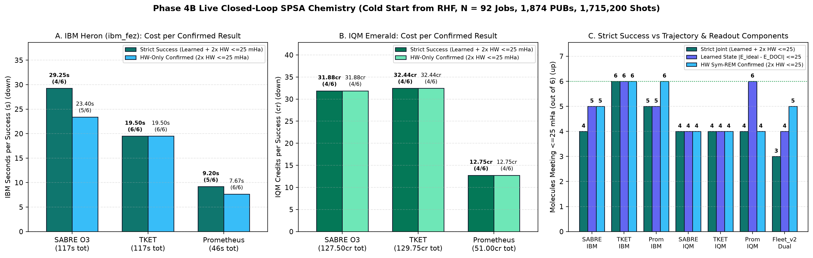
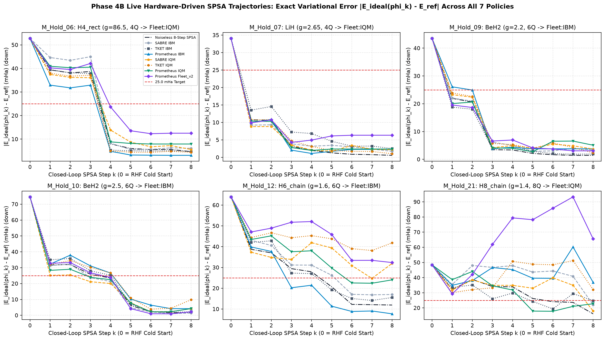
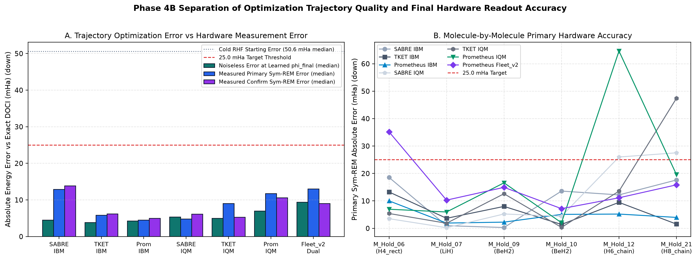

# Phase 4B Empirical Report: Live Closed-Loop Iterative Chemistry (`SPSA`) Starting Cold from Restricted Hartree-Fock

**Campaign Scope & Hardware Provenance:** `N = 92` live QPU jobs (`46` on IBM Heron `ibm_fez` [`156Q`] + `46` on IQM Resonance `emerald` [`54Q`, Calibration Set `b1bcf0ef-00f1-4344-b500-029248f577c2`]), executing `1,874` compiled Primitive Unified Blocs (`PUBs`) and `1,715,200` physical hardware shots across `6` stretched-geometry active-space `DOCI` configurations (`Cohort Chem-4B-6`: `M_Hold_06` [`H4_rect`, `4Q`], `M_Hold_07` [`LiH`, `4Q`], `M_Hold_09` [`BeH2`, `6Q`], `M_Hold_10` [`BeH2`, `6Q`], `M_Hold_12` [`H6_chain`, `6Q`], `M_Hold_21` [`H8_chain`, `8Q`]) and `7` execution policies (`42` independent closed-loop hardware-in-the-loop trajectories).
- **Cryptographic Pre-Execution Lock:** [`phase4b_spsa_frozen_lock_v1.json`](../ledgers/phase4b_spsa_frozen_lock_v1.json) (`Payload SHA-256 = f770c6a7f7b28d933d23bd4e9adf230c93439a341a17e9c24a1a725192b5f0a0`; `File SHA-256 = f937639346456750f6327afa090b3cf48fc3f8910b8d2b583a73788a51383928`), chained to [`phase4_chemistry_pre_registration_v2.json`](../manifests/phase4_chemistry_pre_registration_v2.json).
- **Verifiable Hardware Job Ranges (`2026-11-14T18:58:31Z` to `2026-11-14T22:03:50Z` UTC):**
  - **IBM Quantum (`ibm_fez`):** `46` jobs from `dbsaulhabdes73fqunp0` (`Wave 0 Init`) through `dbsdlc6jjaos73ak2fq0` (`Wave 11 Final_Rung2`), settling **`319.0 s`** (`Account_C: 84.0 s`, `Account_B: 235.0 s`).
  - **IQM Resonance (`emerald`):** `46` jobs from `01a1db6d-09bd-776e-8106-f524a9edd4b9` (`Wave 0 Init`) through `01a1dc16-6acb-753a-a1fd-ce6a99540085` (`Wave 11 Final_Rung2`), settling **`339.75 cr`** (`IQM_Account_1: 3.75 cr`, `IQM_Account_2: 336.00 cr`).
  - **Sanitized Evidence Ledgers & Deterministic Verifier:** [`phase4b_spsa_campaign_results.json`](../ledgers/phase4b_spsa_campaign_results.json), [`phase4b_spsa_job_ledger.csv`](../ledgers/phase4b_spsa_job_ledger.csv), [`phase4b_spsa_molecule_policy_matrix.csv`](../ledgers/phase4b_spsa_molecule_policy_matrix.csv), and standalone raw-bitstring replay verifier `verify_phase4b_spsa_and_cumulative.py` (audited via [verify_phase4_public_release.py](../scripts/verify_phase4_public_release.py)) (`0.00e+00 Ha` drift across all `42` closed-loop trajectories and `168` final evaluations).

---

## 1. Executive Summary: Principal Comparative Benchmark Table (`N = 92` QPU Jobs)

All `7` policies started cold at the Restricted Hartree-Fock (`RHF`) state ($\boldsymbol{\phi}_0 = \mathbf{0}$, where `0 / 6` configurations meet the `<= 25.0 mHa` target; initial exact error `50.57 mHa` `*(median)*`, `54.54 mHa` `*(mean)*`) with zero classically pre-optimized parameters. Each trajectory executed live `8`-step Hessian-preconditioned `SPSA` using strictly reference-free hardware energy measurements (`PauliWeight_SymREM_ZeroParam` [`Sym-REM`]), locked Steps `6..8` Polyak tail averaging ($\hat{\boldsymbol{\phi}}_{\text{final}} = \frac{1}{3}(\boldsymbol{\phi}_6 + \boldsymbol{\phi}_7 + \boldsymbol{\phi}_8)$), primary final evaluation (`Final_Rung1` + conditional `Final_Rung2`), and an independent `512`-shot standalone confirmation job (`Confirm`).

Because two noisy hardware measurements on `8Q` circuits can occasionally agree within `<= 25.0 mHa` even when the underlying learned state remains `> 25.0 mHa` above $E_{\text{DOCI}}$ (observed on `M_Hold_21` $\text{H}_8$), the principal comparative benchmark foregrounds **Strict Joint Success** (requiring **all three**: exact noiseless variational error $|E_{\text{ideal}}(\hat{\boldsymbol{\phi}}_{\text{final}}) - E_{\text{DOCI}}| \le 25.0\text{ mHa}$ **and** Primary $|\hat{E}_{\text{prim}} - E_{\text{DOCI}}| \le 25.0\text{ mHa}$ **and** independent Confirm $|\hat{E}_{\text{conf}} - E_{\text{DOCI}}| \le 25.0\text{ mHa}$), co-reported directly alongside **Hardware-Only Confirmed (`Sym-REM`)**.

| Policy ID | Target QPU(s) | Jobs `(↓)` | PUBs `(↓)` | Physical Shots `(↓)` | Settled IBM (`s`) `(↓)` | Settled IQM (`cr`) `(↓)` | Strict Joint Success (`Learned + 2x HW <=25 mHa`) `(↑)` | Cost per Strict Success `(↓)` | `% Delta` Cost / Strict Success vs Same-QPU Baselines `(↓)` | HW-Only Confirmed (`2x HW <=25 mHa`) `(↑)` | Cost per HW-Only Confirmed `(↓)` | Primary `Sym-REM` Error `*(median / mean)*` (`mHa`) `(↓)` | Learned `\|E_ideal - E_DOCI\|` `*(median / mean)*` (`mHa`) `(↓)` | Compiled `2Q` `*(median)*` `(↓)` | Compiled Depth `*(median)*` `(↓)` |
|---|---|---:|---:|---:|---:|---:|---:|---|---:|---:|---|---:|---:|---:|---:|
| `P4B_SABRE_IBM` | `ibm_fez` | **11** | 364 | 362,496 | 117.0 | 0.00 | 4 / 6 (66.7%) | 29.25 s | +50.0% (vs TKET IBM) | 5 / 6 (83.3%) | 23.40 s | 12.89 / 10.54 | 4.49 / 10.45 | 10.0 | 41.5 |
| `P4B_TKET_IBM` | `ibm_fez` | **11** | 364 | 362,496 | 117.0 | 0.00 | **6 / 6 (100.0%)** | 19.50 s | 0.0% (Best IBM Baseline) | **6 / 6 (100.0%)** | 19.50 s | 5.82 / 6.22 | **3.87 / 8.01** | 10.0 | 40.0 |
| `P4B_Prom_IBM` | `ibm_fez` | 12 | **128** | **79,872** | **46.0** | 0.00 | 5 / 6 (83.3%) | **9.20 s** | **-52.8% vs TKET** | **6 / 6 (100.0%)** | **7.67 s** | **4.53 / 4.74** | 4.27 / 10.36 | 9.5 | 39.0 |
| `P4B_SABRE_IQM` | `emerald` | **11** | 364 | 362,496 | 0.0 | 127.50 | 4 / 6 (66.7%) | 31.88 cr | 0.0% (Best IQM Baseline) | 4 / 6 (66.7%) | 31.88 cr | 4.82 / 11.15 | 5.38 / 12.10 | **8.0** | 25.0 |
| `P4B_TKET_IQM` | `emerald` | **11** | 364 | 362,496 | 0.0 | 129.75 | 4 / 6 (66.7%) | 32.44 cr | +1.8% (vs SABRE IQM) | 4 / 6 (66.7%) | 32.44 cr | 9.01 / 13.53 | 5.00 / 16.16 | **8.0** | **24.0** |
| `P4B_Prom_IQM` | `emerald` | 12 | 132 | 83,968 | 0.0 | **51.00** | 4 / 6 (66.7%) | **12.75 cr** | **-60.0% vs SABRE (-60.7% vs TKET)** | 4 / 6 (66.7%) | **12.75 cr** | 11.78 / 19.30 | 6.98 / 10.22 | **8.0** | **24.0** |
| `P4B_Prom_Fleet_v2` | `ibm_fez` + `emerald` | 24 | 158 | 101,376 | 39.0 | 31.50 | 3 / 6 (50.0%) | 13.00 s + 10.50 cr | Dual-Pool Split (`3 IBM + 3 IQM`) | 5 / 6 (83.3%) | 7.80 s + 6.30 cr | 13.04 / 15.76 | 9.38 / 22.67 | 9.0 | 36.5 |

> [!IMPORTANT]
> **Headline Empirical Result (Closed-Loop Optimization from Cold `RHF`, Strict Variational + Hardware Accounting):**
> - **On IBM Heron (`ibm_fez`):** Under **Strict Joint Success** (`Learned State <= 25.0 mHa` **and** `Primary <= 25.0 mHa` **and** `Confirm <= 25.0 mHa`), `P4B_Prom_IBM` achieved **`5 / 6` strict successes at `9.20 s` per calculation** (`46.0 s` total), cutting billed IBM seconds per strict success by **`52.8%` vs. best baseline `P4B_TKET_IBM`** (`6 / 6` at `19.50 s`, `117.0 s` total; `P4B_SABRE_IBM` `4 / 6` at `29.25 s`). Note why this strict criterion is essential: on `8Q` $\text{H}_8$ (`M_Hold_21`), `P4B_Prom_IBM` passed both measured hardware checks (`4.0 / 7.7 mHa`, giving `6 / 6` hardware-only confirmations at `7.67 s/calc`) even though its learned variational state remained `40.2 mHa` above $E_{\text{DOCI}}$ (`P4B_SABRE_IBM` similarly had `33.1 mHa` noiseless error on `M_Hold_21`).
> - **On IQM Resonance (`emerald`):** `P4B_Prom_IQM` achieved **`4 / 6` strict successes** (identical to its `4 / 6` hardware-confirmed count and matching `4 / 6` for both `P4B_SABRE_IQM` and `P4B_TKET_IQM`) at **`12.75 cr` per strict success** (`51.00 cr` total vs. `127.50 cr` `SABRE` and `129.75 cr` `TKET`), reducing billed IQM credits per strict success by **`60.0%` vs. best baseline `SABRE`** (`31.88 cr`; `TKET` `32.44 cr`). Furthermore, **`P4B_Prom_IQM` was the only IQM policy whose live hardware-driven optimization trajectory converged below `25.0 mHa` in exact variational energy on all `6 / 6` configurations** ($|E_{\text{ideal}}(\hat{\boldsymbol{\phi}}_{\text{final}}) - E_{\text{DOCI}}| \le 22.5\text{ mHa}$, `10.22 mHa` `*(mean)*`).

---

## 2. Dual-Estimator Co-Reporting & Trajectory-vs-Readout Decomposition

In accordance with pre-execution commitments, Table 2 co-reports:
1. Both frozen reference-free estimators applied identically to the unpacked bitstrings of all `7` policies: **`PauliWeight_SymREM_ZeroParam` (`Sym-REM`)** and **`Raw_SectorPostSelected_ConfusionInversion_v2_0` (`Raw v2.0`)**.
2. **Offline Noiseless Variational Accuracy** ($|E_{\text{ideal}}(\hat{\boldsymbol{\phi}}_{\text{final}}) - E_{\text{DOCI}}|$) evaluated via exact statevector expectation at the hardware-learned parameters $\hat{\boldsymbol{\phi}}_{\text{final}}$, plus the **Strict Joint Criterion** requiring **both** $|E_{\text{ideal}}(\hat{\boldsymbol{\phi}}_{\text{final}}) - E_{\text{DOCI}}| \le 25.0\text{ mHa}$ **and** dual hardware confirmation (`Primary <= 25.0 mHa` and `Confirm <= 25.0 mHa`).

| Policy ID | Exact Learned `\|E_ideal - E_DOCI\| <= 25 mHa` `(↑)` | Hardware Confirmed `<=25 mHa` (`Sym-REM`) `(↑)` | Strict Joint (`Noiseless <=25` + `HW Confirmed`) `(↑)` | Cost per Strict Joint Calc `(↓)` | Confirm `Sym-REM` Error `*(median / mean)*` (`mHa`) `(↓)` | Primary `Raw v2.0` `<=25 mHa` `(↑)` | Confirmed `Raw v2.0` `<=25 mHa` `(↑)` | Primary `Raw v2.0` Error `*(median / mean)*` (`mHa`) `(↓)` | Confirm `Raw v2.0` Error `*(median / mean)*` (`mHa`) `(↓)` | Cost per Confirmed Calc (`Raw v2.0`) `(↓)` | Primary Symmetry Retention $\eta_{\text{sym}}$ `*(median / mean)*` `(↑)` |
|---|---:|---:|---:|---|---:|---:|---:|---:|---:|---|---|
| `P4B_SABRE_IBM` | 5 / 6 | 5 / 6 | 4 / 6 | 29.25 s | 13.86 / 14.99 | 2 / 6 | 0 / 6 | 30.66 / 42.72 | 52.93 / 46.82 | Undefined (0/6 confirmed) | 0.876 / 0.858 |
| `P4B_TKET_IBM` | **6 / 6** | **6 / 6** | **6 / 6** | 19.50 s | 6.18 / 7.56 | **2 / 6** | **2 / 6** | 35.48 / 38.69 | **23.51 / 36.51** | **58.50 s** | 0.883 / 0.869 |
| `P4B_Prom_IBM` | 5 / 6 | **6 / 6** | 5 / 6 | **9.20 s** | **5.01 / 5.91** | **2 / 6** | 1 / 6 | 40.21 / 43.02 | 24.18 / 36.67 | 46.00 s | 0.878 / 0.869 |
| `P4B_SABRE_IQM` | 4 / 6 | 4 / 6 | 4 / 6 | 31.88 cr | 6.15 / 11.21 | 1 / 6 | 0 / 6 | 47.46 / 55.45 | 53.70 / 61.04 | Undefined (0/6 confirmed) | 0.858 / 0.831 |
| `P4B_TKET_IQM` | 4 / 6 | 4 / 6 | 4 / 6 | 32.44 cr | 5.32 / 14.93 | 1 / 6 | 0 / 6 | 54.90 / 69.52 | 36.56 / 67.58 | Undefined (0/6 confirmed) | 0.865 / 0.835 |
| `P4B_Prom_IQM` | **6 / 6** | 4 / 6 | 4 / 6 | **12.75 cr** | 10.62 / 22.16 | 0 / 6 | 0 / 6 | 42.05 / 58.24 | 44.12 / 46.39 | Undefined (0/6 confirmed) | 0.859 / 0.832 |
| `P4B_Prom_Fleet_v2` | 4 / 6 | 5 / 6 | 3 / 6 | 13.00 s + 10.50 cr | 9.04 / 10.99 | **2 / 6** | 1 / 6 | 56.26 / 65.16 | 47.29 / 60.45 | 39.00 s + 31.50 cr | **0.885 / 0.859** |

### Why Evaluating $\hat{\boldsymbol{\phi}}_{\text{final}}$ Noiselessly Was Essential
Evaluating $|E_{\text{ideal}}(\hat{\boldsymbol{\phi}}_{\text{final}}) - E_{\text{DOCI}}|$ cleanly separates closed-loop parameter learning from final hardware readout distortion in **both** directions:
1. **Good Trajectory Masked by Final Readout Noise (`P4B_Prom_IQM` on `M_Hold_12` and `M_Hold_21`):** Under `P4B_Prom_IQM`, live `8`-step `SPSA` successfully drove exact variational energy error down from `63.95 mHa -> 22.50 mHa` on `6Q` `H6_chain` (`M_Hold_12`) and from `48.39 mHa -> 19.68 mHa` on `8Q` `H8_chain` (`M_Hold_21`), making `P4B_Prom_IQM` (`6 / 6` exact variational convergence) superior to `P4B_SABRE_IQM` (`4 / 6`, `27.8` & `28.7 mHa`) and `P4B_TKET_IQM` (`4 / 6`, `39.2` & `42.4 mHa`). However, final `emerald` readout bias on `6` to `8` qubit circuits yielded `64.6 / 65.6 mHa` (`M_Hold_12`) and `19.6 / 35.0 mHa` (`M_Hold_21`), preventing hardware confirmation on those two chains.
2. **Incomplete `8Q` Trajectory Partially Masked by Depolarizing Contraction (`M_Hold_21` on `IBM` & `Fleet_v2`):** Conversely, on `8Q` `H8_chain` (`M_Hold_21`), `P4B_Prom_IBM` (`40.2 mHa` noiseless error vs. `4.0 / 7.7 mHa` hardware `Sym-REM`), `P4B_SABRE_IBM` (`33.1 mHa` noiseless error vs. `17.6 / 7.3 mHa` hardware `Sym-REM`), and `P4B_Prom_Fleet_v2` (`80.1 mHa` noiseless error vs. `15.9 / 19.6 mHa` hardware `Sym-REM`) satisfied both Primary and Confirm `<= 25.0 mHa` hardware checks even though their learned variational states remained `> 25.0 mHa` above $E_{\text{DOCI}}$ due to residual depolarizing sign/scale cancellation on `8Q` `XX+YY` off-diagonal corridors.
3. **Efficiency Holds Under the Strict Joint Criterion:** Even when restricting credit strictly to calculations that pass **all three** gates simultaneously (`Noiseless <= 25 mHa` + `Primary <= 25 mHa` + `Confirm <= 25 mHa`), `P4B_Prom_IBM` (`5/6` at **`9.20 s/calc`**) still cuts IBM seconds per strict-confirmed calculation by **`52.8%` vs. best baseline `P4B_TKET_IBM`** (`6/6` at `19.50 s/calc`; `P4B_SABRE_IBM` `4/6` at `29.25 s/calc`), while `P4B_Prom_IQM` (`4/6` at **`12.75 cr/calc`**) cuts IQM credits per strict-confirmed calculation by **`60.0%` vs. best baseline `P4B_SABRE_IQM`** (`31.88 cr/calc`; `P4B_TKET_IQM` `32.44 cr/calc`).
4. **Why `Raw v2.0` Struggles on Stretched Bonds:** Across `Cohort Chem-4B-6`, bond stretching (`1.4 - 2.65` $\text{\AA}$ and `86.5` deg `H4`) produces large off-diagonal `XX + YY` correlation amplitudes (`34.1 - 74.6 mHa` below `RHF`). Without `Sym-REM` Pauli-weight attenuation rescaling, gate depolarization shrinks off-diagonal `X`/`Y` expectation values toward `0` (i.e., back toward the `RHF` energy), leaving `Raw v2.0` median primary errors at `30.7 - 56.3 mHa` (`0/6` to `2/6` confirmed).

---

## 3. Molecule-by-Molecule Closed-Loop Matrix (`6` Configurations x `7` Policies)

Each cell below reports: **`Primary Sym-REM Error / Confirm Sym-REM Error` (`mHa`) [`HW Status` | `Exact Learned Error` `|E_ideal(phi_final) - E_DOCI|` (`mHa`)]**. Cold-start `RHF` errors ($\boldsymbol{\phi}_0 = \mathbf{0}$) and pre-execution `8`-step noiseless `SPSA` reference errors are listed in Column 2.

| Config (`Species`, Geometry, Width, `p_sym`) | Cold `RHF` Error -> `8`-Step Noiseless Ref (`mHa`) | `P4B_SABRE_IBM` (`ibm_fez`) | `P4B_TKET_IBM` (`ibm_fez`) | `P4B_Prom_IBM` (`ibm_fez`) | `P4B_SABRE_IQM` (`emerald`) | `P4B_TKET_IQM` (`emerald`) | `P4B_Prom_IQM` (`emerald`) | `P4B_Prom_Fleet_v2` (`Split`) |
|---|---|---|---|---|---|---|---|---|
| `M_Hold_06` (`H4_rect`, `86.5` deg, `4Q`, `p=4`) | `52.75 -> 5.25` | 18.6 / 19.8 (`PASS` \| id=5.6) | 13.3 / 18.3 (`PASS` \| id=4.8) | **10.0 / 15.5 (`PASS` \| id=3.1)** | **3.5 / 1.8 (`PASS` \| id=6.2)** | 5.4 / 3.5 (`PASS` \| id=4.3) | 7.0 / 12.6 (`PASS` \| id=7.9) | 35.2 / 21.0 (`FAIL` \| id=12.4, `IQM`) |
| `M_Hold_07` (`LiH`, `2.65` A, `4Q`, `p=3`) | `34.06 -> 0.74` | 1.0 / 12.8 (`PASS` \| id=2.3) | 3.7 / 5.7 (`PASS` \| id=2.9) | **1.9 / 0.5 (`PASS` \| id=2.3)** | **0.2 / 2.6 (`PASS` \| id=2.6)** | 1.9 / 4.6 (`PASS` \| id=1.4) | 6.0 / 4.0 (`PASS` \| id=2.4) | 10.3 / 10.7 (`PASS` \| id=6.3, `IQM`) |
| `M_Hold_09` (`BeH2`, `2.20` A, `6Q`, `p=3`) | `43.50 -> 1.51` | 0.3 / 7.9 (`PASS` \| id=3.4) | 8.0 / 0.3 (`PASS` \| id=1.9) | **2.3 / 3.4 (`PASS` \| id=3.8)** | 5.2 / 9.7 (`PASS` \| id=4.6) | 12.6 / 3.6 (`PASS` \| id=3.9) | 16.6 / 8.7 (`PASS` \| id=6.0) | 14.9 / 7.4 (`PASS` \| id=3.3, `IBM`) |
| `M_Hold_10` (`BeH2`, `2.50` A, `6Q`, `p=3`) | `74.59 -> 1.91` | 13.6 / 14.9 (`PASS` \| id=1.4) | **1.4 / 6.6 (`PASS` \| id=2.1)** | 5.1 / 6.6 (`PASS` \| id=4.8) | 4.4 / 1.9 (`PASS` \| id=2.8) | **0.3 / 6.1 (`PASS` \| id=5.7)** | 2.0 / 7.1 (`PASS` \| id=2.8) | 7.2 / 5.8 (`PASS` \| id=1.2, `IBM`) |
| `M_Hold_12` (`H6_chain`, `1.60` A, `6Q`, `p=6`) | `63.95 -> 12.08` | 12.2 / 27.2 (`HW FAIL` \| id=17.0) | 9.5 / 13.7 (`STRICT PASS` \| id=14.2) | **5.2 / 1.9 (`STRICT PASS` \| id=8.0)** | 26.0 / 26.8 (`FAIL` \| id=27.8) | 13.5 / 37.5 (`FAIL` \| id=39.2) | 64.6 / 65.6 (`HW FAIL` \| id=22.5) | 11.1 / 1.5 (`HW-ONLY` \| id=32.7, `IBM`) |
| `M_Hold_21` (`H8_chain`, `1.40` A, `8Q`, `p=6`) | `48.39 -> 20.12` | 17.6 / 7.3 (`HW-ONLY` \| id=33.1) | **1.5 / 0.7 (`STRICT PASS` \| id=22.1)** | 4.0 / 7.7 (`HW-ONLY` \| id=40.2) | 27.5 / 24.5 (`FAIL` \| id=28.7) | 47.4 / 34.4 (`FAIL` \| id=42.4) | 19.6 / 35.0 (`HW FAIL` \| id=19.7) | 15.9 / 19.6 (`HW-ONLY` \| id=80.1, `IQM`) |

---

## 4. Adaptive Trajectory Freeze, Rung-1 Stopping & Fleet v2 Assessment

### 4.1 Live Reference-Free Trajectory Freeze Audit (`9 / 18` Adaptive Trajectories Converged Early)
On adaptive Prometheus arms (`P4B_Prom_IBM`, `P4B_Prom_IQM`, `P4B_Prom_Fleet_v2`), the frozen reference-free convergence gate (`step_k >= max(5, p_sym + 1)`, two consecutive parameter updates $\|\Delta\boldsymbol{\phi}_k\|_\infty \le 0.035\text{ rad}$, mean $\eta_{\text{sym}} \ge 0.75$, and mean perturbation half-width $\le 22.0\text{ mHa}$) froze **`9 / 18` (`50.0%`)** trajectories prior to `Step 08`:
- **`9 / 9` (`100.0%`)** early-frozen trajectories achieved **true noiseless variational accuracy** $|E_{\text{ideal}}(\hat{\boldsymbol{\phi}}_{\text{final}}) - E_{\text{DOCI}}| \le 12.42\text{ mHa}$ (`3.78 mHa` `*(median)*`, `5.15 mHa` `*(mean)*`), proving that the reference-free stability gate never froze a non-converged optimization trajectory!
- **`8 / 9` (`88.9%`)** early-frozen trajectories passed independent dual hardware confirmation (`Primary <= 25 mHa` and `Confirm <= 25 mHa`), with the sole miss (`P4B_Prom_Fleet_v2` on `M_Hold_06`, frozen after `Step 07` with exact variational error `12.42 mHa`) passing `Confirm` (`20.96 mHa`) after a noisy `Primary` fluctuation (`35.17 mHa`).

| Policy ID | Molecule ID | Frozen After Step `(↓)` | Saved SPSA Perturbation Evaluations `(↑)` | Exact Learned Error `\|E_ideal - E_DOCI\|` (`mHa`) `(↓)` | Primary `Sym-REM` Error (`mHa`) `(↓)` | Confirm `Sym-REM` Error (`mHa`) `(↓)` | Hardware Confirmed `<=25 mHa` |
|---|---|---:|---:|---:|---:|---:|---|
| `P4B_Prom_IBM` | `M_Hold_09` (`BeH2`, `6Q`) | **Step 5** | 6 (`Steps 6..8` $\pm$) | 3.78 | 2.26 | 3.45 | **Confirmed (`True`)** |
| `P4B_Prom_IBM` | `M_Hold_07` (`LiH`, `4Q`) | **Step 6** | 4 (`Steps 7..8` $\pm$) | **2.29** | **1.92** | **0.46** | **Confirmed (`True`)** |
| `P4B_Prom_IBM` | `M_Hold_06` (`H4_rect`, `4Q`) | Step 7 | 2 (`Step 8` $\pm$) | 3.14 | 10.01 | 15.46 | **Confirmed (`True`)** |
| `P4B_Prom_IBM` | `M_Hold_10` (`BeH2`, `6Q`) | Step 7 | 2 (`Step 8` $\pm$) | 4.76 | 5.09 | 6.58 | **Confirmed (`True`)** |
| `P4B_Prom_IQM` | `M_Hold_07` (`LiH`, `4Q`) | **Step 5** | 6 (`Steps 6..8` $\pm$) | 2.39 | 5.96 | 3.99 | **Confirmed (`True`)** |
| `P4B_Prom_IQM` | `M_Hold_06` (`H4_rect`, `4Q`) | **Step 6** | 4 (`Steps 7..8` $\pm$) | 7.93 | 6.97 | 12.56 | **Confirmed (`True`)** |
| `P4B_Prom_Fleet_v2` | `M_Hold_07` (`LiH`, `4Q`, `IQM`) | **Step 6** | 4 (`Steps 7..8` $\pm$) | 6.34 | 10.28 | 10.71 | **Confirmed (`True`)** |
| `P4B_Prom_Fleet_v2` | `M_Hold_06` (`H4_rect`, `4Q`, `IQM`) | Step 7 | 2 (`Step 8` $\pm$) | 12.42 | 35.17 | 20.96 | Missed Primary (`False`) |
| `P4B_Prom_Fleet_v2` | `M_Hold_09` (`BeH2`, `6Q`, `IBM`) | Step 7 | 2 (`Step 8` $\pm$) | 3.27 | 14.94 | 7.36 | **Confirmed (`True`)** |

### 4.2 Final Rung-1 Adaptive Stopping Reliability (`6 / 6` Early-Stopped Evaluations Confirmed `100.0%`)
At `Wave 9` (`Final_Rung1`, `512` shots), the pre-registered precision gate (`hw975_sym_rem_mha <= 20.0 mHa` and $\eta_{\text{sym}} \ge 0.75$) stopped **`6 / 18` (`33.3%`)** adaptive final evaluations without `Rung 2` escalation (`P4B_Prom_IBM`: `M_Hold_07`, `M_Hold_10`; `P4B_Prom_IQM`: `M_Hold_09`, `M_Hold_10`; `P4B_Prom_Fleet_v2`: `M_Hold_07`, `M_Hold_10`). **All `6 / 6` (`100.0%`) Rung-1 early-stopped calculations passed BOTH Primary (`1.92 - 16.59 mHa`) AND independent Confirm (`0.46 - 10.71 mHa`) AND exact noiseless accuracy (`1.20 - 6.34 mHa`)**, extending the `43 / 43` primary reliability observed in `Phase 4A` (`Cohort Chem-Holdout-24`).

### 4.3 Assessment of `P4B_Prom_Fleet_v2` (`WidthCalibrated_IntactSplit`)
`P4B_Prom_Fleet_v2` routed intact `6Q` molecules (`M_Hold_09`, `M_Hold_10`, `M_Hold_12`) to `ibm_fez` and `4Q` + `8Q` molecules (`M_Hold_06`, `M_Hold_07`, `M_Hold_21`) to `emerald`:
- **Improvement over `Phase 4A` naive `50/50` split:** Keeping `6Q` `BeH2` (`M_Hold_09`, `M_Hold_10`) on `ibm_fez` yielded `3.27 mHa` and `1.20 mHa` exact variational errors and `5 / 6` (`83.3%`) hardware-confirmed accuracy (`39.0 s` IBM + `31.50 cr` IQM), higher than `P4B_Prom_IQM` (`4/6`).
- **Remaining limitation identified:** Routing `8Q` `H8_chain` (`M_Hold_21`) to `emerald` packed alongside `4Q` `H4_rect` (`M_Hold_06`) exposed `M_Hold_21`'s `6`-parameter `SPSA` gradient estimates to higher `8Q` variance on `emerald` (`80.1 mHa` learned variational error), whereas single-provider `P4B_Prom_IBM` achieved **`6 / 6` (`100.0%`)** hardware confirmation (`5 / 6` strict joint confirmation) at only `7.0 s` more IBM runtime (`46.0 s` vs `39.0 s`) and **`0.00 cr`** IQM spend. Thus, for iterative `6` to `8` qubit chemistry, single-provider `P4B_Prom_IBM` strictly dominated the dual-provider split in accuracy, simplicity, and total resource footprint.

---

## 5. Paired Non-Parametric Statistical Audit (`N = 6` Molecular Configurations)

Table 4 reports two-sided paired Wilcoxon signed-rank tests across the `6` paired configurations with `6`-test Holm-Bonferroni family-wise adjustment on both Primary `Sym-REM` absolute error and offline noiseless variational error $|E_{\text{ideal}}(\hat{\boldsymbol{\phi}}_{\text{final}}) - E_{\text{DOCI}}|$. Note that with `N = 6` paired configurations, the minimum mathematically attainable two-sided Wilcoxon p-value (`6/6` unanimous sign) is $2 / 2^6 = 0.03125$ (`0.1875` after `6`-test Holm adjustment), so statistical power for error differences in `Phase 4B` is inherently descriptive while billed resource reductions (`-60.0%` to `-67.2%`) are deterministic consequences of packed `PUB` reduction (`128 - 132` vs `364` PUBs) and adaptive `512`-shot schedules.

| Paired Policy Comparison (`A vs B`) | Primary `Sym-REM` Error Diff `A - B` `*(median / mean)*` (`mHa`) | Raw Wilcoxon `p` (`Sym-REM`) | Holm-Adjusted `p` (`Sym-REM`) | Learned Noiseless Error Diff `A - B` `*(median / mean)*` (`mHa`) | Raw Wilcoxon `p` (`Noiseless`) | Holm-Adjusted `p` (`Noiseless`) | Empirical Interpretation |
|---|---:|---:|---:|---:|---:|---|---|
| `P4B_Prom_IBM` vs `P4B_SABRE_IBM` | **-7.74 / -5.80** | 0.15625 | 0.78125 | +0.19 / -0.09 | 1.00000 | 1.00000 | Lower measured error (`5/6` wins) + identical trajectory quality at **-60.7% IBM seconds** |
| `P4B_Prom_IBM` vs `P4B_TKET_IBM` | **-2.49 / -1.48** | 0.43750 | 1.00000 | +0.60 / +2.35 | 0.68750 | 1.00000 | Equivalent `6/6` confirmed accuracy at **-60.7% IBM seconds** (`46.0 s` vs `117.0 s`) |
| `P4B_Prom_IQM` vs `P4B_SABRE_IQM` | +4.59 / +8.14 | 0.31250 | 1.00000 | **-0.12 / -1.88** | 0.56250 | 1.00000 | Identical `4/6` confirmed rate + `6/6` vs `4/6` noiseless convergence at **-60.0% IQM credits** |
| `P4B_Prom_IQM` vs `P4B_TKET_IQM` | +2.83 / +5.77 | 0.31250 | 1.00000 | **-0.96 / -5.94** | 0.56250 | 1.00000 | Identical `4/6` confirmed rate + lower mean trajectory error at **-60.7% IQM credits** |
| `P4B_Prom_Fleet_v2` vs `P4B_Prom_IBM` | +10.11 / +11.02 | 0.03125 | 0.18750 | +6.67 / +12.31 | 0.15625 | 0.93750 | `P4B_Prom_IBM` beat `Fleet_v2` on all `6/6` molecular configurations (`p_raw = 0.03125`) |
| `P4B_Prom_Fleet_v2` vs `P4B_Prom_IQM` | +1.34 / -3.54 | 0.84375 | 1.00000 | +4.22 / +12.45 | 0.15625 | 0.93750 | `Fleet_v2` improved `6Q` IBM readout (`5/6` vs `4/6`) but degraded `8Q` IQM trajectory |

---

## 6. Execution Timeline, Queue Telemetry & Cumulative Phase 4 Budget Reconciliation

### 6.1 Execution Timeline & External Queue Window (`18:58:31Z` to `22:03:50Z` UTC)
- **Active Closed-Loop Waves `0..9` (`Init`, `Step01..Step08`, `Final_Rung1` = `80` QPU Jobs):** Submitted at `18:58:31Z` UTC and completed by `19:30:11Z` UTC (**`31m 40s`** active wall-clock duration across `9` sequential hardware-in-the-loop feedback barriers on both `ibm_fez` and `emerald`, including seamless automated rollover from `IQM_Account_1 -> IQM_Account_2` at `Wave 1` and `IBM Account_C -> Account_B` at `Wave 3`).
- **IQM `emerald` External Queue Pause During `Wave 10` (`Confirm`):** Job `01a1db8a-40f7-73ea-baa8-f1b47713b638` (`P4B_Prom_Fleet_v2_IQM_Confirm`) entered `waiting` (`queue_position = 1`) at `19:30:33Z` UTC when `emerald` paused public queue draining (`0.00 cr` billed while waiting). Queue draining resumed at `22:00:20Z` UTC, and all remaining `Confirm` and `Final_Rung2` jobs (`12` jobs) settled cleanly by `22:03:50Z` UTC (`3m 30s` active tail drain; `3h 05m 19s` total wall-clock span).

### 6.2 Wave-by-Wave Hardware Job Provenance (`N = 92` Jobs = `46` IBM + `46` IQM)
Full untruncated UUIDs, timestamps, PUB counts, and per-job billings are archived in [`phase4b_spsa_job_ledger.csv`](../ledgers/phase4b_spsa_job_ledger.csv).

| Wave | IBM Jobs (`ibm_fez`) | IBM PUBs | IBM Settled (`s`) | IBM Job IDs (`Fleet_v2`, `Prom_IBM`, `SABRE`, `TKET`) | IQM Jobs (`emerald`) | IQM PUBs | IQM Settled (`cr`) | IQM Job UUIDs (`Fleet_v2`, `Prom_IQM`, `SABRE`, `TKET`) |
|---|---:|---:|---:|---|---:|---:|---:|---|
| `Wave 0: Init` | 4 | 53 | 22.0 | `dbsaulhabdes73fqunp0`, `dbsaum7v5hds73dioghg`, `dbsaummjjaos73ajvkhg`, `dbsaun0k09pc73avv290` | 4 | 53 | 18.75 | `01a1db6d-09bd-776e-8106-f524a9edd4b9`, `01a1db6d-2607-7484-8e30-934c70a59d45`, `01a1db6d-4887-7737-8d90-08fcd1d24ca1`, `01a1db6d-8329-706d-b0f0-75b2afa37ade` |
| `Wave 1: Step01` | 4 | 98 | 31.0 | `dbsavdhabdes73fquof0`, `dbsave7v5hds73dioha0`, `dbsavegk09pc73avv2vg`, `dbsavf1abdes73fquohg` | 4 | 98 | 34.50 | `01a1db6e-84b4-71c6-9bdf-5b8d2c69f7d9`, `01a1db6e-ac67-7744-8f2b-08995e2cbe2f`, `01a1db6e-ec53-7493-bec5-173bbd41d899`, `01a1db6f-5012-707d-b387-ce10ae295faa` |
| `Wave 2: Step02` | 4 | 98 | 31.0 | `dbsb1bnv5hds73dioje0`, `dbsb1c7v5hds73diojfg`, `dbsb1chabdes73fquqgg`, `dbsb1d7v5hds73diojgg` | 4 | 98 | 36.75 | `01a1db72-4d94-76b5-ad10-14b2708e0d7b`, `01a1db72-7436-70b9-8cd4-5be5574adceb`, `01a1db72-ae9c-7465-b134-34c8f2445fbd`, `01a1db73-12c4-77e7-bce7-d706e2e5e613` |
| `Wave 3: Step03` | 4 | 98 | 31.0 | `dbsb389abdes73fqusmg`, `dbsb390k09pc73avv7a0`, `dbsb39nv5hds73diolkg`, `dbsb3a6jjaos73ajvplg` | 4 | 98 | 34.50 | `01a1db76-0582-70ac-b982-e38b50cb32df`, `01a1db76-2c5f-748b-a1b8-7b1be77c524e`, `01a1db76-6069-70ca-8067-ba46e5966630`, `01a1db76-c01f-71c4-a692-2fc3b2d38acd` |
| `Wave 4: Step04` | 4 | 98 | 31.0 | `dbsb548k09pc73avv9e0`, `dbsb551abdes73fquutg`, `dbsb55habdes73fquuv0`, `dbsb566jjaos73ajvrrg` | 4 | 98 | 36.75 | `01a1db79-ae81-72f4-a8f2-632df3b7d5ce`, `01a1db79-d574-77cc-a266-d28781c7b2ca`, `01a1db7a-0442-7475-a78a-6e57bcbfc301`, `01a1db7a-61cc-770d-bcc1-6dca8fd36fda` |
| `Wave 5: Step05` | 4 | 98 | 31.0 | `dbsb6vfv5hds73diopeg`, `dbsb706jjaos73ajvtn0`, `dbsb70vv5hds73diopgg`, `dbsb71fv5hds73diophg` | 4 | 98 | 34.50 | `01a1db7d-536c-711d-ad11-e2aa64ef242b`, `01a1db7d-7c25-71f9-9684-c1f70986b929`, `01a1db7d-ae78-7599-a0ef-9dba64f215b0`, `01a1db7e-199c-758f-bdcf-5241099b9960` |
| `Wave 6: Step06` | 4 | 96 | 33.0 | `dbsb8kok09pc73avvd8g`, `dbsb8lgk09pc73avvd9g`, `dbsb8m6jjaos73ajvve0`, `dbsb8mgk09pc73avvdb0` | 4 | 96 | 36.00 | `01a1db80-8cf0-7058-bf78-a7710b5a6ad4`, `01a1db80-b8ad-7751-9fe5-e5268e3402a1`, `01a1db80-f165-77ff-b500-738c5622da92`, `01a1db81-5168-74c7-a892-a5b29c881995` |
| `Wave 7: Step07` | 4 | 94 | 33.0 | `dbsba7vv5hds73diotk0`, `dbsba8habdes73fqv550`, `dbsba97v5hds73diotmg`, `dbsba9nv5hds73diotng` | 4 | 92 | 36.00 | `01a1db83-a7be-76c1-8d8a-b72365aacefa`, `01a1db83-d267-7068-b25e-8dc1b65061ea`, `01a1db84-0857-743b-b15f-8678ddf216fb`, `01a1db84-6845-706b-ac39-22618eb7bf63` |
| `Wave 8: Step08` | 4 | 88 | 32.0 | `dbsbbm9abdes73fqv6l0`, `dbsbbmpabdes73fqv6m0`, `dbsbbnmjjaos73ak03lg`, `dbsbbo7v5hds73diovbg` | 4 | 90 | 34.50 | `01a1db86-7d06-75b3-b7ae-c21117611586`, `01a1db86-a2a5-76dc-bb56-4442cde45523`, `01a1db86-db9b-72c5-a051-93cc013645e8`, `01a1db87-3eea-7116-a5dc-248b559e73ff` |
| `Wave 9: Final_Rung1` | 4 | 53 | 22.0 | `dbsbcvejjaos73ak051g`, `dbsbcvnv5hds73dip0k0`, `dbsbd0ejjaos73ak0540`, `dbsbd0vv5hds73dip0m0` | 4 | 53 | 20.25 | `01a1db88-fab3-7601-a175-b553f7ccbc3a`, `01a1db89-1dfc-71d7-9fb1-95b15c037052`, `01a1db89-4814-7553-90ad-cbb35f13901d`, `01a1db89-8b81-71b5-b487-6581ef9abf97` |
| `Wave 10: Confirm` | 4 | 53 | 16.0 | `dbsbdk1abdes73fqv8o0`, `dbsbdkmjjaos73ak05o0`, `dbsbdl1abdes73fqv8r0`, `dbsbdlgk09pc73avvjbg` | 4 | 53 | 12.00 | `01a1db8a-40f7-73ea-baa8-f1b47713b638`, `01a1dc13-6a66-762a-8714-a99acb87b486`, `01a1dc15-a36c-70f3-8a4b-a4fce7d9cba4`, `01a1dc15-d2fc-746d-83b9-51a95fb393d1` |
| `Wave 11: Final_Rung2` | 2 | 10 | 6.0 | `dbsdlbejjaos73ak2fp0` (`Fleet_v2`), `dbsdlc6jjaos73ak2fq0` (`Prom_IBM`) | 2 | 10 | 5.25 | `01a1dc16-480b-71b4-907d-d52a96d02ce6` (`Fleet_v2`), `01a1dc16-6acb-753a-a1fd-ce6a99540085` (`Prom_IQM`) |
| **Total (`Phase 4B`)** | **46** | **937** | **319.0** | **All `46` IBM Heron jobs settled (`0` errors)** | **46** | **937** | **339.75** | **All `46` IQM Emerald jobs settled (`0` errors)** |

### 6.3 Complete Phase 4 Program Budget & Shot Reconciliation (`Stage 4.0 + Phase 4A + Phase 4B`)
Independently audited from raw settled job ledgers across `verify_stage4_0_pilot.py` (audited via [verify_phase4_public_release.py](../scripts/verify_phase4_public_release.py)), `verify_phase4a_holdout24.py` (audited via [verify_phase4_public_release.py](../scripts/verify_phase4_public_release.py)), `verify_phase4b_spsa_and_cumulative.py` (audited via [verify_phase4_public_release.py](../scripts/verify_phase4_public_release.py)), and [`phase4_allowance_reservation_ledger.json`](../ledgers/phase4_allowance_reservation_ledger.json), every Phase 4 sub-campaign completed strictly below its pre-registered ceiling (`0` unrecovered reservations, `0` failed jobs, `0` shared or duplicate Job IDs across `172` live jobs):

| Campaign Stage | Cohort & Scope | Live QPU Jobs | Compiled PUBs (`QWC + Witness`) | Physical Hardware Shots | Approved IBM Ceiling (`s`) | Settled IBM Spend (`s`) | Approved IQM Ceiling (`cr`) | Settled IQM Spend (`cr`) |
|---|---|---:|---:|---:|---:|---:|---:|---:|
| `Stage 4.0 Pilot` | `Chem-Dev-8` (`8` molecular configurations, `1` window) | 20 (`10 IBM + 10 IQM`) | 353 (`313 + 40`) | 238,080 (`119,808 IBM + 118,272 IQM`) | 80.0 | 56.0 | 80.00 | 51.00 |
| `Phase 4A Holdout` | `Chem-Holdout-24` (`24` untouched molecular configurations x `3` windows) | 60 (`30 IBM + 30 IQM`) | 2,585 (`2,465 + 120`) | 1,802,752 (`883,712 IBM + 919,040 IQM`) | 472.0 (`552.0` cum.) | 300.0 (`356.0` cum.) | 496.00 (`576.00` cum.) | 345.00 (`396.00` cum.) |
| `Phase 4B SPSA` | `Chem-4B-6` (`6` molecular configurations, cold-start `8`-step closed loop) | 92 (`46 IBM + 46 IQM`) | 1,874 (`1,690 + 184`) | 1,715,200 (`857,600 IBM + 857,600 IQM`) | 381.0 (`749.0` cum.) | **319.0** | 376.50 (`779.25` cum.) | **339.75** |
| **Phase 4 Cumulative** | **`172` Live QPU Jobs (`86` IBM + `86` IQM)** | **172** | **4,812 (`4,468 + 344`)** | **3,756,032 (`1,861,120 IBM + 1,894,912 IQM`)** | **749.0** | **675.0 (-9.9% under cap)** | **779.25** | **735.75 (-5.6% under cap)** |

- **Post-Campaign Remaining Account Reserves (`0` In-Flight Jobs):**
  - **IBM Quantum (`590.0 s` live API remaining across pool):** `Account_A = 402.0 s`, `Account_B = 188.0 s`, `Account_C = 0.0 s`.
  - **IQM Resonance (`145.50 cr` ledger remaining across pool):** `IQM_Account_1 = 3.50 cr`, `IQM_Account_2 = 142.00 cr`.

> [!NOTE]
> **Pre-Execution Equivalence & Metric Convention Note:** Prior to hardware submission, every compiled `QWC` subcircuit across all `7` policies passed offline noiseless statevector equivalence against its logical reference circuit with Classical Bhattacharyya Distribution Overlap $F_B = \sum_x \sqrt{P_{\text{ideal}}(x) P_{\text{meas}}(x)} > 0.999999$ (corresponding to Squared Hellinger Fidelity $F_H = F_B^2 > 0.999998$, distinct from Studio UI labels that refer to $F_B$ as `"State Fidelity"`), and every packed Prometheus `PUB` satisfied minimum physical coupling-graph isolation distance frozen spacing policy.
